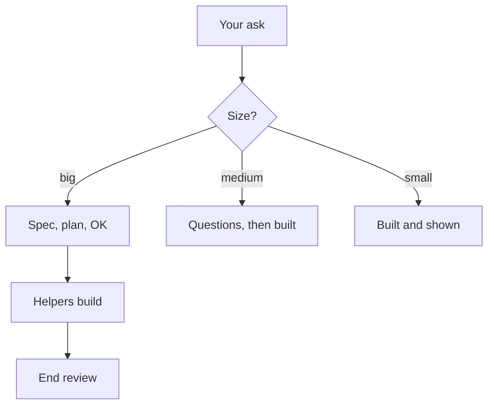

<p align="center">
  
</p>

<h1 align="center">AI coding setup for Claude Code</h1>

<p align="center">Claude Code that asks before it builds, plans big jobs and checks its own claims.</p>

<p align="center"><b>English</b> | <a href="README.ru.md">Русский</a></p>

<p align="center">
  <a href="https://github.com/tigran-martirosian/ai-coding-setup/releases/latest"></a>
  <a href="https://github.com/tigran-martirosian/ai-coding-setup/actions/workflows/tests.yml"></a>
  <a href="LICENSE"></a>
  
</p>

<p align="center"><b>New in 26.6:</b> <a href="docs/whats-new.md">how the setup works now</a></p>

A set of rules, hooks, skills and helper agents you add to Claude Code. Before a big job, Claude asks its questions and writes down what done looks like. Then it plans the job, helpers build the parts side by side, and one reviewer checks the result against that list. Small scripts called hooks compare what Claude says it did with Claude Code's own log, so it can't claim it opened a page or ran the tests when it didn't. It works in Claude Code in the terminal and in Nimbalyst, a desktop editor for Claude Code sessions, where it adds its own screens. People in finance, data engineering and government IT use it for their own work.

https://github.com/user-attachments/assets/d08b7744-b464-4537-89a4-f02348e2aa83

If the video doesn't load (the GitHub app sometimes won't play it), [watch it here](https://github.com/user-attachments/assets/d08b7744-b464-4537-89a4-f02348e2aa83).

## How a job runs

Claude gives every ask a size in one line first: small, medium or big. You can change it in a word.



- **Small** (one change): made now and shown working.
- **Medium** (one session, a few parts): one to three questions, each with a recommended answer, and a few lines saying what done looks like. Then it is built in the same chat.
- **Big** (a new project, more than one session, or parts that must fit together): the `grilling` skill asks its questions, first looks for what already exists (your own code, your packages, a maintained package or template), and writes a spec, a file that lists what done looks like, each line with the check that proves it. Then the `lead` skill writes the plan, has it reviewed once and waits for your OK. Helpers then build the parts side by side, each in its own copy of the project, and one reviewer checks the whole result against the spec.

The commands and the words that start each part are on one page: [docs/whats-new.md](docs/whats-new.md).

## What you get

### Checks that catch false claims

These are sent back to Claude to fix:

- a reply quoting a link it never actually opened;
- a turn that changed code and ended with no build or test run after the last change;
- a reply to your message with no answer in it;
- a multiple-choice question to you that doesn't actually ask anything.

`DROP`, `TRUNCATE`, and `DELETE` or `UPDATE` without a `WHERE` ask you first, and so does a `git push` with something shaped like a key in it. Each project with code gets its own `verify` skill: it starts the app, uses it the way a person would and prints what it saw before a commit. In Nimbalyst, the **Try it** button in the chat box runs it on the last change.

All 31 hooks are listed in [docs/features.md](docs/features.md#hooks). They run together in a few small Node processes: 3 for a shell command and 4 for a file edit, not one per hook.

### Cost controls

- Long chats compact themselves (summarise what came before) at about 200k tokens while they are still working; finished chats are left alone.
- Typing `usage` in a Claude Code chat opens a dashboard of your token and plan use, with a forecast of when you'll hit your plan limit. It makes no model calls.
- Helpers run on the model their job needs: reading and drafting on Sonnet, code and most other steps on Opus, the plan review, the end review and long refactors on Fable.

### Research that says how solid each finding is (new)

When you ask Claude to look something up, the report opens with the answer, and each finding carries one tag: **Solid** (three or more independent current sources agree), **Thin** (one or two independent sources), **Ours** (Claude's own reasoning or test) or **Old** (only evidence from before 2025, or from older Claude models). A recommendation never rests on an Old finding.

### Security in three levels (new)

- **Always on:** Anthropic's security-guidance plugin warns on risky code as Claude edits it and reviews each change. Install and update turn it on. It needs Python 3.10 or newer; without it the plugin stays off and the installer says so.
- **Quick:** `/security` runs Claude Code's `/security-review` on a change and scans it for secrets with gitleaks, before a commit or a release.
- **Deep:** `/security deep` scans a whole project once with the deepsec scanner, when you ask for it.

### Design tools (new)

Install and update turn on Anthropic's frontend-design and impeccable (Paul Bakaus's design commands and checks) for building interfaces. `/gridlines` draws guide lines down an interface and fixes the paddings so the edges of sidebars, toolbars and panels line up.

### What changes on day one

- Replies start with the answer, and every shell command ends with a short line saying what it does.
- Claude runs commands itself instead of asking you to paste them, except for passwords and decisions that are yours.
- If you haven't picked a model, it sets Claude Opus at medium effort. If you haven't set how long to keep transcripts, it keeps them 120 days.
- On Windows, Nimbalyst updates through the setup, which changes some of its app files to add fixes ([details and how to undo it](docs/features.md#updating-details)).
- An update that asks you nothing installs itself in the background (`AUTO_UPDATE=off` stops that). One that needs your answer waits for `/update-setup`.

## Test results

- **The reviewer agent finds as many bugs as a plain "review this change" prompt, with 40% fewer tokens and 16% lower cost:** both found 5 of 8 known bugs in 16 real code changes.
- **The hooks ran over 12,000 times without a crash** on replayed real sessions and on tricky made-up ones; every guard (a hook that blocks a risky command) judged all 30 test commands right.
- **False alarms dropped from 4 of 12 real sessions to 1 of 13** after the fixes this test led to.

How each test ran: [docs/test-results.md](docs/test-results.md).

## Install and undo

You need Claude Code installed and signed in. It works best on a Max plan or higher; on the $20 Pro plan there's no Fable, so the Fable helpers run on Opus and go less deep. Nimbalyst is optional. More in [docs/features.md](docs/features.md#install-details).

> [!IMPORTANT]
> This is source-available, not open source. You may use the code and change your own copy, at home or at work, but not publish, share or sell it, changed or unchanged ([LICENSE](LICENSE)).

Download the ZIP or clone the repo into a folder that stays, then pick one option and run it in that folder.

**Option 1: a new computer with only Claude Code.** Claude asks which subscriptions you have, then installs the missing programs and the setup files. You need only Claude Code. Claude follows [docs/full-install.md](docs/full-install.md); read it first to see every step.

```
claude "Read docs/full-install.md and carry out every step in it."
```

**Option 2: only the setup files, when Node.js is already there.** You need Node.js 18 or newer; three Nimbalyst features need 22.5 or newer, and the installer names them if yours is older. `--dry-run` shows what would change without changing anything. On a Mac, add `--node "$(command -v node)"` to both lines so the hooks find Node by its full path.

```
node install.mjs --dry-run
node install.mjs
```

Your own hooks and skills are left alone. Any file the installer replaces is backed up to `~/.claude/setup-logs/<YYYY-MM-DD>-install-backup/`. If your `CLAUDE.md` already has rules of your own, they move to `~/.claude/rules/my-rules.md`, which Claude Code also loads in every session.

It runs on Windows and macOS. Linux is untested.

To remove it:

```
node install.mjs --uninstall
```

This takes the setup's hooks out of `settings.json` and your project settings, removes its files (unless you changed them), puts back any of your files it replaced and puts Nimbalyst's original app files back. Most hooks can also be turned off on their own with an environment variable, like `LINK_GATE=off`; [docs/setup.md](docs/setup.md#rules-that-became-hooks) lists which, and [docs/HOW-TO.md](docs/HOW-TO.md) walks through what to type and what you should see.

## What leaves your computer

Claude Code sends your work to Anthropic either way. On top of that, this setup sends your saved Claude sign-in to api.anthropic.com to read your plan percentages, and asks GitHub for the latest version every 12 hours. The rest is a lookup Claude makes during a job, or something you switch on yourself. Every item in the list below has an off switch except one: the version lookups Claude makes during a job. An off switch is an environment variable you set in your shell or system settings; [docs/HOW-TO.md](docs/HOW-TO.md) shows how.

<details>
<summary>Everything this setup sends, where and when</summary>

| What | Where it goes | When | Off switch |
|---|---|---|---|
| Your saved Claude sign-in, to read your plan percentages | api.anthropic.com | At the end of a reply, at most every 5 minutes; every 30 seconds once you pass 70% of a limit | `PLAN_USAGE_LOGGER=off` |
| A request for the latest version number | GitHub | Every 12 hours; an hour after a failed try | `UPDATE_CHECK=off` |
| A release that asks you nothing, panel builds included, installed in the background; files you changed stay yours | GitHub | When one comes out | `AUTO_UPDATE=off` |
| Requests for the plugins it turns on (security-guidance, frontend-design, impeccable) | GitHub, where their plugin lists live | At install and update | `claude plugin uninstall <name>`; updates then leave it out |
| Your project's files, read by the systems map's background worker (the systems map is a list of your project's parts and how they connect; the worker is a Claude helper, about 50 tool calls per build or refresh) | Anthropic, like any Claude work | In a project with 100+ code files and 10,000+ lines: a build only if you answer yes to a question card, asked once per project; then at most a weekly refresh | `MAP_NUDGE=off` |
| Package names, to fetch what a changed Nimbalyst panel is built from | The npm registry | When an update rebuilds a panel | `AUTO_UPDATE=off` for the background ones |
| Project and package names, when Claude looks up a version | endoflife.date, GitHub, npm, PyPI, crates.io, Docker Hub, Maven Central, NuGet | When it checks a version | None |
| Your sessions, sealed so the relay cannot read them. The phone app is invite-only, and the relay is the server that passes messages between your computer and Telegram. It is run on Cloudflare by the person who invited you (the bot's owner). It sees alert lines (a project name and a session title) in plain text, and it serves the app's page, so you are trusting that person | Telegram, and the bot owner's relay on Cloudflare | Only if you add the phone app (`install.mjs --with phone-bot`) and join it | `node ~/.claude/skills/phone-bot/pc/setup.mjs remove` |
| Your Claude folder and picked project folders, encrypted with a password only you have | Your own Backblaze B2 storage | Only if you set up `/backup`: when you ask, or daily or weekly | `/backup off` stops the schedule |

</details>

The installer also adds rules that stop Claude Code from reading saved sign-ins for Claude, Codex and Gemini, or your SSH keys, through its own tools, and makes it ask before opening a `.env` file. A script that reaches a file without naming it won't be stopped.

## Limits

- A check knows a page was opened, not what was on it.
- If a hook hits an error, it lets the call through, so a broken check doesn't block anything. The guards block the call instead: deletes, searches across a whole drive, SQL, the key scan before a push, and the read-only checks on the browser tool and the reviewers. Either way the next session tells you about the crash (`HOOK_CRASH_ALARM=off` silences that).
- Not every rule has a check behind it. "Lead with the answer" is just text the model reads.
- A check can send Claude back by mistake. I track those and fix the checks behind them.

## More

- **What you see in Nimbalyst:** a page per project for the job in hand, a list of running helpers, a commands button, a usage pop-up, the systems map, Read Aloud and themes ([docs/features.md](docs/features.md#editor-extensions)).
- **How it compares** with Claude Code and a few skills: [docs/features.md](docs/features.md#how-it-compares).
- **Long work and the systems map** (`/handoff` moves work to a fresh chat, `/where-are-we` says how much of a job is left, and a map of a project's parts says what a change touches): [docs/features.md](docs/features.md#sessions).
- **How it works and what each folder holds:** [docs/setup.md](docs/setup.md#how-the-setup-works).
- **Everything else** (starter projects, web pages and videos, backups, a phone app in Telegram, voice typing): [docs/features.md](docs/features.md); each version's changes: [CHANGELOG.md](CHANGELOG.md).
- **Tests:** `node tests/run-all.mjs`; GitHub runs them on Windows and macOS for every pull request ([details](docs/setup.md#tests)).
- **Problems:** open an issue with the Bug report form; a security problem goes privately, as [SECURITY.md](SECURITY.md) explains. Pull requests aren't accepted, because the licence doesn't allow sharing changed code ([CONTRIBUTING.md](CONTRIBUTING.md)).
- **Licence:** source-available; you may use it and change your own copy, not publish, share or sell it ([LICENSE](LICENSE)).
