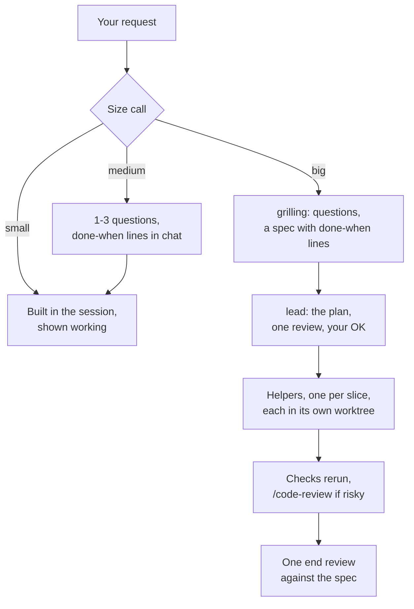
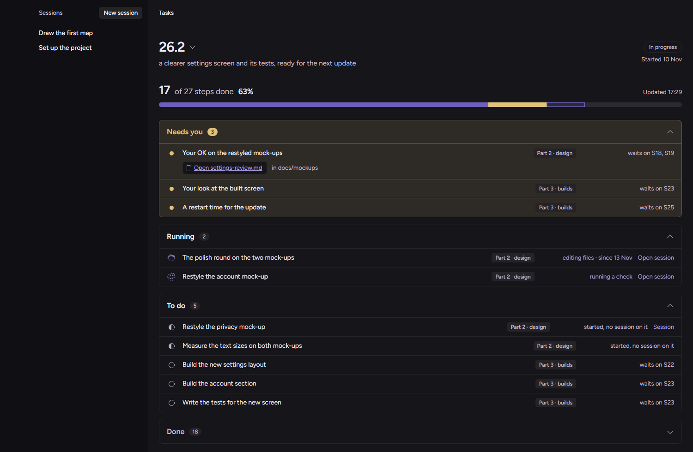

<p align="center">
  
</p>

<h1 align="center">AI coding setup for Claude Code</h1>

<p align="center">Claude Code that asks before it builds, plans big jobs and checks its own claims.</p>

<p align="center"><b>English</b> | <a href="README.ru.md">Русский</a></p>

<p align="center">
  <a href="https://github.com/tigran-martirosian/ai-coding-setup/releases/latest"></a>
  <a href="https://github.com/tigran-martirosian/ai-coding-setup/actions/workflows/tests.yml"></a>
  <a href="LICENSE"></a>
  
</p>

<p align="center"><b>New in 26.5:</b> <a href="docs/whats-new.md">how the setup works now</a></p>

A multi-agent setup for Claude Code. Before a big job it asks its questions and writes down what done looks like. Then the main session plans the job, helpers build the parts side by side, and one reviewer checks the result against that list. Hooks compare what an agent says it did with Claude Code's own log, so it can't claim it opened a link or tested a change when it didn't. It runs in Claude Code in the terminal and in Nimbalyst, a desktop editor for Claude Code sessions, where it also adds its own screens. People in finance, data engineering and government IT use it for their own work.

https://github.com/user-attachments/assets/9de3696e-cfde-4024-a7a3-7710bf9ebdb5

If the video doesn't load (the GitHub app sometimes won't play it), [watch it here](https://github.com/user-attachments/assets/9de3696e-cfde-4024-a7a3-7710bf9ebdb5).

## How a job runs

Every ask gets a size in one line first: small, medium or big. You can change it in a word.



A small change is made and shown working. A medium one gets one to three questions, each with a recommended answer, and a few lines saying what done looks like. A big job goes to `grilling`, which asks its questions and writes a spec: what done looks like, each line with the check that proves it. Then `/lead` writes the plan in the same session, has it reviewed once, and waits for your OK. After that, workers build the slices side by side, each in its own git worktree. The lead reruns every slice's checks itself, runs `/code-review` on the risky ones, and at the end one reviewer checks the whole result against the spec.

Each project can have its own `verify` skill, which starts the app, uses it the way a person would and prints proof before a commit. In Nimbalyst, the **Try it** button beside Note runs that check on the last change; when the change has a local web page, the page opens in a browser tab beside the chat.

The whole setup as it works now, with the commands and the words that start each part: [docs/whats-new.md](docs/whats-new.md).

## Test results

- **The reviewer agent finds as many bugs as a plain review, with 40% fewer tokens and 16% lower cost.** On 16 real code changes with 8 known bugs, it and a plain "review this change" prompt each found 5, and it was faster on 13 of the 16. Both ran the same model, effort and tools; only the instructions differed.
- **The hooks ran over 12,000 times without a crash**, replayed on real past sessions and hard made-up cases. Every guard in that test was right on all 30 test commands.
- **False alarms dropped from 4 of 12 real sessions to 1 of 13** after the fixes this test led to ([what changed](docs/test-results.md#the-hooks-on-real-sessions)).

How each test ran: [docs/test-results.md](docs/test-results.md).

## What you see in Nimbalyst

Nimbalyst is a desktop editor for Claude Code sessions. The setup adds its own screens to it as extensions, built from source when you install. Without Nimbalyst the rules, hooks and skills still work.



*The Job Tracker on its test page. The job and its steps are made up.*

- The Job Tracker turns Nimbalyst's tracker into one page per project for the job in hand: how many steps are left, a bar, and folds for what needs you, what is running, what is left and what is done. Each step says what it waits on, and a click opens its session or the file it asks you to read. The session you're in stays open beside the page, so you can keep working while you check the job.
- In the right sidebar, the Agents & commands list puts running helpers and commands on top, in plain words, and folds the finished ones. A helper on one step for over 2 minutes shows the step and for how long.
- A side-bar button starts the setup's commands, such as the setup audit and the usage report, each in a new session.
- A usage pop-up shows this week's use, the 5-hour limit and when you'll run out at your current pace.
- The systems map draws the project's parts as a graph you can pan, zoom and search.

Clips of the command button, Read Aloud and the themes are in [docs/features.md](docs/features.md#editor-extensions).

## How it compares

| | Claude Code with a few skills | With this setup |
|---|---|---|
| Its claims | Nothing checks them | Hooks check them against the log of what it did |
| Before a big job | It starts building | Questions first, then a spec with a check for each line |
| Big jobs | Helpers you arrange | `/lead`: a plan reviewed once, workers side by side, one end review |
| Long chats | Compact (summarise themselves) when nearly full, or by hand | Compact at about 200k tokens, mid-work; finished chats are left alone |
| Spending | `/usage`: the last 14 days | Per project, with a forecast of when you'll hit your limit |

## What it does

### Checks

A hook is a small script Claude Code runs before or after a step. [hooks/link-gate.mjs](hooks/link-gate.mjs) is a short example. A helper, on this page, is a second Claude session that the main one starts to do one part of a job.

Sent back to the agent:

- a reply with a link it never actually opened
- a turn that changed code and ended with no build or test run after the last change
- a reply to your message that has no answer in it
- a multiple-choice question to you that doesn't actually ask you anything

`DROP`, `TRUNCATE`, and `DELETE` or `UPDATE` without a `WHERE` ask you first, and so does a `git push` with something shaped like a key in it.

All 30 hooks are listed in [docs/features.md](docs/features.md#hooks). Most of them run together in one Node process per step, so a shell command starts one process for its checks instead of one per hook.

### Cost

- Long chats compact themselves at about 200k tokens while they're still working, and finished chats are left alone.
- `usage` opens a dashboard of your token and plan use and when you'll hit your plan limit. It doesn't make any model calls.
- Helpers run on the model their job needs: the `worker` on Sonnet; `worker-code`, `worker-full` and the blind reviewer on Opus; the plan reviewer, the end reviewer and `worker-refactor` on Fable.

### Long work

- `/handoff` writes a short brief of the work and opens a fresh session that continues from it.
- `/update-project` brings an older project folder up to date with the setup, and shows you every change first.
- `/where-are-we` says how much of a job is left, from the project's Nimbalyst tracker. A `blind-reviewer` looks at anything a person will see, the way a newcomer would.

### Systems map

A project can have a map of its parts and what connects to what. In a project with 100 or more code files and 10,000 or more lines, Claude asks you once, on a question card, and a background helper builds the map only on your yes. Putting map lines into a helper's brief is a trial, off unless its trial file is set ([details](docs/features.md#systems-map)).

## What changes on day one

- Replies start with the answer, and every shell command ends with a short line saying what it does.
- The agent runs commands itself instead of asking you to paste them, except for passwords and decisions that are yours.
- On Windows, Nimbalyst updates through the setup, which changes some of its app files to add fixes ([details and how to undo it](docs/features.md#updating-details)).
- If you haven't picked a model, it sets Claude Opus at medium effort. The plan reviewer, the end reviewer and `worker-refactor` run Fable, a stronger Claude model, at high effort ([why](docs/features.md#install-details)).
- If you haven't set how long to keep transcripts, it keeps them for 120 days.
- Every 12 hours you might see a line saying there's a new version. An update that asks you nothing installs itself in the background, and panel changes show the next time Nimbalyst starts; on a Mac they wait until you type `/update-setup` when the grey line asks (`AUTO_UPDATE=off` stops all that). Only one that needs your answer waits for `/update-setup`.

## Install and undo

You need Claude Code installed and signed in. It works best on a Max plan or higher. On the $20 Pro plan there's no Fable, so the Fable helpers run on Opus instead and go less deep. Nimbalyst is optional. More in [docs/features.md](docs/features.md#install-details).

> [!IMPORTANT]
> This is source-available, not open source. You may use the code and change your own copy, at home or at work, but not publish, share or sell it, changed or unchanged ([LICENSE](LICENSE)).

Download the ZIP or clone the repo into a folder that stays, then pick one option and run it in that folder. Both put in the setup files.

**Option 1: everything, on a new computer.** Claude asks which subscriptions you have, then installs the missing programs and the setup files. You need only Claude Code. Claude follows [docs/full-install.md](docs/full-install.md); read it first to see every step.

```
claude "Read docs/full-install.md and carry out every step in it."
```

**Option 2: only the setup files.** You need Node.js 18 or newer (22.5+ for `steer --to` and `compact-self`). `--dry-run` shows what would change without changing anything.

```
node install.mjs --dry-run
node install.mjs
```

Your own hooks and skills are left alone. Any file the installer replaces is backed up to `~/.claude/setup-logs/<YYYY-MM-DD>-install-backup/`. If your `CLAUDE.md` already has rules of your own, they move to `~/.claude/rules/my-rules.md`, which Claude Code also loads in every session.

I run this on Windows. The tests pass on macOS too, but I haven't run the installer on a real Mac yet. On a Mac, pass `--node "$(command -v node)"` so the hooks find Node by its full path. Linux is untested: the tests don't run there and the full install has no Linux steps.

To remove it:

```
node install.mjs --uninstall
```

This takes the setup's hooks out of `settings.json` and your project settings, removes its files (unless you changed them) and puts back any of your files it replaced. It also puts Nimbalyst's original app files back and deletes the setup versions the updater downloaded to `~/.claude/setup-source`.

Every hook can be turned off with an environment variable, like `LINK_GATE=off`. [docs/HOW-TO.md](docs/HOW-TO.md) walks through what to type and what you should see.

## How it works

`install.mjs` copies the hooks, agents, skills and workers into `~/.claude`, writes the rules into `~/.claude/CLAUDE.md` and adds the hook wiring from `settings.example.json` to `~/.claude/settings.json`. It also sets up the starter project folders and, when Nimbalyst is there, builds the extensions and installs them.

After that, Claude Code does the work. It loads the rules into every session and runs the hooks on its own events (session start and end, your message, each tool call, the end of a reply). A hook reads the event and the session log, then lets the step through or sends a message back.

<details>
<summary>What each folder holds</summary>

| Folder | What's in it |
|---|---|
| `agents/` | The 7 helpers, one file each: four workers, the plan reviewer, the end reviewer and the blind reviewer |
| `docs/` | How to use it, feature details, the install steps and the test results ([index](docs/README.md)) |
| `extensions/` | The Nimbalyst extensions (agents list, job tracker, board tidying, command buttons, usage pop-up, systems map, Read Aloud, themes), built from source |
| `hooks/` | The scripts Claude Code runs on its events, with shared code in `hooks/lib` and the groups that run together in `hooks/dispatch-groups.json` |
| `projects/` | The starter project folders (`quick-tasks`, `claude-settings`) and the skills and hooks they share |
| `rules/` | The rules file that becomes `~/.claude/CLAUDE.md`, which rules need Nimbalyst, and which versions shipped |
| `scripts/` | The installer's parts, the privacy scan and the commit title check |
| `skills/` | The slash commands, such as `/grilling`, `/lead`, `/backup` and `/update-setup`, one folder each |
| `tests/` | One test file per part, run together by `tests/run-all.mjs` |
| `tools/` | `nimbalyst-patch`: the setup's fixes to Nimbalyst's app files, and Nimbalyst updates on Windows |
| `workers/` | Scripts for jobs that run on their own: backups, version lookups, big downloads, disk tidying, page reads |

</details>

## What leaves your computer

Claude Code sends your work to Anthropic either way. On top of that, this setup sends your saved Claude sign-in to api.anthropic.com to read your plan percentages, and asks GitHub for the latest version every 12 hours. The rest is a lookup the agent makes during a job, or something you switch on yourself. Each line has its off switch.

<details>
<summary>Everything this setup sends, where and when</summary>

| What | Where it goes | When | Off switch |
|---|---|---|---|
| Your saved Claude sign-in, to read your plan percentages | api.anthropic.com | At the end of a reply, at most every 5 minutes; every 30 seconds once you pass 70% of a limit | `PLAN_USAGE_LOGGER=off` |
| A request for the latest version number | GitHub | Every 12 hours; an hour after a failed try | `UPDATE_CHECK=off` |
| A release that asks you nothing, panel builds included, installed in the background; files you changed stay yours | GitHub | When one comes out | `AUTO_UPDATE=off` |
| Your project's files, read by the systems map's background worker (a Claude helper, about 50 tool calls per build or refresh) | Anthropic, like any Claude work | In a project with 100+ code files and 10,000+ lines: a build only if you answer yes to a question card, asked once per project; then at most a weekly refresh | `MAP_NUDGE=off` |
| Package names, to fetch what a changed Nimbalyst panel is built from | The npm registry | When an update rebuilds a panel | `AUTO_UPDATE=off` for the background ones |
| Project and package names, when the agent looks up a version | endoflife.date, GitHub, npm, PyPI, crates.io, Docker Hub, Maven Central, NuGet | When it checks a version | None |
| Your sessions, sealed so the relay cannot read them. The relay is run on Cloudflare by the person who invited you (the bot's owner). It sees alert lines (a project name and a session title) in plain text, and it serves the app's page, so you are trusting that person | Telegram, and the bot owner's relay on Cloudflare | Only if you add the phone app (`install.mjs --with phone-bot`) and join it | `node ~/.claude/skills/phone-bot/pc/setup.mjs remove` |
| Your Claude folder and picked project folders, encrypted with a password only you have | Your own Backblaze B2 storage | Only if you set up `/backup`: when you ask, or daily or weekly | `/backup off` stops the schedule |

</details>

The installer also adds rules that stop Claude Code from reading saved sign-ins for Claude, Codex and Gemini, or your SSH keys, through its own tools, and makes it ask before opening a `.env` file. A script that reaches a file without naming it won't be stopped.

## Limits

- A check knows a page was opened, not what was on it.
- If a hook hits an error, it lets the call through, so a broken check doesn't block anything. The guards block the call instead: deletes, searches across a whole drive, SQL, the key scan before a push, and the read-only checks on OpenCLI and the reviewers. Either way the next session tells you about the crash (`HOOK_CRASH_ALARM=off` silences that).
- Not every rule has a check behind it. "Lead with the answer" is just text the model reads. The rules file, about 2,100 words, is read in every session.
- A send-back can be a false alarm. I track those and fix the checks behind them.

## Everything else

Starter projects, the lead, helpers, reviewers, web pages and videos (`/watch`), backups, a phone app in Telegram, voice typing, Read Aloud and themes are in [docs/features.md](docs/features.md). Each version's changes are in [CHANGELOG.md](CHANGELOG.md).

## Tests

```
node tests/run-all.mjs
```

Each hook runs as its own process on made-up session logs, the installer runs twice on an empty home folder, and `scripts/privacy-check.mjs` scans the repo for home folder paths, email addresses and API keys. GitHub Actions runs all of it on Windows and macOS on every pull request to `main`, along with a lint, a type check of the four TypeScript extensions, a key scan of the whole history and the privacy scan.

`--only a,b`, `--failed`, `--changed` and `--verbose` are explained at the top of `tests/run-all.mjs`.

## Problems and contributing

- A bug, or a send-back you think was wrong: open an issue and pick the Bug report form.
- A security problem: report it privately, as [SECURITY.md](SECURITY.md) explains.
- Pull requests aren't accepted, because the licence doesn't allow sharing changed code. Describe a fix in an issue instead. [CONTRIBUTING.md](CONTRIBUTING.md) has the details.

## License

This isn't open source. You can use the code and change your own copy, at home or at work. You can't publish, share or sell it, or present it as your own, without my written permission. See [LICENSE](LICENSE).
