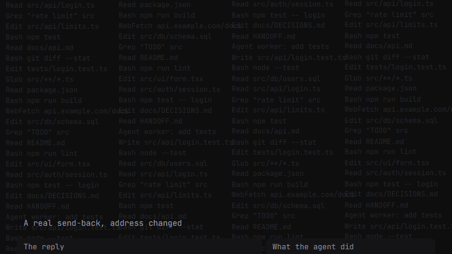

# AI coding setup for Claude Code, Codex and Gemini

The rules, checks and skills I run AI coding agents with for all my development. The checks compare what an agent says with the log of what it did: a reply that links a page it never opened is rejected, and so is "checked" with no lookup behind it. Claude Code writes the code; Codex (GPT) and Gemini do the searching and long reading.

Professionals in finance, data engineering and government IT installed it and use it at work.

<a href="docs/img/promo.mp4"></a>

Every change, one line per version: [CHANGELOG.md](CHANGELOG.md).

## Install

Needs Claude Code, installed and signed in. Download the ZIP or clone the repository, then in its folder:

```
claude "Read docs/full-install.md and carry out every step in it."
```

Claude Code asks which subscriptions you have (ChatGPT for Codex, Google AI for Gemini; both optional), then installs what is missing. The steps are in [docs/full-install.md](docs/full-install.md).

Only the setup files, with Node.js 18 or newer:

```
node install.mjs --dry-run
node install.mjs
```

Your own hooks and skills stay as they are; a file the installer replaces is kept as `<name>.before-install-<date>`. Without Nimbalyst the rules, hooks and skills still work; the extensions, the session board and `/lead` need it. More: [Install details](docs/features.md#install-details) and [docs/HOW-TO.md](docs/HOW-TO.md), which says what to type and what you should see.

## Updating

Every 12 hours the setup asks GitHub whether a newer version is out and says so in one line. Nothing is downloaded until you type `/update-setup`, which installs it and keeps the files you changed. Details: [Updating details](docs/features.md#updating-details).


## What's inside

| Part | What it does | Where |
|---|---|---|
| Rules | How the agent replies, asks, delegates and finishes work | [rules](rules) |
| Hooks | Scripts that check each step and can send it back | [hooks](hooks) |
| Skills | Commands for repeated jobs: `/court`, `/lead`, `/handoff`, `/btw`, `/setup-audit` and others | [skills](skills) |
| Starter projects | Four folders, each with its own rules and tools | [projects](projects) |
| Editor extensions | Usage pop-up, Read Aloud, a commands button and eleven colour themes for Nimbalyst | [extensions](extensions) |
| Worker agent | A cheaper subagent for routine edits | [agents](agents) |
| Planner agent | The strongest model writes the plan for big or hard-to-undo work, and changes nothing | [agents](agents) |
| Worker command | One short command for searching and long reading. The first free worker that is set up answers (Codex, then Gemini); Claude does the job when none can | [workers](workers) |
| Installer | Puts the files in place and keeps a copy of what it replaces | [install.mjs](install.mjs) |
| Updater | Says when a newer version is out; `/update-setup` installs it and keeps your own files | [skills/update-setup](skills/update-setup) |
| Phone bot | `/phone-bot` sets up your own Telegram bot that talks to your sessions | [skills/phone-bot](skills/phone-bot) |
| Watch | `/watch` answers a question about a video, read by a cheap model | [skills/watch](skills/watch) |
| Shared usage | `/shared-usage` shows who used how much of a shared subscription | [skills/shared-usage](skills/shared-usage) |
| Tour video | The Remotion source of the video above | [promo](promo) |


## Checks



Each check is a Node.js hook: a script Claude Code runs around a step, and that can send the step back. Claude Code logs every tool call in a session, and the first two hooks compare a reply with that log. If you read one file, read [hooks/link-gate.mjs](hooks/link-gate.mjs).

| Hook | What it sends back |
|---|---|
| `link-gate` | A reply with a link the agent remembered or saw in search results but never opened |
| `question-other` | A recommended option that says "Checked:" when no file read or search in the log matches it |
| `command-explain` | A shell command that doesn't end with a line in plain words saying what it does |
| `picture-in-project` | A picture shown in the chat from outside the open project, which Nimbalyst can't open enlarged |
| `run-yourself` | A reply that ends with "now open a terminal and run this"; the agent runs it itself |
| `opencli-readonly` | Posting, liking or following from my logged-in accounts through OpenCLI |

The other hooks keep sessions cheap and safe:

| Hook | What it does |
|---|---|
| `big-read-gate` | Large files are read in parts, not whole |
| `worker-nudge` | Sends searching to the first free worker that is ready (Codex, Gemini) |
| `loop-warn` | Tells the agent when it repeats the same call |
| `repeat-guard` | Refuses a retry of the same call after the same error came back three times |
| `sql-guard` | Asks before DROP, TRUNCATE, or DELETE and UPDATE without WHERE |
| `cold-cache` | Warns when you come back to a big session after the prompt cache has expired |
| `context-guard` | Warns when a session gets long (150k and 200k tokens) |
| `handoff-brief` | Rewrites a brief after every reply, so a fresh session can continue |
| `decided-quote` | Refuses a helper's brief that calls something decided without quoting your words |
| `board-nudge` | Offers a board cleanup when many sessions have piled up |
| `update-check` | Says, at most every 12 hours, when a newer version of the setup is released |
| `usage-dashboard-hook` | Typing just `usage` opens the usage dashboard |
| `plan-usage-logger` | Saves the plan percentages every 5 minutes for the forecast |

A hook that hits an error lets the call through. `link-gate` knows that a page was opened, not what it said.

## More

[docs/features.md](docs/features.md) describes the three models and the court, sessions and handoff, the usage forecast and dashboard, the starter projects, the editor extensions and voice typing, with their clips and screenshots.

## Tests

```
node tests/run-all.mjs
```

Each hook runs as a separate process on made-up session logs, the installer runs twice on an empty home folder, and `scripts/privacy-check.mjs` scans the repository for home folder paths, email addresses and API keys. GitHub Actions runs all of it on every push, on Windows and on macOS.

## License

All rights reserved. You may download it, use it and change your own installed copy, but not publish, distribute or sell it, and not present a changed version as mine. See [LICENSE](LICENSE).
