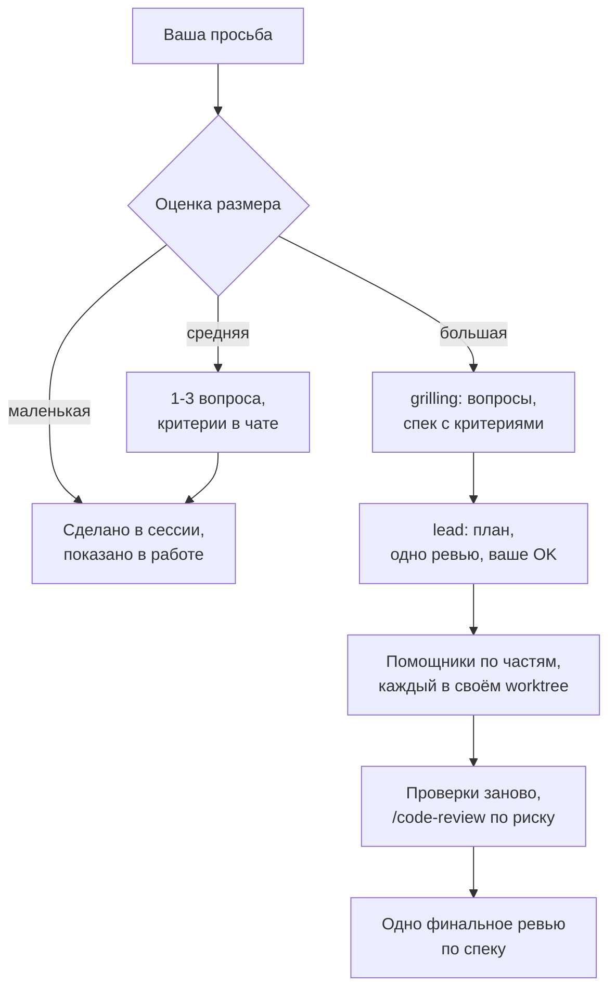
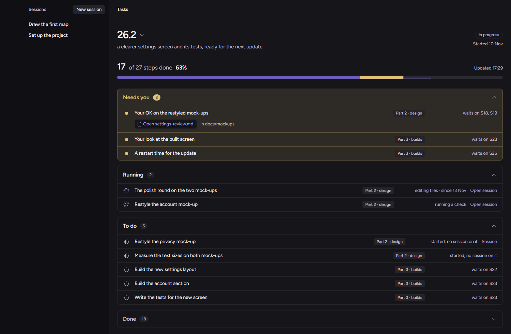

<p align="center">
  
</p>

<h1 align="center">AI coding setup для Claude Code</h1>

<p align="center">Claude Code, который сначала спрашивает, планирует большие задачи и проверяет свои же заявления.</p>

<p align="center"><a href="README.md">English</a> | <b>Русский</b></p>

<p align="center">
  <a href="https://github.com/tigran-martirosian/ai-coding-setup/releases/latest"></a>
  <a href="https://github.com/tigran-martirosian/ai-coding-setup/actions/workflows/tests.yml"></a>
  <a href="LICENSE"></a>
  
</p>

<p align="center"><b>Новое в 26.5:</b> <a href="docs/whats-new.md">как сетап работает сейчас</a></p>

Сетап из нескольких агентов для Claude Code. Перед большой задачей он задаёт вопросы и записывает, что считать готовым результатом. Потом основная сессия планирует работу, помощники параллельно собирают части, а один ревьюер сверяет итог с этим списком. Хуки сравнивают то, что агент говорит о своей работе, с журналом самого Claude Code, поэтому он не может сказать, что открыл ссылку или проверил изменение, если этого не было. Он работает в Claude Code в терминале и в Nimbalyst, десктопном редакторе для сессий Claude Code, куда ещё и добавляет свои экраны. Им пользуются люди из финансов, дата-инжиниринга и государственного IT в своей работе.

https://github.com/user-attachments/assets/9de3696e-cfde-4024-a7a3-7710bf9ebdb5

Если видео не загружается (приложение GitHub иногда его не проигрывает), [посмотрите его здесь](https://github.com/user-attachments/assets/9de3696e-cfde-4024-a7a3-7710bf9ebdb5).

## Как проходит задача

Каждая просьба сначала получает размер в одной строке: маленькая, средняя или большая. Его можно поменять одним словом.



Маленькое изменение делается сразу и показывается в работе. Для средней задачи будет от одного до трёх вопросов, у каждого рекомендуемый ответ, и несколько строк о том, что считать готовым. Большая задача идёт в `grilling`: он задаёт вопросы и пишет спек, где у каждого критерия готовности есть проверка, которая его доказывает. Потом `/lead` пишет план в той же сессии, отдаёт его на одно ревью и ждёт вашего OK. Дальше воркеры параллельно собирают части, каждый в своём git worktree. Lead сам перезапускает проверки каждой части, запускает `/code-review` на рискованных, а в конце один ревьюер сверяет весь результат со спеком.

У каждого проекта может быть свой скилл `verify`: он запускает приложение, пользуется им как человек и печатает доказательство перед коммитом. В Nimbalyst кнопка **Try it** рядом с Note запускает эту проверку на последнем изменении; если у изменения есть локальная веб-страница, она открывается во вкладке браузера рядом с чатом.

Весь сетап, как он работает сейчас, с командами и словами, которые запускают каждую часть: [docs/whats-new.md](docs/whats-new.md).

## Результаты тестов

- **Агент-ревьюер находит столько же багов, сколько обычное ревью, тратя на 40% меньше токенов и на 16% меньше денег.** На 16 реальных изменениях кода с 8 известными багами он и простой промпт «проверь это изменение» нашли по 5, и он был быстрее в 13 случаях из 16. У обоих были одна модель, один уровень effort и одни инструменты; различались только инструкции.
- **Хуки отработали больше 12 000 раз без единого падения** на повторах реальных прошлых сессий и на сложных придуманных случаях. Каждый guard в этом тесте верно разобрал все 30 тестовых команд.
- **Ложных срабатываний стало меньше: было в 4 реальных сессиях из 12, стало в 1 из 13** после исправлений, к которым привёл этот тест ([что поменялось](docs/test-results.md#the-hooks-on-real-sessions)).

Как проходил каждый тест: [docs/test-results.md](docs/test-results.md).

## Что вы видите в Nimbalyst

Nimbalyst — десктопный редактор для сессий Claude Code. Сетап добавляет в него свои экраны в виде расширений, которые собираются из исходников при установке. Без Nimbalyst правила, хуки и скиллы всё равно работают.



*Job Tracker на тестовой странице. Задача и её шаги придуманы.*

- Job Tracker превращает трекер Nimbalyst в одну страницу на проект для текущей задачи: сколько шагов осталось, полоса прогресса и раскрывающиеся блоки «ждёт вас», «выполняется», «осталось» и «готово». У каждого шага написано, чего он ждёт, а клик открывает его сессию или файл, который нужно прочитать. Ваша сессия остаётся открытой рядом со страницей, так что можно работать дальше и поглядывать на задачу.
- В правой панели список Agents & commands показывает запущенных помощников и команды сверху, простыми словами, а завершённые сворачивает. Если помощник висит на одном шаге больше 2 минут, видно этот шаг и сколько он идёт.
- Кнопка на боковой панели запускает команды сетапа, например аудит сетапа и отчёт об использовании, каждую в новой сессии.
- Всплывающее окно использования показывает расход за неделю, пятичасовой лимит и когда вы упрётесь в него при текущем темпе.
- Systems map рисует части проекта графом, который можно двигать, масштабировать и искать по нему.

Ролики про кнопку команд, Read Aloud и темы — в [docs/features.md](docs/features.md#editor-extensions).

## Чем отличается

| | Claude Code с парой скиллов | С этим сетапом |
|---|---|---|
| Его утверждения | Никто не проверяет | Хуки сверяют их с журналом того, что он делал |
| Перед большой задачей | Сразу начинает делать | Сначала вопросы, потом спек с проверкой на каждую строку |
| Большие задачи | Помощники, которых вы расставляете сами | `/lead`: план с одним ревью, воркеры параллельно, одно финальное ревью |
| Длинные чаты | Сжимаются (пересказывают сами себя), когда почти заполнены, или вручную | Сжимаются примерно на 200k токенов, посреди работы; законченные чаты не трогаются |
| Расходы | `/usage`: последние 14 дней | По проектам, с прогнозом, когда вы упрётесь в лимит |

## Что он делает

### Проверки

Хук — небольшой скрипт, который Claude Code запускает до или после шага. Короткий пример — [hooks/link-gate.mjs](hooks/link-gate.mjs). Помощник на этой странице — вторая сессия Claude, которую основная запускает, чтобы сделать одну часть задачи.

Агенту возвращается:

- ответ со ссылкой, которую он на самом деле не открывал
- ход, в котором менялся код и после последнего изменения не было ни сборки, ни тестов
- ответ на ваше сообщение, в котором нет ответа
- вопрос с вариантами, который на самом деле ни о чём вас не спрашивает

`DROP`, `TRUNCATE`, а также `DELETE` или `UPDATE` без `WHERE` сначала спрашивают вас, как и `git push`, в котором есть что-то похожее на ключ.

Все 30 хуков перечислены в [docs/features.md](docs/features.md#hooks). Большинство из них работают вместе в одном процессе Node на шаг, поэтому shell-команда запускает один процесс для своих проверок, а не по одному на хук.

### Расходы

- Длинные чаты сжимаются сами примерно на 200k токенов, пока ещё идёт работа, а законченные чаты не трогаются.
- `usage` открывает дашборд расхода токенов и тарифа и показывает, когда вы упрётесь в лимит. Он не делает ни одного вызова модели.
- Помощники работают на той модели, которая нужна их задаче: `worker` на Sonnet; `worker-code`, `worker-full` и blind-ревьюер на Opus; ревьюер плана, финальный ревьюер и `worker-refactor` на Fable.

### Долгая работа

- `/handoff` пишет короткую сводку работы и открывает новую сессию, которая продолжает с этого места.
- `/update-project` подтягивает старую папку проекта до текущего сетапа и заранее показывает каждое изменение.
- `/where-are-we` показывает, сколько осталось от задачи, по трекеру Nimbalyst этого проекта. `blind-reviewer` смотрит на всё, что увидит человек, глазами новичка.

### Systems map

У проекта может быть карта его частей и связей между ними. В проекте от 100 файлов кода и от 10 000 строк Claude один раз спрашивает вас карточкой с вопросом, и помощник в фоне строит карту только после вашего «да». Строки карты в брифе помощника — это пробный режим, он выключен, пока не задан его пробный файл ([подробнее](docs/features.md#systems-map)).

## Что меняется с первого дня

- Ответы начинаются с сути, а каждая shell-команда заканчивается короткой строкой о том, что она делает.
- Агент сам запускает команды и не просит вас их вставлять, кроме паролей и решений, которые принимаете вы.
- На Windows Nimbalyst обновляется через сетап, который меняет часть его файлов, чтобы добавить исправления ([подробности и как это откатить](docs/features.md#updating-details)).
- Если вы не выбрали модель, ставится Claude Opus со средним effort. Ревьюер плана, финальный ревьюер и `worker-refactor` работают на Fable, более сильной модели Claude, с высоким effort ([почему](docs/features.md#install-details)).
- Если вы не задали, сколько хранить транскрипты, они хранятся 120 дней.
- Раз в 12 часов может появиться строка о новой версии. Обновление, которое ничего у вас не спрашивает, ставится само в фоне, а изменения панелей видны при следующем запуске Nimbalyst; на Mac они ждут, пока вы наберёте `/update-setup`, когда об этом попросит серая строка (`AUTO_UPDATE=off` отключает всё это). Только обновление, которому нужен ваш ответ, ждёт `/update-setup`.

## Установка и удаление

Нужен установленный Claude Code, в котором вы вошли в аккаунт. Лучше всего работает на тарифе Max или выше. На тарифе Pro за $20 нет Fable, поэтому помощники на Fable работают на Opus и копают не так глубоко. Nimbalyst не обязателен. Подробнее в [docs/features.md](docs/features.md#install-details).

> [!IMPORTANT]
> Это source-available, а не open source. Можно пользоваться кодом и менять свою копию, дома или на работе, но нельзя публиковать, передавать или продавать его, ни изменённым, ни как есть ([LICENSE](LICENSE)).

Скачайте ZIP или склонируйте репозиторий в папку, которая останется на месте, потом выберите один вариант и запустите его в этой папке. Оба ставят файлы сетапа.

**Вариант 1: всё сразу, на новом компьютере.** Claude спросит, какие у вас подписки, потом поставит недостающие программы и файлы сетапа. Нужен только Claude Code. Claude идёт по [docs/full-install.md](docs/full-install.md); прочитайте его заранее, чтобы увидеть каждый шаг.

```
claude "Read docs/full-install.md and carry out every step in it."
```

**Вариант 2: только файлы сетапа.** Нужен Node.js 18 или новее (22.5+ для `steer --to` и `compact-self`). `--dry-run` показывает, что изменится, ничего не меняя.

```
node install.mjs --dry-run
node install.mjs
```

Ваши собственные хуки и скиллы не трогаются. Каждый файл, который установщик заменяет, сохраняется в `~/.claude/setup-logs/<YYYY-MM-DD>-install-backup/`. Если в вашем `CLAUDE.md` уже есть свои правила, они переезжают в `~/.claude/rules/my-rules.md`, который Claude Code тоже загружает в каждой сессии.

Я запускаю это на Windows. Тесты проходят и на macOS, но установщик на настоящем Mac я пока не запускал. На Mac передайте `--node "$(command -v node)"`, чтобы хуки находили Node по полному пути. Linux не проверялся: тесты там не запускаются, а в полной установке нет шагов для Linux.

Чтобы удалить:

```
node install.mjs --uninstall
```

Это убирает хуки сетапа из `settings.json` и настроек ваших проектов, удаляет его файлы (если вы их не меняли) и возвращает ваши файлы, которые он заменил. Оригинальные файлы Nimbalyst тоже возвращаются, а версии сетапа, которые скачало обновление в `~/.claude/setup-source`, удаляются.

Каждый хук можно выключить переменной окружения, например `LINK_GATE=off`. В [docs/HOW-TO.md](docs/HOW-TO.md) по шагам: что набрать и что вы должны увидеть.

## Как это устроено

`install.mjs` копирует хуки, агентов, скиллы и воркеры в `~/.claude`, записывает правила в `~/.claude/CLAUDE.md` и добавляет подключение хуков из `settings.example.json` в `~/.claude/settings.json`. Ещё он создаёт стартовые папки проектов и, если есть Nimbalyst, собирает и ставит расширения.

Дальше работает сам Claude Code. Он загружает правила в каждую сессию и запускает хуки на своих событиях (начало и конец сессии, ваше сообщение, каждый вызов инструмента, конец ответа). Хук читает событие и журнал сессии, а потом пропускает шаг или отправляет агенту сообщение.

<details>
<summary>Что лежит в каждой папке</summary>

| Папка | Что в ней |
|---|---|
| `agents/` | 7 помощников, по файлу на каждого: четыре воркера, ревьюер плана, финальный ревьюер и слепой ревьюер |
| `docs/` | Как пользоваться, подробности о возможностях, шаги установки и результаты тестов ([оглавление](docs/README.md)) |
| `extensions/` | Расширения Nimbalyst (список агентов, Job Tracker, уборка доски, кнопки команд, окно использования, systems map, Read Aloud, темы), собираются из исходников |
| `hooks/` | Скрипты, которые Claude Code запускает на своих событиях; общий код в `hooks/lib`, а группы, которые работают вместе, в `hooks/dispatch-groups.json` |
| `projects/` | Стартовые папки проектов (`quick-tasks`, `claude-settings`) и общие для них скиллы и хуки |
| `rules/` | Файл правил, который становится `~/.claude/CLAUDE.md`, список правил, которым нужен Nimbalyst, и список выпущенных версий |
| `scripts/` | Части установщика, проверка приватности и проверка заголовков коммитов |
| `skills/` | Слэш-команды, например `/grilling`, `/lead`, `/backup` и `/update-setup`, по папке на каждую |
| `tests/` | По файлу тестов на каждую часть, все вместе запускаются через `tests/run-all.mjs` |
| `tools/` | `nimbalyst-patch`: исправления сетапа в файлах Nimbalyst и обновления Nimbalyst на Windows |
| `workers/` | Скрипты для задач, которые идут сами: бэкапы, поиск версий, большие загрузки, уборка диска, чтение страниц |

</details>

## Что уходит с вашего компьютера

Claude Code и так отправляет вашу работу в Anthropic. Сверх этого сетап отправляет ваш сохранённый вход в Claude на api.anthropic.com, чтобы прочитать проценты тарифа, и раз в 12 часов спрашивает у GitHub последнюю версию. Остальное — либо запросы, которые агент делает во время задачи, либо то, что вы включаете сами. У каждой строки есть свой выключатель.

<details>
<summary>Всё, что отправляет сетап, куда и когда</summary>

| Что | Куда | Когда | Выключатель |
|---|---|---|---|
| Ваш сохранённый вход в Claude, чтобы прочитать проценты тарифа | api.anthropic.com | В конце ответа, не чаще раза в 5 минут; раз в 30 секунд, когда вы прошли 70% лимита | `PLAN_USAGE_LOGGER=off` |
| Запрос номера последней версии | GitHub | Раз в 12 часов; через час после неудачной попытки | `UPDATE_CHECK=off` |
| Релиз, который ничего не спрашивает, вместе со сборками панелей, ставится в фоне; изменённые вами файлы остаются вашими | GitHub | Когда он выходит | `AUTO_UPDATE=off` |
| Файлы вашего проекта, которые читает фоновый воркер systems map (помощник Claude, около 50 вызовов инструментов на сборку или обновление) | Anthropic, как любая работа Claude | В проекте со 100+ файлами кода и 10 000+ строк: сборка, только если вы ответите «да» на карточке с вопросом, которая приходит один раз на проект; дальше обновление не чаще раза в неделю | `MAP_NUDGE=off` |
| Имена пакетов, чтобы скачать то, из чего собирается изменённая панель Nimbalyst | Реестр npm | Когда обновление пересобирает панель | `AUTO_UPDATE=off` для фоновых |
| Имена проектов и пакетов, когда агент ищет версию | endoflife.date, GitHub, npm, PyPI, crates.io, Docker Hub, Maven Central, NuGet | Когда он проверяет версию | Нет |
| Ваши сессии в зашифрованном виде, который relay не может прочитать. Relay на Cloudflare держит человек, который вас пригласил (владелец бота). Строки уведомлений (название проекта и сессии) он видит открытым текстом, и он же отдаёт страницу приложения, так что вы доверяете этому человеку | Telegram и relay владельца бота на Cloudflare | Только если вы добавили приложение для телефона (`install.mjs --with phone-bot`) и подключились к нему | `node ~/.claude/skills/phone-bot/pc/setup.mjs remove` |
| Ваша папка Claude и выбранные папки проектов, зашифрованные паролем, который есть только у вас | Ваше собственное хранилище Backblaze B2 | Только если вы настроили `/backup`: по вашей просьбе или раз в день или неделю | `/backup off` останавливает расписание |

</details>

Установщик также добавляет правила, которые не дают Claude Code читать своими инструментами сохранённые входы в Claude, Codex и Gemini или ваши SSH-ключи, и заставляют его спрашивать перед открытием файла `.env`. Скрипт, который добирается до файла, не называя его, остановлен не будет.

## Ограничения

- Проверка знает, что страница была открыта, но не знает, что на ней было.
- Если хук падает с ошибкой, он пропускает вызов, чтобы сломанная проверка ничего не блокировала. Guard'ы, наоборот, блокируют вызов: удаления, поиск по всему диску, SQL, проверка ключей перед push и проверки «только чтение» для OpenCLI и ревьюеров. В обоих случаях следующая сессия сообщит вам о падении (`HOOK_CRASH_ALARM=off` это отключает).
- Не за каждым правилом стоит проверка. «Начинай с ответа» — просто текст, который читает модель. Файл правил, около 2100 слов, читается в каждой сессии.
- Возврат может оказаться ложным срабатыванием. Я их отслеживаю и чиню проверки, которые за ними стоят.

## Всё остальное

Стартовые проекты, lead, помощники, ревьюеры, веб-страницы и видео (`/watch`), бэкапы, приложение для телефона в Telegram, голосовой ввод, Read Aloud и темы описаны в [docs/features.md](docs/features.md). Изменения каждой версии — в [CHANGELOG.md](CHANGELOG.md).

## Тесты

```
node tests/run-all.mjs
```

Каждый хук запускается отдельным процессом на придуманных журналах сессий, установщик дважды запускается на пустой домашней папке, а `scripts/privacy-check.mjs` ищет в репозитории пути к домашним папкам, адреса почты и API-ключи. GitHub Actions прогоняет всё это на Windows и macOS на каждый pull request в `main`, плюс линтер, проверку типов четырёх расширений на TypeScript, поиск ключей по всей истории и проверку приватности.

`--only a,b`, `--failed`, `--changed` и `--verbose` описаны в начале `tests/run-all.mjs`.

## Проблемы и участие

- Баг или возврат, который вы считаете ошибочным: откройте issue и выберите форму Bug report.
- Проблема с безопасностью: сообщите о ней закрыто, как описано в [SECURITY.md](SECURITY.md).
- Pull request'ы не принимаются, потому что лицензия не разрешает распространять изменённый код. Опишите исправление в issue. Подробности в [CONTRIBUTING.md](CONTRIBUTING.md).

## Лицензия

Это не open source. Можно пользоваться кодом и менять свою копию, дома или на работе. Нельзя публиковать, передавать или продавать его или выдавать за свой без моего письменного разрешения. См. [LICENSE](LICENSE).
