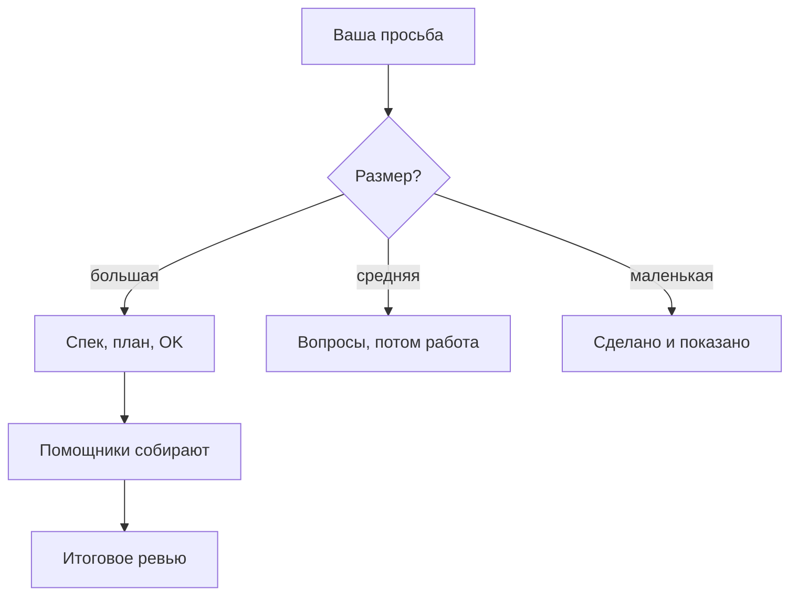

<p align="center">
  
</p>

<h1 align="center">AI coding setup для Claude Code</h1>

<p align="center">Claude Code, который сначала спрашивает, планирует большие задачи и проверяет свои же заявления.</p>

<p align="center"><a href="README.md">English</a> | <b>Русский</b></p>

<p align="center">
  <a href="https://github.com/tigran-martirosian/ai-coding-setup/releases/latest"></a>
  <a href="https://github.com/tigran-martirosian/ai-coding-setup/actions/workflows/tests.yml"></a>
  <a href="LICENSE"></a>
  
</p>

<p align="center"><b>Новое в 26.6:</b> <a href="docs/whats-new.md">как сетап работает сейчас</a></p>

Набор правил, хуков, скиллов и агентов-помощников, который добавляется к Claude Code. Перед большой задачей Claude задаёт вопросы и записывает, что будет считаться готовым результатом. Потом он планирует работу, помощники параллельно собирают части, а один ревьюер сверяет итог с этим списком. Небольшие скрипты, хуки, сравнивают то, что Claude говорит о своей работе, с журналом самого Claude Code, поэтому он не может заявить, что открыл страницу или прогнал тесты, если этого не было. Сетап работает в Claude Code в терминале и в Nimbalyst, десктопном редакторе для сессий Claude Code, куда добавляет свои экраны. Им пользуются люди из финансов, дата-инжиниринга и государственного IT в своей работе.

https://github.com/user-attachments/assets/d08b7744-b464-4537-89a4-f02348e2aa83

Если видео не загружается (приложение GitHub иногда его не проигрывает), [посмотрите его здесь](https://github.com/user-attachments/assets/d08b7744-b464-4537-89a4-f02348e2aa83).

## Как проходит задача

Каждая просьба сначала получает размер в одной строке: маленькая, средняя или большая. Его можно поменять одним словом.



- **Маленькая** (одно изменение): делается сразу и показывается в работе.
- **Средняя** (одна сессия, несколько частей): от одного до трёх вопросов, у каждого рекомендованный ответ, и несколько строк о том, что считать готовым. Потом всё делается в том же чате.
- **Большая** (новый проект, больше одной сессии или части, которые должны сойтись): скилл `grilling` задаёт вопросы, сначала ищет то, что уже есть (ваш код, ваши пакеты, поддерживаемый пакет или шаблон), и пишет спек: файл со списком того, что считать готовым, где у каждой строки есть своя проверка. Потом скилл `lead` пишет план, отдаёт его на одно ревью и ждёт вашего OK. Помощники собирают части параллельно, каждый в своей копии проекта, а один ревьюер сверяет весь результат со спеком.

Команды и слова, которыми запускается каждая часть, собраны на одной странице: [docs/whats-new.md](docs/whats-new.md).

## Что вы получаете

### Проверки, которые ловят ложные заявления

Это возвращается Claude на исправление:

- ответ, который ссылается на страницу, которую он на самом деле не открывал;
- ход, в котором менялся код, но после последнего изменения не было ни сборки, ни тестов;
- ответ на ваше сообщение, в котором нет ответа;
- вопрос с вариантами, который на самом деле ни о чём не спрашивает.

`DROP`, `TRUNCATE`, а также `DELETE` или `UPDATE` без `WHERE` сначала спрашивают вас; так же и `git push`, в котором есть что-то похожее на ключ. У каждого проекта с кодом есть свой скилл `verify`: перед коммитом он запускает приложение, пользуется им как человек и печатает, что увидел. В Nimbalyst кнопка **Try it** в поле чата запускает его на последнем изменении.

Все 31 хук перечислены в [docs/features.md](docs/features.md#hooks). Они работают вместе в нескольких небольших процессах Node: 3 на команду в терминале и 4 на правку файла, а не по одному на хук.

### Контроль расходов

- Длинные чаты сами сжимаются (пересказывают то, что было раньше) примерно на 200k токенов, пока ещё идёт работа; законченные чаты не трогаются.
- Если набрать `usage` в чате Claude Code, откроется панель с расходом токенов и лимитов подписки и прогнозом, когда вы упрётесь в лимит. Моделей она не вызывает.
- Помощники работают на той модели, которая нужна их задаче: чтение и черновики на Sonnet, код и большинство остальных шагов на Opus, ревью плана, итоговое ревью и долгие рефакторинги на Fable.

### Исследования, где сказано, насколько надёжен каждый вывод (новое)

Когда вы просите Claude что-то выяснить, отчёт начинается с ответа, и у каждого вывода одна метка: **Solid** (три и больше независимых свежих источника согласны), **Thin** (один или два независимых источника), **Ours** (собственное рассуждение или тест Claude) или **Old** (только данные до 2025 года или от старых моделей Claude). Рекомендация никогда не опирается на вывод с меткой Old.

### Безопасность в три уровня (новое)

- **Всегда включено:** плагин security-guidance от Anthropic предупреждает о рискованном коде, пока Claude его правит, и проверяет каждое изменение. Установка и обновление его включают. Ему нужен Python 3.10 или новее; без него плагин остаётся выключенным, и установщик об этом говорит.
- **Быстрая проверка:** `/security` запускает `/security-review` из Claude Code на изменении и ищет в нём секреты с помощью gitleaks, перед коммитом или релизом.
- **Глубокая:** `/security deep` один раз проверяет весь проект сканером deepsec, когда вы об этом просите.

### Инструменты для дизайна (новое)

Установка и обновление включают frontend-design от Anthropic и impeccable (команды и проверки дизайна от Paul Bakaus) для работы над интерфейсами. `/gridlines` проводит вертикальные направляющие по интерфейсу и поправляет отступы, чтобы края боковых панелей, тулбаров и панелей совпадали.

### Что меняется с первого дня

- Ответы начинаются с сути, а каждая команда в терминале заканчивается короткой строкой о том, что она делает.
- Claude сам запускает команды, а не просит вас их вставить, кроме паролей и решений, которые принимаете вы.
- Если вы не выбрали модель, ставится Claude Opus со средним уровнем усилий. Если вы не задали, сколько хранить переписки, они хранятся 120 дней.
- На Windows Nimbalyst обновляется через сетап, который меняет часть его файлов, чтобы добавить исправления ([подробности и как это отменить](docs/features.md#updating-details)).
- Обновление, которое ни о чём не спрашивает, ставится само в фоне (`AUTO_UPDATE=off` это выключает). Обновление, которому нужен ваш ответ, ждёт `/update-setup`.

## Результаты тестов

- **Агент-ревьюер находит столько же багов, сколько обычный запрос «проверь это изменение», но тратит на 40% меньше токенов и стоит на 16% дешевле:** оба нашли 5 из 8 известных багов в 16 настоящих изменениях кода.
- **Хуки отработали больше 12 000 раз без единого падения** на повторённых настоящих сессиях и на хитрых придуманных; каждый страж (хук, который блокирует рискованную команду) правильно оценил все 30 тестовых команд.
- **Ложных срабатываний стало меньше: было 4 на 12 настоящих сессий, стало 1 на 13** после исправлений, к которым привёл этот тест.

Как проходил каждый тест: [docs/test-results.md](docs/test-results.md).

## Установка и удаление

Нужен установленный Claude Code, в котором вы вошли в аккаунт. Лучше всего работает на тарифе Max или выше; на тарифе Pro за $20 нет Fable, поэтому помощники на Fable работают на Opus и копают не так глубоко. Nimbalyst не обязателен. Подробнее в [docs/features.md](docs/features.md#install-details).

> [!IMPORTANT]
> Это source-available, а не open source. Можно пользоваться кодом и менять свою копию, дома или на работе, но нельзя публиковать, передавать или продавать его, ни изменённым, ни как есть ([LICENSE](LICENSE)).

Скачайте ZIP или склонируйте репозиторий в папку, которая останется на месте, потом выберите один вариант и запустите его в этой папке.

**Вариант 1: новый компьютер, на котором есть только Claude Code.** Claude спросит, какие у вас подписки, потом поставит недостающие программы и файлы сетапа. Нужен только Claude Code. Claude идёт по [docs/full-install.md](docs/full-install.md); прочитайте его заранее, чтобы увидеть каждый шаг.

```
claude "Read docs/full-install.md and carry out every step in it."
```

**Вариант 2: только файлы сетапа, если Node.js уже стоит.** Нужен Node.js 18 или новее; трём функциям Nimbalyst нужен 22.5 или новее, и установщик назовёт их, если ваш старше. `--dry-run` показывает, что изменится, ничего не меняя. На Mac добавьте к обеим строкам `--node "$(command -v node)"`, чтобы хуки находили Node по полному пути.

```
node install.mjs --dry-run
node install.mjs
```

Ваши собственные хуки и скиллы не трогаются. Каждый файл, который установщик заменяет, сохраняется в `~/.claude/setup-logs/<YYYY-MM-DD>-install-backup/`. Если в вашем `CLAUDE.md` уже есть свои правила, они переезжают в `~/.claude/rules/my-rules.md`, который Claude Code тоже загружает в каждой сессии.

Работает на Windows и macOS. Linux не проверялся.

Чтобы удалить:

```
node install.mjs --uninstall
```

Это убирает хуки сетапа из `settings.json` и настроек ваших проектов, удаляет его файлы (если вы их не меняли), возвращает ваши файлы, которые он заменил, и возвращает оригинальные файлы Nimbalyst. Большинство хуков можно выключить и по отдельности переменной окружения, например `LINK_GATE=off`; какие именно — в [docs/setup.md](docs/setup.md#rules-that-became-hooks), а в [docs/HOW-TO.md](docs/HOW-TO.md) по шагам: что набрать и что вы должны увидеть.

## Что уходит с вашего компьютера

Claude Code и так отправляет вашу работу в Anthropic. Сверх этого сетап отправляет ваш сохранённый вход в Claude на api.anthropic.com, чтобы прочитать проценты тарифа, и раз в 12 часов спрашивает у GitHub последнюю версию. Остальное — либо запросы, которые Claude делает во время задачи, либо то, что вы включаете сами. У каждой строки в списке ниже есть выключатель, кроме одной: поиска версий, который Claude делает во время задачи. Выключатель — это переменная окружения, которую вы задаёте в терминале или в настройках системы; как это сделать, показано в [docs/HOW-TO.md](docs/HOW-TO.md).

<details>
<summary>Всё, что отправляет сетап, куда и когда</summary>

| Что | Куда | Когда | Выключатель |
|---|---|---|---|
| Ваш сохранённый вход в Claude, чтобы прочитать проценты тарифа | api.anthropic.com | В конце ответа, не чаще раза в 5 минут; раз в 30 секунд, когда вы прошли 70% лимита | `PLAN_USAGE_LOGGER=off` |
| Запрос номера последней версии | GitHub | Раз в 12 часов; через час после неудачной попытки | `UPDATE_CHECK=off` |
| Релиз, который ничего не спрашивает, вместе со сборками панелей, ставится в фоне; изменённые вами файлы остаются вашими | GitHub | Когда он выходит | `AUTO_UPDATE=off` |
| Запросы плагинов, которые сетап включает (security-guidance, frontend-design, impeccable) | GitHub, где лежат их списки плагинов | При установке и обновлении | `claude plugin uninstall <name>`; обновления его потом не ставят |
| Файлы вашего проекта, которые читает фоновый помощник карты проекта (systems map: список частей проекта и связей между ними; помощник — это Claude, около 50 вызовов инструментов на сборку или обновление) | Anthropic, как любая работа Claude | В проекте со 100+ файлами кода и 10 000+ строк: сборка, только если вы ответите «да» на карточке с вопросом, которая приходит один раз на проект; дальше обновление не чаще раза в неделю | `MAP_NUDGE=off` |
| Имена пакетов, чтобы скачать то, из чего собирается изменённая панель Nimbalyst | Реестр npm | Когда обновление пересобирает панель | `AUTO_UPDATE=off` для фоновых |
| Имена проектов и пакетов, когда Claude ищет версию | endoflife.date, GitHub, npm, PyPI, crates.io, Docker Hub, Maven Central, NuGet | Когда он проверяет версию | Нет |
| Ваши сессии в зашифрованном виде, который сервер-посредник (relay) не может прочитать. Приложение работает только по приглашению, а сервер-посредник передаёт сообщения между вашим компьютером и Telegram. Его на Cloudflare держит человек, который вас пригласил (владелец бота). Строки уведомлений (название проекта и сессии) он видит открытым текстом, и он же отдаёт страницу приложения, так что вы доверяете этому человеку | Telegram и сервер-посредник владельца бота на Cloudflare | Только если вы добавили приложение для телефона (`install.mjs --with phone-bot`) и подключились к нему | `node ~/.claude/skills/phone-bot/pc/setup.mjs remove` |
| Ваша папка Claude и выбранные папки проектов, зашифрованные паролем, который есть только у вас | Ваше собственное хранилище Backblaze B2 | Только если вы настроили `/backup`: по вашей просьбе или раз в день или неделю | `/backup off` останавливает расписание |

</details>

Установщик также добавляет правила, которые не дают Claude Code читать своими инструментами сохранённые входы в Claude, Codex и Gemini или ваши SSH-ключи, и заставляют его спрашивать перед открытием файла `.env`. Скрипт, который добирается до файла, не называя его, остановлен не будет.

## Ограничения

- Проверка знает, что страница была открыта, но не знает, что на ней было.
- Если хук падает с ошибкой, он пропускает вызов, чтобы сломанная проверка ничего не блокировала. Стражи, наоборот, блокируют вызов: удаления, поиск по всему диску, SQL, проверка ключей перед push и проверки «только чтение» для браузерного инструмента и ревьюеров. В обоих случаях следующая сессия сообщит вам о падении (`HOOK_CRASH_ALARM=off` это отключает).
- Не за каждым правилом стоит проверка. «Начинай с ответа» — просто текст, который читает модель.
- Проверка может вернуть Claude по ошибке. Я такие случаи отслеживаю и чиню проверки, которые за ними стоят.

## Ещё

- **Что вы видите в Nimbalyst:** страница текущей задачи для каждого проекта, список работающих помощников, кнопка команд, всплывающее окно с расходами, systems map, Read Aloud и темы ([docs/features.md](docs/features.md#editor-extensions)).
- **Чем отличается** от Claude Code и нескольких скиллов: [docs/features.md](docs/features.md#how-it-compares).
- **Долгая работа и systems map** (`/handoff` переносит работу в свежий чат, `/where-are-we` говорит, сколько осталось от задачи, а карта частей проекта показывает, что затронет изменение): [docs/features.md](docs/features.md#sessions).
- **Как это устроено и что лежит в каждой папке:** [docs/setup.md](docs/setup.md#how-the-setup-works).
- **Всё остальное** (стартовые проекты, веб-страницы и видео, бэкапы, приложение для телефона в Telegram, голосовой ввод): [docs/features.md](docs/features.md); изменения каждой версии: [CHANGELOG.md](CHANGELOG.md).
- **Тесты:** `node tests/run-all.mjs`; GitHub прогоняет их на Windows и macOS на каждый pull request ([подробности](docs/setup.md#tests)).
- **Проблемы:** откройте issue через форму Bug report; о проблеме с безопасностью сообщите закрыто, как описано в [SECURITY.md](SECURITY.md). Pull request'ы не принимаются, потому что лицензия не разрешает распространять изменённый код ([CONTRIBUTING.md](CONTRIBUTING.md)).
- **Лицензия:** source-available; можно пользоваться и менять свою копию, но нельзя публиковать, передавать или продавать ([LICENSE](LICENSE)).
