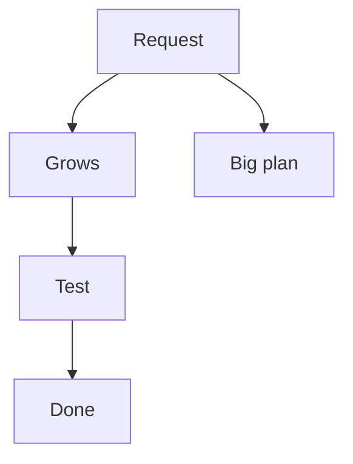

# A page with a cut label

The words in the "Grows" box get bigger after Mermaid has measured them, as when a reader's browser draws the
label in a wider font than the one Mermaid measured: the box stays the same size and the words are cut off.

