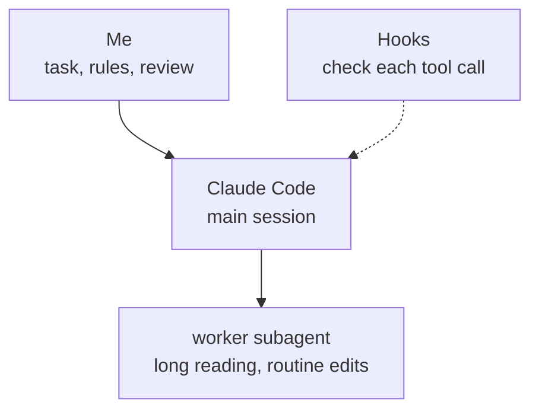
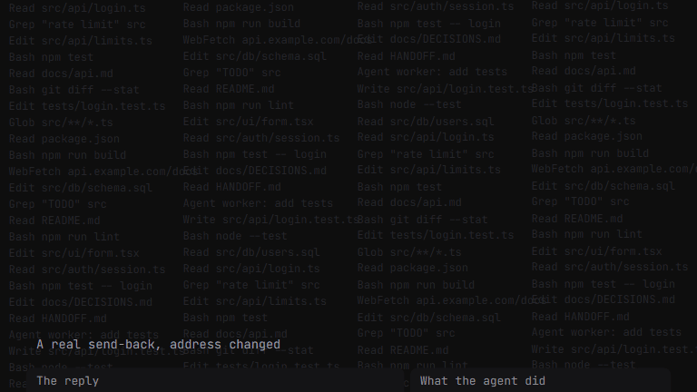
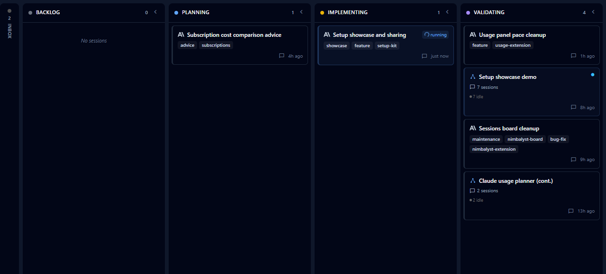
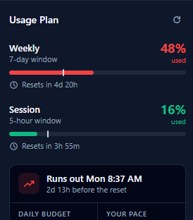

# Features in detail

The parts of the setup that the [README](../README.md) only names.

## Install details

This copies `hooks`, `agents` and `skills` into `~/.claude`, wires the hooks into `~/.claude/settings.json`, writes `~/.claude/CLAUDE.md` whole (rules of your own already in it move to `~/.claude/rules/my-rules.md`, which Claude Code loads in every session too), and creates two project folders under `~/Projects`. When Nimbalyst is installed it also builds the editor extensions (the themes, the usage pop-up, the command buttons, the agents list) and puts them into Nimbalyst; `--extensions no` leaves them out. It installs the `claude-hud` plugin when the `claude` command and Git are there (`--plugins no` leaves it out), sets the model to Opus at medium effort if you never set one, and adds permission rules so the agent can't read saved sign-ins or SSH keys and asks before it reads a `.env` file. The settings inside Nimbalyst and voice typing need a chat: the run names them, and `/update-setup` carries them out once. A file it replaces is kept in `~/.claude/setup-logs/<YYYY-MM-DD>-install-backup/`, not next to the new one.

The `phone-bot` skill (the phone app's PC program and the steps to join it; it also puts the shared sealing code in `~/.claude/phone/shared`) and the `read-aloud` extension are add-ons, left out of a default install. `node install.mjs --with phone-bot,read-aloud` (either or both) adds them; a copy already in place stays and keeps being updated by a plain run.

If you already have a Claude Code setup, yours stays. A hook or skill of yours with the same name as one of these is left as it is, and the run ends with the list of those files. `--replace <name>` takes my version of one, and `--replace-all` takes all of them, for when you want to start over. `--leave-out "<lead>"` leaves one of my rules out of `~/.claude/CLAUDE.md` on this and later runs, and `--put-back "<lead>"` brings it back. A run that changed something saves what it printed in `~/.claude/setup-logs`.

- **Claude Code version and plan:** the installer updates Claude Code to the newest version and stops below 2.1.321. The plan reviewer, the end reviewer, long refactors, charts, science and maths run Fable, so a Max plan or higher works best. On the $20 Pro plan, which has no Fable, the installer sets those helpers to Opus.
- **Models and effort:** with no model set, it sets Opus at medium effort. Three helpers run Fable at high effort, as their agent files set: the plan reviewer, the end reviewer and `worker-refactor` for long refactors (on the Pro plan the installer sets them to Opus). Helpers that write code run Opus at high effort; Fable as an advisor is off until `/advisor fable` (`/advisor off` turns it off again). Each helper runs at the effort its agent file sets: Nimbalyst passes its effort pick to Claude Code as `CLAUDE_CODE_EFFORT_LEVEL`, which would override every helper, so the installer sets that variable to an empty value in `~/.claude/settings.json`. Nimbalyst's effort picker then no longer changes the level; `/effort` in the chat changes the main session's.
- **Nimbalyst's Claude Code:** Nimbalyst's chats are pointed at your own Claude Code instead of the copy Nimbalyst bundles, so they get Claude Code fixes on the day they ship (a newer line than Nimbalyst's waits for Nimbalyst; `SETUP_NIMBALYST_CLAUDE=off` leaves Nimbalyst on its own).
- **Without Nimbalyst:** the rules, hooks and skills work in plain Claude Code. The extensions and the session board need Nimbalyst, the editor I run Claude Code in. `/lead` runs its steps as subagents, but keeps its job card in Nimbalyst's tracker. `question-other`, `command-explain`, `file-link-gate` and `picture-in-project` are written for it too.
- **Mac:** I run the setup on Windows. The tests also run on macOS, but the full install has not been run on a real Mac, and Read Aloud is Windows only.
- **Afterwards:** [docs/HOW-TO.md](HOW-TO.md) says what to type and what you should see.

## Updating details

Every 12 hours the setup asks GitHub whether a newer version is released ([hooks/update-check.mjs](../hooks/update-check.mjs)) and says so in a grey line: about every 8 hours while an important release is waiting (with a few bullets from Claude about once a day on what it brings), at most once a day for small ones. With no network it waits under a second, writes why it failed into `~/.claude/update-check.json`, and asks again only after an hour. A release that asks you nothing installs itself: it is downloaded and installed in the background, keeping any file you changed, and one grey line says so afterwards (`AUTO_UPDATE=off` stops that). Changed Nimbalyst panels go in only while Nimbalyst is closed, so they show the next time it starts; on a Mac, or when the grey line asks, type `/update-setup`. Your own Claude Code is not updated in the background. Only a release that needs you (a new question, a step only a chat can do, a newer Claude Code) waits until you type `/update-setup`. That runs [update.mjs](../skills/update-setup/update.mjs): it downloads the release to `~/.claude/setup-source` and runs its installer with the answers you gave the first time.


- **Yours stays yours.** The installer only writes the setup's own files. Skills, hooks, settings and notes you added are not touched, and every replaced file is kept in `~/.claude/setup-logs/<YYYY-MM-DD>-install-backup/`.
- **Rules.** `~/.claude/CLAUDE.md` is written whole with this version's rules, and a dated copy of the old file is kept. Rules you added yourself are not lost: they move to `~/.claude/rules/my-rules.md`, which Claude Code loads in every session too, and `/update-setup` can offer to tidy that file so it repeats nothing the setup already does.
- **Files of mine that you changed.** The same goes for a hook or a skill from this setup that you edited: it stays as you have it, the update lists it, and `/update-setup` asks whether you want the new version.
- **Disk and files.** An update ends by clearing the setup's own leftovers (worktrees and chat logs from its test runs, its cache and temp folders) and says how much it freed. Your own leftovers and a reorganize of your project files by the file standard are offered on one question card, the first time with the chat archive too: yes runs `/disk-tidy` or `/file-upkeep`, not now leaves them for any time you type the same command. The same card asks once whether you want the encrypted backup, with no answer marked as the one to pick; yes runs `/backup`, and `/backup` sets it up any time.
- **Nimbalyst (Windows).** Nimbalyst updates through the setup, not by itself. The installer puts the update tools in `~/.claude/tools/nimbalyst-patch/`: `pin.json` names the Nimbalyst version the setup delivers and the patches that go into it, `patch.mjs` puts the patches into Nimbalyst's app files, `deliver.mjs` downloads and checks the pinned version and installs and patches it, and `restart.mjs` closes Nimbalyst, installs, patches and opens it again. The first patch, `patches/updater-block.mjs`, turns Nimbalyst's own updater off; every patch run applies it first, and without it no other patch is applied. After an update, `/update-setup` gets the pinned version ready: it goes in when Nimbalyst closes, or at once through one restart card. `node ~/.claude/tools/nimbalyst-patch/deliver.mjs --off` (or `NIMBALYST_FOLLOW=off`) stops the delivery, and `--on` starts it again; `--off` also puts Nimbalyst's original app files back (at once if Nimbalyst is closed, otherwise when it next closes), so Nimbalyst updates itself again. A failed delivery opens Nimbalyst again and the next `/update-setup` tries again. `--uninstall` puts Nimbalyst's original app files back; with Nimbalyst open it prints the command to run after closing it.
- **Without a chat:** `node ~/.claude/skills/update-setup/update.mjs`, or `--check` to only look.
- **Installed before version 1.0.0?** Download the repository once more and run the install again; from then on it updates itself.
- **Off switch:** set `UPDATE_CHECK=off` to stop the check, `AUTO_UPDATE=off` (environment or the `env` of `~/.claude/settings.json`) to stop only the background install.

## Where the work goes

Long reading of local files and a second opinion go to the capped `worker` agent, which runs Sonnet at medium effort; a worker that writes code is `worker-code` on Opus at high, a job that needs a skill or an MCP tool goes to `worker-full` on Opus at high, one that reads charts or does science or maths runs Fable at medium, and a long refactor goes to `worker-refactor` on Fable at high. Outside command-line workers used to do this; they often failed or ran out of time and the job went back to Claude anyway, so the work now goes straight to Claude's own helpers. A quick web lookup stays with the main session, which reads the source that knows the answer; research across many pages goes to a `worker`. The settings hold the agent to that: the installer adds `Agent(Explore)` and `Agent(general-purpose)` to `permissions.deny` in `~/.claude/settings.json`, so those uncapped helpers never start and the work goes to the capped `worker` agent (`worker-full` when a job needs a skill or an MCP tool). So the setup needs no subscription besides Claude. I added it after `scripts/usage-scan.mjs`, which reads the session logs, showed single helper subagents using 0.6 to 4.3 million tokens.



- **The lead.** For a big task, [skills/lead](../skills/lead/SKILL.md) runs it from the main session, starting from the spec file `grilling` wrote. The session writes the plan itself: slices, each with the done-when lines it proves, its files and its helper, and the size as a count of slices and sessions, never time. A `plan-reviewer` checks the plan once, and I give one OK on the spec and the plan together. Each slice goes to a `worker` that knows the goal of the whole job; slices that run side by side get their own git worktree and are merged one at a time. At the end one `reviewer` checks the result against the spec, for correctness only, and the report shows each done-when line with its proof.
- **The blind look.** When a person will see, read or use the result (a page, screen, chart, message, document or a command's output), the `blind-reviewer` agent looks at it as a newcomer: it gets only the screenshots of every state, the text or the output, never the code or the author's reasoning. It looks once early, at the mock-up or first draft, and once at the finished result beside the build review. It ranks the flaws, the author fixes the serious ones, and it looks again once.
- **Writing for other people.** [skills/writing](../skills/writing/SKILL.md) is for text other people will read: emails, posts, READMEs, profiles, resumes, form answers, PR descriptions and release notes. It drafts from the facts you give, in your own voice when you keep a few of your own texts in `~/.claude/writing-samples/`, then checks the draft against current signs of machine-written text and fixes them by naming the specific thing. Chat replies keep their usual format. A project's own writing rule wins.
- **Bringing a project up to the setup.** [skills/update-project](../skills/update-project/SKILL.md) (`/update-project`) brings one project folder up to the current setup: its `CLAUDE.md`, `HANDOFF.md` and `DECISIONS.md`, the `.claude/` rules, skills and settings, the file layout, stale notes and facts past their recheck date. It also offers a verify skill to a folder with code and none. Every change is shown first. After an update that raised the pass level, the first message in a folder that is behind offers it.

The rules I give the models are described in [docs/setup.md](setup.md).

## Agents

Seven agents in [agents](../agents). The main session starts them with the Agent tool; the uncapped built-in helpers are denied in the settings, so the work comes to these.

| Agent | What it does |
|---|---|
| `plan-reviewer` | One independent read-only pass over a big job's plan before I see it, on Fable. The main session wrote the plan; it holds each slice against the spec and my own words in six checks (every done-when line proved, my words kept, nothing dropped, each slice runs as written, shared files have edges, risky slices marked) and reports each finding with its proof. It runs once per job |
| `worker` | Does one numbered step of a job, or one clear one-off job, on Sonnet at medium effort (Fable at medium for charts, science or maths), and stops after 80 turns. It knows the goal of the whole job. It starts without the `CLAUDE.md` files and with file, shell and web tools only, so its brief names the project commands it needs. It stays inside the files it was given, reports anything else it notices, and stops with a `BLOCKED` line when what it finds contradicts the plan. It never edits, weakens or skips a test to get green; a flaky test with no cause found may be deleted, with the reason in the project's `docs/known-failures.md`, never patched with sleeps or retries |
| `worker-full` | The same worker with every tool and the `CLAUDE.md` files loaded. It costs much more to start, so it is for a step that needs a skill or an MCP tool such as the browser |
| `worker-code` | The same worker on Opus at high effort, for a step that writes or changes code. A long refactor that is not mechanical goes to `worker-refactor` instead |
| `worker-refactor` | The same worker on Fable at high effort, with a refactor section (map every dependent first, change them all the same way, the compiler and tests as the judge, behaviour unchanged) and told to keep going until the step is done, for a long refactor that is not mechanical: a change to an interface, signature, type, data shape or module split that code in other files depends on, with dependents too many or too scattered to list, or a refactor step that already failed its check on `worker-code`. A rename is never a reason, whatever its size. It costs far more per step, so everything else stays on `worker` |
| `reviewer` | One independent read-only pass over a finished big job, on Fable, once at the end. It gets the spec, the full diff and the end-check outputs, never the chat; it runs each done-when line's check itself where it can and marks each line met, missing, looks wrong or not asked for, with its proof. Its scope is correctness: style and what the project's tools enforce are left out |
| `blind-reviewer` | A newcomer's look, on Opus at medium effort, at something a person will see, read or use: screenshots of every state, a text, or a command with its docs and output. It never sees the code, the plan or the chat, can only read the files it is handed, and ranks each flaw by how much it hurts. It looks early at a mock-up or draft, at the finished result beside the `reviewer`, and once a release at the whole setup |

## Systems map

Each project gets a dictionary of its parts and what connects to what, in `.claude/systems-map.json`: `/new-project` starts one, `/update-project` offers one, and in a project with 100 or more code files holding 10,000 or more lines and no map, you are asked once, on a question card, whether to build one; it is built only on yes. A part is something a person would name out loud (a feature, a service, a screen, a data store, a background job), not a folder. A link says that changing one part means looking at the other, and names the code that does it. [skills/systems-map](../skills/systems-map/SKILL.md) builds the map, refreshes it when files have moved, and looks things up with `map.mjs`: `--scan` to start a build, `--near <word>` for a part with its links and up to 3 short decision lines, `--check` for listed paths that no longer exist, for links whose code changed and for match words that are one common word ("release"), which the map ignores. A part lists the files a session opens first, never one shared index file: a file that more than 3 parts list points at none of them. A link can name its kind (`uses`, `feeds`, `spends`, `opens`, `boosts`, `limits`) and the token in a file that proves it; a part can have a group, words that `--near` matches, and rules ("never / only here" lines) that a helper's brief carries.

The map also holds topics and how-to things. A topic is a subject that spans parts ("damage balance" links to gear, monster damage and buffs). A how-to thing is a job sessions in the project get asked to do (research, a web search, tests, a release), with the 1 to 3 files to read first and a link to the step it hands on to, so `--near research` points a session at the right skill and the step after. A map may point at the setup's own files as `~/.claude/...`, so it works on any computer.

Four hooks run it. `map-nudge` notices a big project without a map (100 or more code files holding 10,000 or more lines) and has the agent ask you once, on a question card, whether to build one now; only on yes does a background worker build it. The question comes once per project, ever. A map whose files are mostly gone or changed gets a background refresh, at most once a week, without a question. `map-brief` acts only during its trial: while `~/.claude/state/map-brief-trial.json` (`{"until": "YYYY-MM-DD"}`) has not expired. Without that file, or after its date, it does nothing. During the trial each eligible helper call gets one of two arms at random, `map` or `none`, logged to `~/.claude/state/map-brief-trial.jsonl`, so the runs with map lines can be compared with the runs without. In the `map` arm it adds to each helper's brief only the lines for the parts whose files the brief names (a full path, a path with its folder, or a file name only one part lists), so the helper doesn't load a whole graph: for the top 3 parts, their rules and their links with the reason for each; every further part named on one line; up to 2,000 characters cut at whole lines. A part named only by its name, its folder or a word gets no lines, a part with no rules and no links is left out, and no start files are listed. `map-drift` notices an edit that removes the token a link rests on and tells the agent to check that link before it is done. `map-generated` refuses a hand edit of a file a script writes, listed under `generated` in the map, and names the script to change and rerun instead, so a fact has one home and the next run can't quietly undo it.

## Hooks



Each check is a Node.js hook: a script Claude Code runs around a step, and that can send the step back. Claude Code logs every tool call in a session, and several hooks compare a reply with that log. If you read one file, read [hooks/link-gate.mjs](../hooks/link-gate.mjs). There are 30 hooks in [hooks](../hooks), plus `dispatch.mjs`, which runs a group of them in one Node.js process. Each hook has an off switch, an environment variable named after it: `LINK_GATE=off` turns off `link-gate`. `PLAN_USAGE_LOGGER=off` and `USAGE_DASHBOARD=off` do the same for the usage logger and the dashboard hook. The settings some hooks take beyond that are listed [below the tables](#hook-settings).

### Checks that can send a step back

| Hook | What it sends back |
|---|---|
| `link-gate` | A reply with a link the agent remembered or saw in search results but never opened |
| `question-other` | Refuses a question card or form that shows a plan-row id such as B6 I didn't use, or that asks no decision (whether I have done my part yet, an open question repeated); the refusal says what to write instead, at most twice in a row, and a Nimbalyst patch hides the refused card. Labels a project really uses (game tiers, product codes) go in its `.claude/card-labels.txt`, one per line, and always pass. Other faults go back as a note to fix in the reply: a question with no box to type my own answer, a choice with one option, a choice with two recommended options, a "look at this" question with no link |
| `command-explain` | Never refuses: a shell command with no plain-words line saying what it does gets a stand-in line and a reminder, and a line that starts in lowercase or runs 70 characters or more gets a note. On Windows with Git Bash the installer turns the PowerShell tool off (`CLAUDE_CODE_USE_POWERSHELL_TOOL=0`), since Nimbalyst's permission popup shows only the word "PowerShell" for it |
| `file-link-gate` | A reply with a file link Nimbalyst's chat can't open (a relative path, backslashes, `file:///`). Only inside Nimbalyst: in the terminal it never refuses |
| `no-response-gate` | A reply to a message you typed that has no text, or only "No response requested."; and a `/btw` question that was only forwarded to another session without an answer. It is sent back once to answer you. When a turn was cut off before it answered, the next message reminds the agent of the unanswered one. Thanks and other short acknowledgements pass. In the turn after you stopped the session, it refuses work calls (helpers, edits, new sessions) until you say go or start (`NO_RESPONSE_GATE=off` turns it off) |
| `verify-gate` | A turn that edited a code file and ended with no build or test run after the last edit; it asks for one run and never runs a command itself. A run of the project's verify skill counts as that run. In a project with a verify skill it also checks each `git commit` (and Nimbalyst's commit tool) of code with no verify run since the last code edit: by default it only logs it, `VERIFY_GATE_COMMIT=enforce` refuses it once, and a `Verify: skipped — <reason>` line in the commit message lets it through. `node ~/.claude/workers/observe-log.mjs` prints the log (`--all` for every line) |
| `transcript-check` | At the start of a session, says out loud when a new Claude Code changed the transcript format the hooks read |
| `picture-in-project` | A picture shown in the chat from a path that can be cleaned up later or that Nimbalyst can't open enlarged; it copies the picture to the project's `shown` folder and gives the path to use |
| `browser-visible-gate` | Opening a Nimbalyst browser session with `headless: false`: that tab shows no window, so the agent is pointed to the `site-login` skill, which opens a real window to sign in |
| `opencli-readonly` | Posting, liking or following from my logged-in accounts through OpenCLI's site commands, or running a script in the page; clicking and filling for a job I asked for still works |
| `planner-readonly` | A shell command from the `plan-reviewer` or `reviewer` agent that would change a file; they may look at git, file lists and the systems map, never change them (the reviewers may also run tests) |

### Hooks that keep sessions cheap and safe

| Hook | What it does |
|---|---|
| `helper-stopped` | When a helper comes back cut off at its turn limit or with no report, tells the agent to ask it once what is done and what is left, and to check the files itself; a cut-off reviewer counts as not run |
| `repeat-guard` | On the second identical error, tells the agent to find what both tries took for granted; refuses a retry of the same call after the same error came back three times; both say that if no other approach is left, the agent asks you in a form and includes the error text (a helper reports BLOCKED instead); and tells the agent when it repeats the same call or edits or reads one file over and over |
| `sql-guard` | Asks before DROP, TRUNCATE, or DELETE and UPDATE without WHERE |
| `delete-guard` | Refuses `rm -rf`, wildcard deletes, `find -delete`, `git clean -f` and `Remove-Item -Recurse` outside temp, cache and worktree folders; deleting named files passes (`DELETE_GUARD=off`) |
| `find-guard` | Refuses a search through a whole drive or the home folder unless its depth is 3 or less (`FIND_GUARD=off`) |
| `download-guard` | A download speed-up, not a guard: rewrites a plain `curl`, `wget` or `Invoke-WebRequest` of a file over 50 MB to run through `workers/download.mjs`, which fetches 32 byte ranges side by side, resumes and prints the sha256 (`DOWNLOAD_GUARD=off`) |
| `workflow-fence` | Refuses `/deep-research` in an app or a headless run (Nimbalyst included), where it skips its approval stop and can't be stopped, and says to run it in the terminal; other workflows and the terminal pass (`WORKFLOW_FENCE=off`) |
| `push-key-scan` | Asks before a `git push` whose new lines hold something shaped like a key or token (`sk-ant-`, `ghp_`, an AWS key id, a private key block, a database address with a password) or add a key file (`.env.*`, `.dev.vars`, `*.pem`, `*.key`, `.claude/settings.local.json`); gitleaks also scans the outgoing commits and the uncommitted changes. In a project switched on with `ship-check init`, it refuses a raw deploy command (`wrangler deploy`, `vercel`, `npm run deploy` ...) and names the `ship-check deploy -- <command>` line to run instead (`SHIP_CHECK=off`); quoted text and the explain line are not read as a push or deploy |
| `map-brief` | A trial: only while `~/.claude/state/map-brief-trial.json` has not expired, and then for a random half of helper calls, adds to a helper's brief (worker, worker-full, worker-code, worker-refactor, reviewer or plan-reviewer) the lines of the project's systems map for the parts that brief touches, and only those; without the trial file, or in a project with no map, it does nothing |
| `map-nudge` | In a project with 100 or more code files holding 10,000 or more lines and no systems map, has the agent ask you once, on a question card, whether to build one; a background worker builds it only on yes, and the question never comes back for that project. A map whose files are mostly gone or changed under a link gets a background refresh, at most once a week, without a question |
| `map-drift` | After an edit to a file that backs a link of the systems map, says when the token the link rests on is gone, so the agent checks that link and fixes or drops it before it is done |
| `map-generated` | Before an edit of a file a script writes (listed under `generated` in the systems map), refuses it and names the script and the command that reruns it |
| `file-name-note` | Before a new file is written, says when its name or place breaks the file standard (`skills/file-upkeep/standard.md`: the name rules, the folder roles such as pictures in `shown/`, the projects folder's order) and gives the rule and the proposed name. It never refuses or rewrites the call. A good name, an existing file, a file outside any project or in a git-ignored folder, and any error give nothing (`FILE_NAME_NOTE=off`) |
| `nimbalyst-notes` | At the start of a session inside Nimbalyst, tells the agent two quirks of Nimbalyst's tools, so they don't sit in the rules of every session. Silent in the terminal |
| `session-cleanup` | A session closes what it started (dev servers, watchers, headless browsers, background shells) when it ends. It starts in report mode: it writes what it would close to `~/.claude/hooks/state/session-cleanup/closed.log` and closes nothing until `SESSION_CLEANUP=on`. It never closes or records a process whose command line holds `tools/nimbalyst-patch/` (a Nimbalyst update that waits for Nimbalyst to close) |
| `update-check` | Says when a newer version of the setup is released (checked every 12 hours), and lets a release that asks you nothing install itself in the background. A notice in `version.json` about a coming release is shown once. Once a day per folder, it offers `/new-project` on a card in a folder that is not a project yet, and `/update-project` in a project folder set up before the current setup |
| `usage-dashboard-hook` | Typing just `usage` opens the usage dashboard (inside Nimbalyst it refreshes the data and says where to click) |
| `plan-usage-logger` | Saves the plan percentages every 5 minutes for the forecast |
| `agent-run-log` | Writes one line per helper to `~/.claude/state/agent-runs.jsonl` with the model and effort it runs on, so the agents panel can show them, and when the helper ends, its result (success, partial or fail). It sends nothing back (`AGENT_RUN_LOG=off` turns it off) |
| `dispatch` | Runs the hooks of one step in one Node process: before a tool call, when you send a message and before a reply goes out (the groups are in `hooks/dispatch-groups.json`). When it fails itself, it stops only a call one of its guards checks (`DISPATCH=off` turns off every hook it runs, the guards too) |

A hook that hits an error lets the call through. `link-gate` knows that a page was opened, not what it said.

`workers/ship-check.mjs` is the safety baseline of a push and a deploy, switched on per project with `node ~/.claude/workers/ship-check.mjs init` (it writes `.claude/ship-check.json` and the missing ignore lines for secret files). `push` checks tracked key files and runs gitleaks over the new commits (`--history`: every commit; `--full`: also `npm audit --audit-level=high` and GitHub's secret scanning and push protection), `build <folder>` lists what a deploy uploads and fails on env files, source maps, dotfiles and baked-in keys, `live <url>` checks that `/.env`, `/.git/HEAD` and the like give 404 and that the security headers are there, and `deploy -- <command>` runs the build check, the command and the live probe in that order.

### Hook settings

Set these in your shell or system environment. The first five are also read from `env` in a project's `.claude/settings.json`, so one project can differ.

| Setting | What it does |
|---|---|
| `VERIFY_GATE=off` | Turns off `verify-gate`, for a project whose build or test is slow |
| `VERIFY_PATTERN` | A regular expression, matched without regard to case against the whole shell command; it replaces `verify-gate`'s list of build and test commands |
| `VERIFY_GATE_COMMIT` | `observe` (the default) only logs a code commit with no verify run; `enforce` refuses it once; `off` turns the commit check off |
| `NIMBALYST_NOTES=off` | Turns off `nimbalyst-notes` |
| `MAP_NUDGE=off` | Turns off `map-nudge`, which asks once whether to build a project's systems map and has a background worker refresh a stale one |
| `MAP_DRIFT=off` | Turns off `map-drift` |
| `MAP_GENERATED=off` | Turns off `map-generated` |
| `FILE_NAME_NOTE=off` | Turns off `file-name-note`, the note when a new file's name or place breaks the file standard |
| `UPDATE_CHECK=off` | Turns off the version check |
| `AUTO_UPDATE=off` | Updates no longer install themselves; they wait for `/update-setup` (also read from the `env` of `~/.claude/settings.json`) |
| `NIMBALYST_FOLLOW=off` | `/update-setup` no longer updates Nimbalyst on Windows (also read from the `env` of `~/.claude/settings.json`); `deliver.mjs --off` also gives updates back to Nimbalyst |
| `WORKFLOW_FENCE=off` | Turns off `workflow-fence`, so `/deep-research` also runs in an app or a headless run (also read from the `env` of `~/.claude/settings.json`) |
| `SESSION_CLEANUP` | Unset: `session-cleanup` only reports what it would close; `on` closes it; `off` turns the hook off |
| `SESSION_CLEANUP_IDLE_HOURS` | How long a session's transcript must be unwritten before `session-cleanup` treats the session as ended and closes what it left; the default is 3 |

## Sessions


- **A note to a busy session.** Nimbalyst holds a new message until the running reply ends. With [skills/steer](../skills/steer/steer.mjs), `/btw <note or question>` in a second chat leaves a note that the busy session reads at once, holding only a slow or consequential next step (a helper launch, a question, a long command) until it has read it, a session waiting on a background job, or whose reply has just ended, is woken to read it without stopping the job, a running helper gets the note too and stops early to report when it is not about its job, and a question answers without touching that session's work. The Commands extension also puts a **Note** button next to Send in every chat box, which sends the typed text the same way. A helper gets a copy only while the session waits on it. The reply lists the notes it read under "### Your notes", and a note that waited 2 minutes or more says so.
- **Handoff.** Every step re-sends the whole conversation, so a long session gets expensive. `/handoff` writes a short brief and moves the work to a fresh session that starts from it, so the next message doesn't re-send the long history. The brief also lets the work go on in a GPT or Gemini session when the Claude plan runs out.
- **The board.** Nimbalyst shows every conversation as a card on a board, and Claude moves its own card from Planning to Complete as the work goes. `/board-cleanup` moves the finished ones that were left behind. On Windows, `/pc-tidy` shows what is holding the computer's memory and stops what finished sessions left behind; it never stops a process whose command line holds `tools/nimbalyst-patch/`, the Nimbalyst update.
- **The disk.** [skills/disk-tidy](../skills/disk-tidy/SKILL.md) (`/disk-tidy`) first reports what fills the disk (leftover worktrees, old chat logs, scratch and temp folders, old project copies, editor backups) and changes nothing; then each item goes only with your tick, checked again just before. Anything with uncommitted or unmerged work is kept and named. Once you say yes to the chat archive, chats older than 60 days move, compressed, to `~/.claude-archive/chats` at each update of the setup and are deleted there at the age Claude Code deletes live chats (`cleanupPeriodDays`). `--keep-forever "<project folder>"` keeps a project's chats archived and never deleted, `--archive-list` finds an archived chat, `--restore <id>` brings it back before `/resume`, and `--archive-off` stops the archive.
- **Files.** [skills/file-upkeep](../skills/file-upkeep/SKILL.md) (`/file-upkeep`) holds the file standard ([standard.md](../skills/file-upkeep/standard.md): names, places, where old decisions and handoffs go) and a checker that lists misnamed and misplaced files in a project. The reorganize moves them after your yes, records every rename and move in a ledger, fixes the references to them in the same pass, and can be undone. `/new-project` starts new projects on the standard.
- **Memory.** The setup relies on Claude Code's built-in auto memory (on by default, `autoMemoryEnabled`), which keeps notes per project under `~/.claude/projects/<project>/memory/`. The setup checks those notes against each project's decisions (`/setup-audit memory`, and `/update-project`) and backs them up with `/backup`.

<details>
<summary>Screenshot of the board</summary>



</details>

## Usage


- **The forecast.** [extensions/usage-plan](../extensions/usage-plan/README.md) adds a button to the editor's side bar that opens a pop-up. It shows this week's usage and the 5-hour limit's usage as bars, a forecast line, and the budget and your pace side by side. The forecast line gives the day and hour the week runs out at the current pace; the budget is the daily amount that would make it last.
- **The dashboard.** Typing `usage` opens one HTML file built by [skills/setup-audit](../skills/setup-audit/usage.md) from the logs on the computer, so opening it uses no tokens. It shows tokens by project, model, day and chat, the main chat apart from its subagents, the Codex and Gemini use found on the computer, what the same work would cost at API prices, and this computer's use apart from other use of the same account.

For the forecast, `plan-usage-logger` reads your saved Claude login, `~/.claude/.credentials.json`, and asks api.anthropic.com for the plan percentages.

<details>
<summary>Screenshot of the pop-up</summary>



</details>

## Starter projects


The installer creates two project folders ([projects](../projects)). A request that has nothing to do with the open project isn't worked on there: the agent names the project it belongs to and opens it.

| Project | For | Its own tools |
|---|---|---|
| `claude-settings` | Changing and checking the setup itself | `/setup-audit` with `usage`, `chat`, `full`, `scan`, `outcomes`, `memory` (saved memories checked against the code) |
| `quick-tasks` | Questions, finding things online, one-off file jobs | A finder skill with a fixed order and its own link gate that accepts only pages that were opened, `peek.mjs` for reading pages, a dated folder per file job, work on copies, the picture skill |

Older installs had two more folders, `ask-anything` and `internet-search`. An update copies their profile, finds and saved answers into `quick-tasks` (where it has none yet) and leaves the old folders with all their files and chats, to delete when you no longer need them. It also moves `quick-tasks` from Sonnet to Opus once and says so; `/update-setup --keep-home-model` keeps Sonnet there.

With Codex installed, `quick-tasks` gets the picture skill. It has Codex draw an illustration of how something looks or works from a reference photo and a few sourced facts, for example a flat front view of a workbench with its clamps in the right places. A hook shows the result only after it passes a written checklist.

## Web pages and videos

- **Web pages.** [skills/web-research](../skills/web-research/SKILL.md) reads a page the cheapest way that gives the words needed: a quick fetch for a quick question, the exact text saved to a file for a quote or docs (`node ~/.claude/workers/read-page.mjs <url>`, which reads with Firecrawl Local when it is installed and with defuddle otherwise, and refuses private and local addresses), `gh` for a GitHub repository, and for a page built by script, a signed-in page or one that refuses the rest, `peek.mjs` in the `quick-tasks` folder, which reads it in Nimbalyst's browser with its sign-ins. When Nimbalyst's browser can't be reached, `peek.mjs` stops and names `read-page.mjs` for a public page. `/deep-research` runs only from the terminal: in an app or a headless run it skips its approval stop and can't be stopped, so the `workflow-fence` hook refuses it there. A page a decision rests on is saved whole (`peek.mjs --save <file>` writes each page's whole text) and a `worker` reads all of it. [skills/site-login](../skills/site-login/SKILL.md) opens a real browser window to sign in to a site.
- **Videos.** [skills/watch](../skills/watch/SKILL.md) (`/watch <link or file> [question]`) turns a video into timed words and sheets of 9 timed stills that a cheap helper reads, and keeps them in `~/.claude/video-cache`, so a second look downloads nothing. A video with no subtitles, or one YouTube refuses them for, is listened to: its sound is turned into text on the computer (with ffmpeg's whisper filter and a 574 MB model it asks before downloading; where ffmpeg has no whisper filter, with faster-whisper through uv), which can take minutes on a long video. `--listen` does that even when there are subtitles. It needs ffmpeg, and yt-dlp for links.

## Backup

[skills/backup](../skills/backup/SKILL.md) (`/backup`) copies the Claude folder (settings, rules, skills, memory) and the project folders you pick to your own Backblaze B2 storage with restic. The files are locked on the computer with a password only you keep, so Backblaze or anyone with the storage key sees only scrambled data, and the key it makes for the backups can't delete them. Setup takes about 10 minutes, in its own window: keys and the password are never typed into the chat. `/backup now` backs up; `/backup schedule` runs it every day or every week instead. A restore into a temp folder is compared with your files before the schedule starts and once a month after. `/backup restore <path>` brings a file or folder back into a new folder, never over the original, and `/backup off` stops the schedule and deletes nothing. Files over 100 MB are left out and named. B2 is free up to 10 GB, then about $7 per TB a month. The full install asks once whether you want it ([docs/setup.md](setup.md#asked-once-at-install)). So far it has been tested against a local folder, not yet against a real Backblaze account.

## Rules

[rules/CLAUDE.md](../rules/CLAUDE.md) is read in every session: lead with the answer, do the work yourself, ask one question with options when the choice matters, fix a repeated mistake in the rule that caused it. `/new-project` gives a folder its own `CLAUDE.md`, a `HANDOFF.md` (where the work stands) and a `DECISIONS.md`, and a decision I confirm is written there at once. A project with code also gets a verify skill from one of four templates (web app, Godot game, command-line or Node tool, data or video pipeline) that says how to start it, what to do in it and what proof to show.

## Editor extensions


Eight extensions for Nimbalyst. The first three and the systems map are written in TypeScript and React; the themes, the agents list, the job tracker and Board Tidy are plain CSS and small scripts.

- [usage-plan](../extensions/usage-plan/README.md) is the usage pop-up from the usage section.
- [read-aloud](../extensions/read-aloud/README.md) reads replies aloud with Kokoro, a voice model that runs on the computer. It cleans a reply for speech (no code, no Markdown), and a Python worker speaks it sentence by sentence.
- [commands](../extensions/commands/README.md) puts fourteen commands behind one button on the side bar, in four groups, most-used first: lead, grill me, next move, where are we, board cleanup; new project, update project, systems map, untangle; setup audit, update setup, backup; PC tidy, disk tidy. Setup audit opens its checks in place: health, usage report, prompt audit, project scan, and in the `claude-settings` folder chat review and full review. A press starts a new session in the open project with that command.
- [ink-themes](../extensions/ink-themes/README.md) adds eleven colour themes with their own fonts and rounder shapes, eight dark and three light, under one **Ink themes** row of the Theme menu.
- [agents-panel](../extensions/agents-panel/README.md) makes the **Agents & commands** list in the right sidebar readable: running helpers and commands on top, finished ones folded behind one line, a taller list you can resize, and each row titled in plain words (a command by its `# WHAT THIS DOES:` line). It also keeps the commit panel below it inside the sidebar when the sidebar is narrow. And a chat you scroll up in stays where you put it while the agent keeps writing, instead of jumping back to the end.
- [board-tidy](../extensions/board-tidy/README.md) keeps the Sessions board to current work. Once an hour, in every project, it archives sessions that are Complete and idle for 3 days, have no phase and are idle for 14 days, or have sat in planning, validating or implementing for 30 days. Pinned, running and worktree sessions stay, and nothing is deleted: Unarchive brings a session back, and Claude can undo the last run. `/board-cleanup` runs it too. A chat-style project, where each chat is its own task you may look up months later, can be kept: nothing there is archived unless you ask ("archive what's older than 6 months there"). The install keeps `quick-tasks`, `/new-project` asks, and "stop tidying this project" or "tidy it again" changes it.
- [job-tracker](../extensions/job-tracker/README.md) turns the tracker into one page per project for the job in hand, a job being any work over more than one session: its name and goal, how many steps are left with a bar, and four folds for what needs you, what is running, what is left and what is done. The job's name is a picker for the other open jobs, or all of them on one list. A step that asks you to read a file opens it in one click, and a step with a session opens that session. The session you are in stays open on the right of the page; pick another on the left, drag its edge to resize it, or hide it with the Chat button.
- [systems-map](../extensions/systems-map/README.md) draws the open project's systems map as a graph you can pan, zoom and search, coloured by group, with a card for each part: its files, notes and links. A link whose code changed is marked, and a project with no map gets a button that starts a session to build one.


## Voice typing


I speak most of my prompts. [Handy](https://handy.computer) types what I say where the cursor is: hold a key, talk, release. The speech model runs on the computer.

```
winget install --id cjpais.Handy -e
```

On a Mac: `brew install --cask handy`; the Mac side is untested. On Windows the full install sets Handy up. It asks once whether you want voice typing and keeps the answer, so no update asks again ([docs/setup.md](setup.md#asked-once-at-install)).
