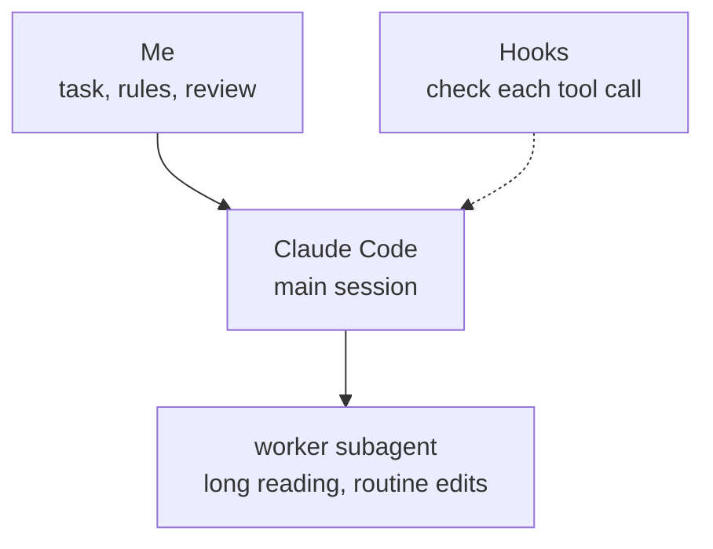
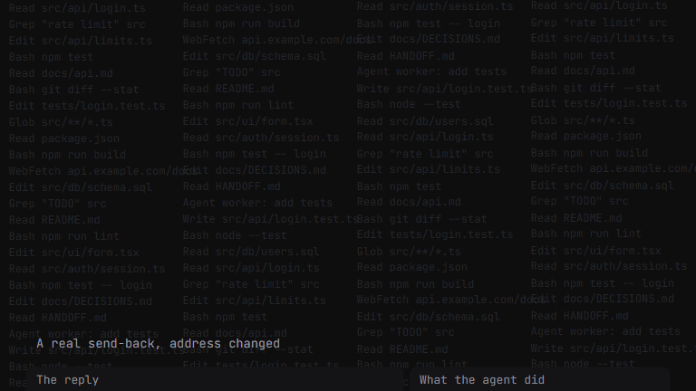
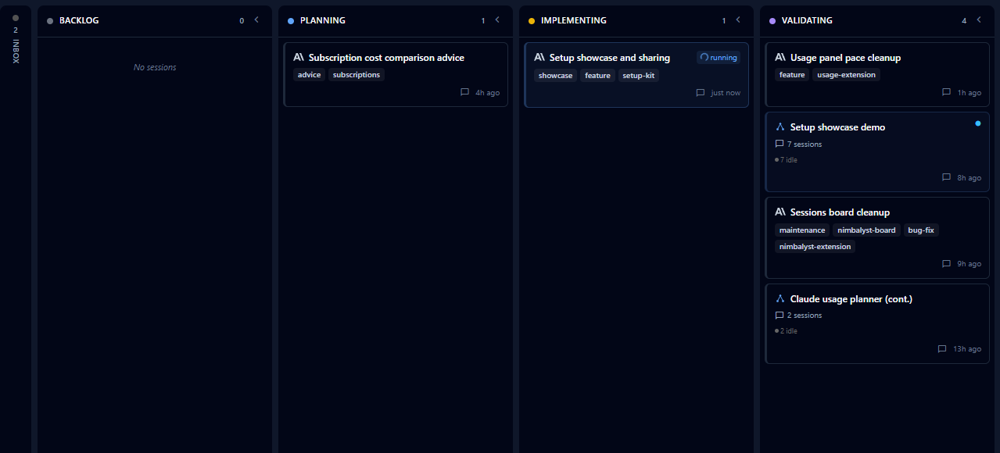
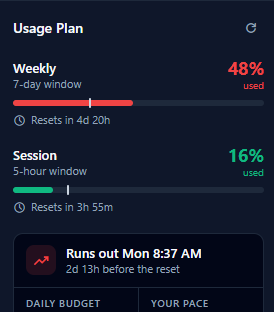

# Features in detail

The parts of the setup that the [README](../README.md) only names.

## Install details

This copies `hooks`, `agents` and `skills` into `~/.claude`, wires the hooks into `~/.claude/settings.json`, writes `~/.claude/CLAUDE.md` if there is none, and creates four project folders under `~/Projects`. When Nimbalyst is installed it also builds the editor extensions (the themes, the usage ring, the command buttons, the agents list) and puts them into Nimbalyst; `--extensions no` leaves them out. It installs the `claude-hud` plugin when the `claude` command and Git are there (`--plugins no` leaves it out), sets the model to Sonnet if you never set one, and adds permission rules so the agent can't read saved sign-ins or SSH keys and asks before it reads a `.env` file. The settings inside Nimbalyst and voice typing need a chat: the run names them, and `/update-setup` carries them out once. A file it replaces is kept as `<name>.before-install-<date>`.

The `phone-bot` skill, the `shared-usage` skill and the `read-aloud` extension are add-ons, left out of a default install. `node install.mjs --with phone-bot,shared-usage,read-aloud` (any subset) adds them; a copy already in place stays and keeps being updated by a plain run.

If you already have a Claude Code setup, yours stays. A hook or skill of yours with the same name as one of these is left as it is, and the run ends with the list of those files. `--replace <name>` takes my version of one, and `--replace-all` takes all of them and the rules, for when you want to start over. A run that changed something saves what it printed in `~/.claude/setup-logs`.

- **Without Nimbalyst:** the rules, hooks and skills work in plain Claude Code. The extensions and the session board need Nimbalyst, the editor I run Claude Code in. `/lead` runs its steps as subagents, but keeps its job card in Nimbalyst's tracker. `question-other`, `command-explain`, `file-link-gate` and `picture-in-project` are written for it too.
- **Mac:** I run the setup on Windows. The tests also run on macOS, but the full install has not been run on a real Mac, and Read Aloud is Windows only.
- **Afterwards:** [docs/HOW-TO.md](HOW-TO.md) says what to type and what you should see.

## Updating details

Every 12 hours the setup asks GitHub whether a newer version is released ([hooks/update-check.mjs](../hooks/update-check.mjs)) and says so in one line. With no network it waits under a second, writes why it failed into `~/.claude/update-check.json`, and asks again only after an hour. Nothing is downloaded until you type `/update-setup`. That runs [update.mjs](../skills/update-setup/update.mjs): it downloads the release to `~/.claude/setup-source` and runs its installer with the answers you gave the first time.


- **Yours stays yours.** The installer only writes the setup's own files. Skills, hooks, settings and notes you added are not touched, and every replaced file is kept as `<name>.before-install-<date>`.
- **Rules.** A `~/.claude/CLAUDE.md` you never changed is brought up to date. One you changed is replaced only after you say yes.
- **Files of mine that you changed.** The same goes for a hook or a skill from this setup that you edited: it stays as you have it, the update lists it, and `/update-setup` asks whether you want the new version.
- **Without a chat:** `node ~/.claude/skills/update-setup/update.mjs`, or `--check` to only look.
- **Installed before version 1.0.0?** Download the repository once more and run the install again; from then on it updates itself.
- **Off switch:** set `UPDATE_CHECK=off` to stop the check.

## Where the work goes

Long reading of local files and a second opinion go to the capped `worker` agent, which runs Sonnet. Outside command-line workers used to do this; they often failed or ran out of time and the job went back to Claude anyway, so the work now goes straight to Claude's own helpers. Searching the web stays with the main session, which reads the source that knows the answer. Design and code stay there too. `worker-nudge` holds the agent to that: when an uncapped Explore, general-purpose or claude helper is about to start, it is refused and the agent is pointed at the capped `worker` agent (`worker-full` when a job needs a skill or an MCP tool). So the setup needs no subscription besides Claude. I added it after `scripts/usage-scan.mjs`, which reads the session logs, showed single helper subagents using 0.6 to 4.3 million tokens.



- **The lead.** For a big task, [skills/lead](../skills/lead/SKILL.md) runs a big task from the main session: the `planner` agent writes the plan, and the session turns it into a numbered job list, hands each step to a `worker` agent that knows the goal of the whole job, answers a worker that gets stuck, has one `reviewer` agent check the result and reports what it checked. Everything runs in that main session and its subagents; parallel steps in one folder are subagents in their own git worktree.
- **The blind screen review.** After building or changing a page, screen, menu or chart, [skills/blind-screen-review](../skills/blind-screen-review/SKILL.md) (also `/blind-screen-review`) hands it to one reviewer who sees only screenshots of every state, never the author's reasoning. Code, plans and text go to the `reviewer` agent instead. The reviewer ranks the flaws, the author fixes the serious ones, and the same reviewer looks again, up to two rounds, until nothing serious is left.

The rules I give the models are described in [docs/setup.md](setup.md).

## Agents

Five agents in [agents](../agents). The main session starts them with the Agent tool, and `worker-nudge` sends it to them instead of to an uncapped helper.

| Agent | What it does |
|---|---|
| `planner` | Writes the plan for a build or design request, in every project, on the strongest model. It reads files and changes nothing, and gets the situation without the main session's own idea of the answer |
| `worker` | Does one numbered step of a job, or one clear one-off job, on Sonnet, and stops after 80 turns. It knows the goal of the whole job. It starts without the `CLAUDE.md` files and with file, shell and web tools only, so its brief names the project commands it needs. It stays inside the files it was given, reports anything else it notices, and stops with a `BLOCKED` line when what it finds contradicts the plan |
| `worker-full` | The same worker with every tool and the `CLAUDE.md` files loaded. It costs much more to start, so it is for a step that needs a skill or an MCP tool such as the browser |
| `reviewer` | One independent read-only pass over a finished bigger change, on Opus. It reads the request first and the code after it, and reports under two headings: what is missing or wrong against the request, and the quality of the change, each problem tagged Important (a bug the change brings in, with the realistic input or use that triggers it), Nit (a small thing, or a bug that needs an unlikely chain of events) or Pre-existing (already wrong before the change). One is enough on any change |
| `rec-check` | A second look at a recommended option before a question reaches me. It tries to break the pick: is it a smaller or safer path than I asked for, is an option missing, does the reason rest on a note instead of the live thing, should it have been decided and not asked. It answers `keep` or `change` in six lines at most |

## Systems map

A project with 100 or more code files gets a dictionary of its parts and what connects to what, in `.claude/systems-map.json`. A part is something a person would name out loud (a feature, a service, a screen, a data store, a background job), not a folder. A link says that changing one part means looking at the other, and names the code that does it. [skills/systems-map](../skills/systems-map/SKILL.md) builds the map, refreshes it when files have moved, and looks things up with `map.mjs`: `--scan` to start a build, `--near <word>` for a part with its links, `--check` for listed paths that no longer exist.

Two hooks run it. `map-nudge` notices a big project without a map and has the agent start a background worker that builds one, so nobody has to ask. `map-brief` adds to each helper's brief only the lines for the parts that brief is about, so the helper doesn't search for files or load a whole graph: the top 3 parts in full, and one line with the start files for every further match, up to 7,000 characters.

## Hooks



Each check is a Node.js hook: a script Claude Code runs around a step, and that can send the step back. Claude Code logs every tool call in a session, and several hooks compare a reply with that log. If you read one file, read [hooks/link-gate.mjs](../hooks/link-gate.mjs). There are 30 hooks in [hooks](../hooks), and each one has an off switch, an environment variable named after it: `LINK_GATE=off` turns off `link-gate`. `PLAN_USAGE_LOGGER=off` and `USAGE_DASHBOARD=off` do the same for the usage logger and the dashboard hook. The settings some hooks take beyond that are listed [below the tables](#hook-settings).

### Checks that can send a step back

| Hook | What it sends back |
|---|---|
| `link-gate` | A reply with a link the agent remembered or saw in search results but never opened |
| `question-other` | A question with no box to type my own answer, a choice with only one option, a "look at this" question with no link to it, a recommended option that says "Checked:" when no file read or search in the log matches it, or a recommended option that no `rec-check` agent has looked at |
| `command-explain` | The PowerShell tool inside Nimbalyst; a shell command with no plain-words line saying what it does gets a stand-in line and a reminder |
| `file-link-gate` | A reply with a file link Nimbalyst's chat can't open (a relative path, backslashes, `file:///`). Only inside Nimbalyst: in the terminal it never refuses |
| `verify-gate` | A turn that edited a code file and ended with no build or test run after the last edit; it asks for one run and never runs a command itself |
| `skill-pointer` | When a project's `SKILL.md` is written and that project's `CLAUDE.md` names the skill nowhere, tells the agent to add one line saying when to call it, or the skill is rarely used. The rule behind it: a procedure done a third time becomes a skill. `SKILL_POINTER=off` turns it off |
| `transcript-check` | At the start of a session, says out loud when a new Claude Code changed the transcript format the hooks read |
| `code-review-gate` | A piece of work about to end with no `reviewer` agent having looked: 10 or more code files over a session, two or more helpers that edited code, or hooks, settings or CI files. It reads the transcript and git (files another open session edited are left out), so nobody has to remember or ask well, and it asks for one reviewer by itself. A `git push`, `gh release` or `npm publish` with such work and no review since is refused too |
| `picture-in-project` | A picture shown in the chat from a path that can be cleaned up later or that Nimbalyst can't open enlarged; it copies the picture to the project's `shown` folder and gives the path to use |
| `run-yourself` | A reply that ends with "now open a terminal and run this"; the agent runs it itself |
| `opencli-readonly` | Posting, liking or following from my logged-in accounts through OpenCLI |
| `web-answer-gate` | A reply that says a version or release "may not be available" or "could not be confirmed" when nothing was checked, and a reply that lists two things when I asked for ten; the message names the lookup that answers it |
| `slow-output-gate` | A command that runs for minutes with its output piped straight into `head` or `tail`, so a cut-off part means running it again; the output is saved to a file first |

### Hooks that keep sessions cheap and safe

| Hook | What it does |
|---|---|
| `big-read-gate` | Large files are read in parts, not whole |
| `worker-nudge` | Sends long local reading, a build or a check to the capped `worker` agent (Sonnet; `worker-full` when it needs a skill or an MCP tool) and a review of a finished job to the `reviewer` agent. It reminds the agent that a worker starts without `CLAUDE.md`, so the brief names the project commands. An uncapped Explore, general-purpose or claude helper is refused every time |
| `loop-warn` | Tells the agent when it repeats the same call |
| `repeat-guard` | Refuses a retry of the same call after the same error came back three times |
| `sql-guard` | Asks before DROP, TRUNCATE, or DELETE and UPDATE without WHERE |
| `cold-cache` | Warns when you come back to a big session after the prompt cache has expired |
| `context-guard` | Warns when a session passes 150k tokens, and after an hour idle it says to move to a fresh session. At about 200k Claude Code compacts the session by itself, and this hook gives it the focus line |
| `handoff-brief` | Rewrites a brief after every reply, so a fresh session can continue |
| `decided-quote` | Refuses a helper's brief that calls something decided without quoting your words |
| `map-brief` | Adds to a helper's brief (worker, worker-full, reviewer or planner) the lines of the project's systems map for the parts that brief touches, and only those; a project with no map gets nothing |
| `map-nudge` | In a project with 100 or more code files and no systems map, has the agent start a background worker that builds one; it asks at most three times, a week apart, and does the same once a week for a map whose files are mostly gone |
| `nimbalyst-notes` | At the start of a session inside Nimbalyst, tells the agent two quirks of Nimbalyst's tools, so they don't sit in the rules of every session. Silent in the terminal |
| `board-nudge` | Offers a board cleanup when many sessions have piled up |
| `pc-tidy-nudge` | On Windows, says to restart Nimbalyst after 12 hours open and points to `/pc-tidy` |
| `update-check` | Says, at most every 12 hours, when a newer version of the setup is released |
| `usage-dashboard-hook` | Typing just `usage` opens the usage dashboard |
| `plan-usage-logger` | Saves the plan percentages every 5 minutes for the forecast |

A hook that hits an error lets the call through. `link-gate` knows that a page was opened, not what it said.

### Hook settings

Set these in your shell or system environment. The first four are also read from `env` in a project's `.claude/settings.json`, so one project can differ.

| Setting | What it does |
|---|---|
| `VERIFY_GATE=off` | Turns off `verify-gate`, for a project whose build or test is slow |
| `VERIFY_PATTERN` | A regular expression, matched without regard to case against the whole shell command; it replaces `verify-gate`'s list of build and test commands |
| `CODE_REVIEW_GATE=off` | Turns off `code-review-gate` (for a script that runs `claude -p` on code); `led` counts no git files |
| `REVIEW_PUSH_PATTERN` | A regular expression for more commands that `code-review-gate` treats as a push, next to `git push`, `gh release` and `npm publish` |
| `SKILL_POINTER=off` | Turns off `skill-pointer` |
| `NIMBALYST_NOTES=off` | Turns off `nimbalyst-notes` |
| `MAP_NUDGE=off` | Turns off `map-nudge`, which has the agent start a background worker to build or refresh a project's systems map |
| `BIG_READ_MAX_LINES` | The longest file `big-read-gate` lets be read whole, in lines; the default is 350 |
| `BIG_READ_MAX_BYTES` | The same in characters; the default is 20000 |
| `UPDATE_CHECK=off` | Turns off the version check |

## Sessions


- **A note to a busy session.** Nimbalyst holds a new message until the running reply ends. With [skills/steer](../skills/steer/steer.mjs), `/btw <note or question>` in a second chat leaves a note that the busy session reads before its next step, a session waiting on a background job is woken to read it without stopping the job, and a question answers without touching that session's work. The Commands extension also puts a **Note** button next to Send in every chat box, which sends the typed text the same way.
- **Handoff.** Every step re-sends the whole conversation, so a long session gets expensive. `handoff-brief` rewrites a short brief after every reply, `context-guard` warns at 150k tokens (at about 200k a session compacts itself, mid-work or before the next message, with a focus line that keeps your messages; one under that size idle for over an hour moves on), and `/handoff` moves the work to a fresh session that starts from the brief, so the next message doesn't re-send the long history. The brief also lets the work go on in a GPT or Gemini session when the Claude plan runs out.
- **The board.** Nimbalyst shows every conversation as a card on a board, and Claude moves its own card from Planning to Complete as the work goes. `/board-cleanup` moves the finished ones that were left behind. On Windows, `/pc-tidy` shows what is holding the computer's memory and stops what finished sessions left behind.

<details>
<summary>Screenshot of the board</summary>



</details>

## Usage


- **The forecast.** [extensions/usage-plan](../extensions/usage-plan/README.md) puts a ring on the editor's side bar with the week's usage. Its pop-up shows the weekly and 5-hour limits, the day and hour the week runs out at the current pace, and the daily budget that would make it last.
- **The dashboard.** Typing `usage` opens one HTML file built by [skills/setup-audit](../skills/setup-audit/usage.md) from the logs on the computer, so opening it uses no tokens. It shows tokens by project, model, day and chat, the main chat apart from its subagents, the Codex and Gemini use found on the computer, what the same work would cost at API prices, and this computer's use apart from other use of the same account.

For the forecast, `plan-usage-logger` reads your saved Claude login, `~/.claude/.credentials.json`, and asks api.anthropic.com for the plan percentages.

<details>
<summary>Screenshot of the pop-up</summary>



</details>

## Starter projects


The installer creates four project folders ([projects](../projects)). A request that has nothing to do with the open project isn't worked on there: the agent names the project it belongs to and opens it.

| Project | For | Its own tools |
|---|---|---|
| `claude-settings` | Changing and checking the setup itself | `/setup-audit` with `usage`, `chat`, `full`, `scan`, `outcomes` |
| `ask-anything` | General questions | The picture skill, reading web pages and videos |
| `internet-search` | Finding things online | A finder skill with a fixed order, and its own link gate that accepts only pages that were opened |
| `quick-tasks` | One-off file jobs | A dated folder per job, work on copies, the picture skill |

With Codex installed, `ask-anything` and `quick-tasks` get the picture skill. It has Codex draw an illustration of how something looks or works from a reference photo and a few sourced facts, for example a flat front view of a workbench with its clamps in the right places. A hook shows the result only after it passes a written checklist.

## Rules

[rules/CLAUDE.md](../rules/CLAUDE.md) is read in every session: lead with the answer, do the work yourself, ask one question with options when the choice matters, fix a repeated mistake in the rule that caused it. `/new-project` gives a folder its own `CLAUDE.md`, a `HANDOFF.md` (where the work stands) and a `DECISIONS.md`, and a decision I confirm is written there at once.

## Editor extensions


Five extensions for Nimbalyst. The first three are written in TypeScript and React; the themes and the agents list are plain CSS and a small script.

- [usage-plan](../extensions/usage-plan/README.md) is the ring and the pop-up from the usage section.
- [read-aloud](../extensions/read-aloud/README.md) reads replies aloud with Kokoro, a voice model that runs on the computer. It cleans a reply for speech (no code, no Markdown), and a Python worker speaks it sentence by sentence.
- [commands](../extensions/commands/README.md) puts eight commands behind one button on the side bar: board cleanup, next move, project scan, setup audit, usage report, PC tidy, new project and update setup. In the `claude-settings` folder it also shows chat review and full review, ten in all. A press starts a new session in the open project with that command.
- [ink-themes](../extensions/ink-themes/README.md) adds eleven colour themes with their own fonts and rounder shapes, eight dark and three light, under one **Ink themes** row of the Theme menu.
- [agents-panel](../extensions/agents-panel/README.md) makes the **Agents & commands** list in the right sidebar readable: running helpers and commands on top, finished ones folded behind one line, a taller list you can resize, and each row titled in plain words (a command by its `# WHAT THIS DOES:` line). It also keeps the commit panel below it inside the sidebar when the sidebar is narrow.


## Voice typing


I speak most of my prompts. [Handy](https://handy.computer) types what I say where the cursor is: hold a key, talk, release. The speech model runs on the computer.

```
winget install --id cjpais.Handy -e
```

On a Mac: `brew install --cask handy`; the Mac side is untested. On Windows the full install sets Handy up.
