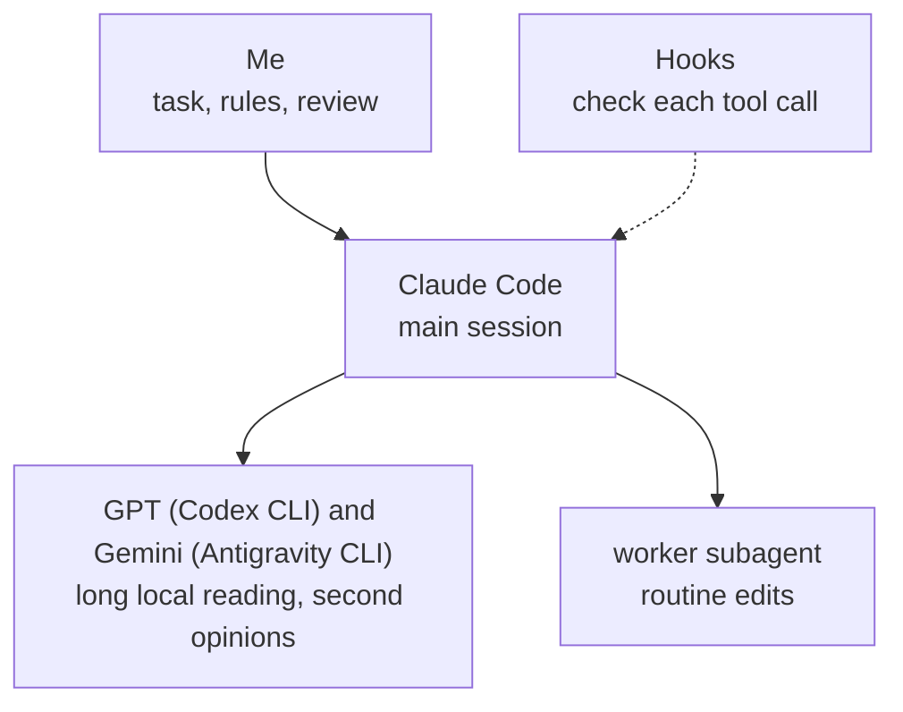

# Features in detail

The parts of the setup that the [README](../README.md) only names.

## Install details

This copies `hooks`, `agents` and `skills` into `~/.claude`, wires the hooks into `~/.claude/settings.json`, writes `~/.claude/CLAUDE.md` if there is none, and creates four project folders under `~/Projects`. When Nimbalyst is installed it also builds the editor extensions (the themes, the usage ring, the command buttons, the agents list) and puts them into Nimbalyst; `--extensions no` leaves them out. It installs four plugins when the `claude` command and Git are there (`claude-hud` on; `claude-code-setup`, `superpowers` and `context7` switched off until a project needs one; `--plugins no` leaves them out), sets the model to Sonnet if you never set one, and adds permission rules so the agent can't read saved sign-ins or SSH keys and asks before it reads a `.env` file. The settings inside Nimbalyst and voice typing need a chat: the run names them, and `/update-setup` carries them out once. A file it replaces is kept as `<name>.before-install-<date>`.

If you already have a Claude Code setup, yours stays. A hook or skill of yours with the same name as one of these is left as it is, and the run ends with the list of those files. `--replace <name>` takes my version of one, and `--replace-all` takes all of them and the rules, for when you want to start over. A run that changed something saves what it printed in `~/.claude/setup-logs`.

- **Without Nimbalyst:** the rules, hooks and skills work in plain Claude Code. The extensions, the session board and `/lead` need Nimbalyst, the editor I run Claude Code in. `question-other`, `command-explain`, `file-link-gate` and `picture-in-project` are written for it too.
- **Mac:** I run the setup on Windows. The tests also run on macOS, but the full install has not been run on a real Mac, and Read Aloud is Windows only.
- **Afterwards:** [docs/HOW-TO.md](HOW-TO.md) says what to type and what you should see.

## Updating details

Every 12 hours the setup asks GitHub whether a newer version is released ([hooks/update-check.mjs](../hooks/update-check.mjs)) and says so in one line. Nothing is downloaded until you type `/update-setup`. That runs [update.mjs](../skills/update-setup/update.mjs): it downloads the release to `~/.claude/setup-source` and runs its installer with the answers you gave the first time.


- **Yours stays yours.** The installer only writes the setup's own files. Skills, hooks, settings and notes you added are not touched, and every replaced file is kept as `<name>.before-install-<date>`.
- **Rules.** A `~/.claude/CLAUDE.md` you never changed is brought up to date. One you changed is replaced only after you say yes.
- **Files of mine that you changed.** The same goes for a hook or a skill from this setup that you edited: it stays as you have it, the update lists it, and `/update-setup` asks whether you want the new version.
- **Without a chat:** `node ~/.claude/skills/update-setup/update.mjs`, or `--check` to only look.
- **Installed before version 1.0.0?** Download the repository once more and run the install again; from then on it updates itself.
- **Off switch:** set `UPDATE_CHECK=off` to stop the check.

## Three models

Long reading of local files and a second opinion go to GPT and Gemini through their command-line tools, which run on my other subscriptions. Searching the web stays with Claude, which reads the source that knows the answer. Design and code stay with Claude. `worker-nudge` holds the agent to that: when an uncapped Explore, general-purpose or claude helper is about to start, it is refused and the agent is pointed at one command, [workers/ask.mjs](../workers/ask.mjs), for long local reading, or at the capped `worker` agent for other jobs. That command tries the workers in order (Codex, then Antigravity), skips one that is not installed, switched off or out of usage, prints which one answered and why another was skipped, and tells the agent to do the job itself when none can. So the setup works with either subscription, both or neither. I added it after `scripts/usage-scan.mjs`, which reads the session logs, showed single helper subagents using 0.6 to 4.3 million tokens.



- **The court.** For a hard question or a claim I want tested, I ask all three with [skills/court](../skills/court/SKILL.md). Claude, GPT and Gemini each answer on their own, GPT and Gemini review the answers without knowing who wrote which, and a Claude chair writes the verdict. There is a quick court and a full one, and I pick at the start of each run. I read the verdict and decide. For a piece of writing there is the reader court (`/court readers <file>`): a few readers with different jobs, say a recruiter, an engineer and an outsider, each read it alone and say how it lands with them, and the chair sums up where they agree and what to change.
- **The lead.** For a big task, [skills/lead](../skills/lead/SKILL.md) splits the work across child sessions in Nimbalyst, side by side when their files don't overlap, has a separate session review the result, sends the fixes back and reports what it checked.
- **The blind review.** After a big piece of work, [skills/blind-review](../skills/blind-review/SKILL.md) (also `/blind-review`) hands it to fresh reviewers who see only the original request and the finished result, or only screenshots for a page or screen, never the author's reasoning. Code, a plan, a design, a text, a data result or a screen all work. The reviewers rank the flaws, the author fixes the serious ones, and a new reviewer looks again, up to three rounds, until nothing serious is left.

The rules I give the models are described in [docs/setup.md](setup.md).

## Hooks


Each check is a Node.js hook: a script Claude Code runs around a step, and that can send the step back. Claude Code logs every tool call in a session, and several hooks compare a reply with that log. If you read one file, read [hooks/link-gate.mjs](../hooks/link-gate.mjs). There are 24 hooks in [hooks](../hooks), and each one has an off switch, an environment variable named after it: `LINK_GATE=off` turns off `link-gate`. `PLAN_USAGE_LOGGER=off` and `USAGE_DASHBOARD=off` do the same for the usage logger and the dashboard hook.

### Checks that can send a step back

| Hook | What it sends back |
|---|---|
| `link-gate` | A reply with a link the agent remembered or saw in search results but never opened |
| `question-other` | A question with no box to type my own answer, a "look at this" question with no link to it, or a recommended option that says "Checked:" when no file read or search in the log matches it |
| `command-explain` | The PowerShell tool inside Nimbalyst; a shell command with no plain-words line saying what it does gets a stand-in line and a reminder |
| `file-link-gate` | A reply with a file link Nimbalyst's chat can't open (a relative path, backslashes, `file:///`) |
| `code-review-gate` | A turn that changed three or more code files and is about to end without a `/code-review` |
| `picture-in-project` | A picture shown in the chat from a path that can be cleaned up later or that Nimbalyst can't open enlarged; it copies the picture to the project's `shown` folder and gives the path to use |
| `run-yourself` | A reply that ends with "now open a terminal and run this"; the agent runs it itself |
| `opencli-readonly` | Posting, liking or following from my logged-in accounts through OpenCLI |
| `web-answer-gate` | A reply that says a version or release "may not be available" or "could not be confirmed" when nothing was checked, and a reply that lists two things when I asked for ten; the message names the lookup that answers it |
| `web-worker-gate` | A web search handed to a free worker. Web research stays with Claude, which reads the source that knows the answer: the project's own page, or the site's catalogue API |
| `slow-output-gate` | A command that runs for minutes with its output piped straight into `head` or `tail`, so a cut-off part means running it again; the output is saved to a file first |

### Hooks that keep sessions cheap and safe

| Hook | What it does |
|---|---|
| `big-read-gate` | Large files are read in parts, not whole |
| `worker-nudge` | Sends long local reading to a free worker if one is set up, and other helper jobs to the capped `worker` agent; an uncapped Explore, general-purpose or claude helper is refused every time |
| `loop-warn` | Tells the agent when it repeats the same call |
| `repeat-guard` | Refuses a retry of the same call after the same error came back three times |
| `sql-guard` | Asks before DROP, TRUNCATE, or DELETE and UPDATE without WHERE |
| `cold-cache` | Warns when you come back to a big session after the prompt cache has expired |
| `context-guard` | Warns when a session passes 150k tokens: with a warm cache it says to compact with a focus line, and after an hour idle it says to move to a fresh session. It shows one more line at 200k |
| `handoff-brief` | Rewrites a brief after every reply, so a fresh session can continue |
| `decided-quote` | Refuses a helper's brief that calls something decided without quoting your words |
| `board-nudge` | Offers a board cleanup when many sessions have piled up |
| `update-check` | Says, at most every 12 hours, when a newer version of the setup is released |
| `usage-dashboard-hook` | Typing just `usage` opens the usage dashboard |
| `plan-usage-logger` | Saves the plan percentages every 5 minutes for the forecast |

A hook that hits an error lets the call through. `link-gate` knows that a page was opened, not what it said.

## Sessions


- **A note to a busy session.** Nimbalyst holds a new message until the running reply ends. With [skills/steer](../skills/steer/steer.mjs), `/btw <note>` in a second chat leaves a note that the busy session reads before its next step, and `/ask <question>` answers a question about that session without touching its work. The Commands extension also puts a **Note** button next to Send in every chat box, which sends the typed text the same way.
- **Handoff.** Every step re-sends the whole conversation, so a long session gets expensive. `handoff-brief` rewrites a short brief after every reply, `context-guard` warns at 150k tokens (a session with a warm cache then compacts itself with a focus line that keeps your messages; one idle for over an hour moves on), and `/handoff` moves the work to a fresh session that starts from the brief, so the next message doesn't re-send the long history. The brief also lets the work go on in a GPT or Gemini session when the Claude plan runs out.
- **The board.** Nimbalyst shows every conversation as a card on a board, and Claude moves its own card from Planning to Complete as the work goes. `/board-cleanup` moves the finished ones that were left behind.

<details>
<summary>Screenshot of the board</summary>


</details>

## Usage


- **The forecast.** [extensions/usage-plan](../extensions/usage-plan/README.md) puts a ring on the editor's side bar with the week's usage. Its pop-up shows the weekly and 5-hour limits, the day and hour the week runs out at the current pace, and the daily budget that would make it last.
- **The dashboard.** Typing `usage` opens one HTML file built by [skills/usage-report](../skills/usage-report/SKILL.md) from the logs on the computer, so opening it uses no tokens. It shows tokens by project, model, day and chat, the main chat apart from its subagents, the Codex and Gemini runs each chat started, what the same work would cost at API prices, and this computer's use apart from other use of the same account.

For the forecast, `plan-usage-logger` reads your saved Claude login, `~/.claude/.credentials.json`, and asks api.anthropic.com for the plan percentages.

<details>
<summary>Screenshot of the pop-up</summary>


</details>

## Starter projects


The installer creates four project folders ([projects](../projects)). A request that has nothing to do with the open project isn't worked on there: the agent names the project it belongs to and opens it.

| Project | For | Its own tools |
|---|---|---|
| `claude-settings` | Changing and checking the setup itself | `/setup-audit`, `/usage-report`, `/chat-review`, `/full-review` |
| `ask-anything` | General questions | The court, the picture skill, reading web pages and videos |
| `internet-search` | Finding things online | A finder skill with a fixed order, and its own link gate that accepts only pages that were opened |
| `quick-tasks` | One-off file jobs | A dated folder per job, work on copies, the picture skill |

With Codex installed, `ask-anything` and `quick-tasks` get the picture skill. It has Codex draw an illustration of how something looks or works from a reference photo and a few sourced facts, for example a flat front view of a workbench with its clamps in the right places. A hook shows the result only after it passes a written checklist.

## Rules

[rules/CLAUDE.md](../rules/CLAUDE.md) is read in every session: lead with the answer, do the work yourself, ask one question with options when the choice matters, fix a repeated mistake in the rule that caused it. `/new-project` gives a folder its own `CLAUDE.md`, a `HANDOFF.md` (where the work stands) and a `DECISIONS.md`, and a decision I confirm is written there at once.

## Editor extensions


Five extensions for Nimbalyst. The first three are written in TypeScript and React; the themes and the agents list are plain CSS and a small script.

- [usage-plan](../extensions/usage-plan/README.md) is the ring and the pop-up from the usage section.
- [read-aloud](../extensions/read-aloud/README.md) reads replies aloud with Kokoro, a voice model that runs on the computer. It cleans a reply for speech (no code, no Markdown), and a Python worker speaks it sentence by sentence.
- [commands](../extensions/commands/README.md) puts seven commands behind one button on the side bar: board cleanup, next move, project scan, setup audit, usage report, new project and update setup. In the `claude-settings` folder it also shows chat review and full review, nine in all. A press starts a new session in the open project with that command.
- [ink-themes](../extensions/ink-themes/README.md) adds eleven colour themes with their own fonts and rounder shapes, eight dark and three light, under one **Ink themes** row of the Theme menu.
- [agents-panel](../extensions/agents-panel/README.md) makes the **Agents & commands** list in the right sidebar readable: running helpers and commands on top, finished ones folded behind one line, a taller list you can resize, and each row titled in plain words (a command by its `# WHAT THIS DOES:` line). It also keeps the commit panel below it inside the sidebar when the sidebar is narrow.


## Voice typing


I speak most of my prompts. [Handy](https://handy.computer) types what I say where the cursor is: hold a key, talk, release. The speech model runs on the computer.

```
winget install --id cjpais.Handy -e
```

On a Mac: `brew install --cask handy`. On Windows the full install sets Handy up.
