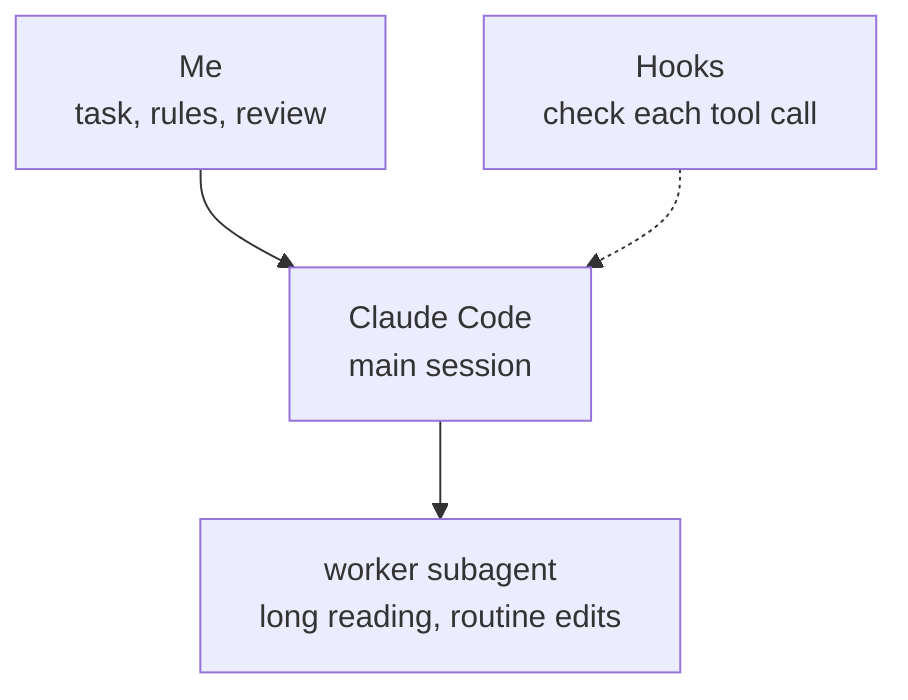

# Features in detail

The parts of the setup that the [README](../README.md) only names.

## Install details

This copies `hooks`, `agents` and `skills` into `~/.claude`, wires the hooks into `~/.claude/settings.json`, writes `~/.claude/CLAUDE.md` whole (rules of your own already in it move to `~/.claude/rules/my-rules.md`, which Claude Code loads in every session too), and creates four project folders under `~/Projects`. When Nimbalyst is installed it also builds the editor extensions (the themes, the usage pop-up, the command buttons, the agents list) and puts them into Nimbalyst; `--extensions no` leaves them out. It installs the `claude-hud` plugin when the `claude` command and Git are there (`--plugins no` leaves it out), sets the model to Opus at medium effort if you never set one, and adds permission rules so the agent can't read saved sign-ins or SSH keys and asks before it reads a `.env` file. The settings inside Nimbalyst and voice typing need a chat: the run names them, and `/update-setup` carries them out once. A file it replaces is kept as `<name>.before-install-<date>`.

The `phone-bot` skill, the `shared-usage` skill and the `read-aloud` extension are add-ons, left out of a default install. `node install.mjs --with phone-bot,shared-usage,read-aloud` (any subset) adds them; a copy already in place stays and keeps being updated by a plain run.

If you already have a Claude Code setup, yours stays. A hook or skill of yours with the same name as one of these is left as it is, and the run ends with the list of those files. `--replace <name>` takes my version of one, and `--replace-all` takes all of them, for when you want to start over. `--leave-out "<lead>"` leaves one of my rules out of `~/.claude/CLAUDE.md` on this and later runs, and `--put-back "<lead>"` brings it back. A run that changed something saves what it printed in `~/.claude/setup-logs`.

- **Without Nimbalyst:** the rules, hooks and skills work in plain Claude Code. The extensions and the session board need Nimbalyst, the editor I run Claude Code in. `/lead` runs its steps as subagents, but keeps its job card in Nimbalyst's tracker. `question-other`, `command-explain`, `file-link-gate` and `picture-in-project` are written for it too.
- **Mac:** I run the setup on Windows. The tests also run on macOS, but the full install has not been run on a real Mac, and Read Aloud is Windows only.
- **Afterwards:** [docs/HOW-TO.md](HOW-TO.md) says what to type and what you should see.

## Updating details

Every 12 hours the setup asks GitHub whether a newer version is released ([hooks/update-check.mjs](../hooks/update-check.mjs)) and says so in a grey line: about every 8 hours while an important release is waiting (with a few bullets from Claude about once a day on what it brings), at most once a day for small ones. With no network it waits under a second, writes why it failed into `~/.claude/update-check.json`, and asks again only after an hour. Small fixes install themselves: a release of only hook, skill, agent or worker files (no restart, no question) is downloaded and put in place in the background, keeping any file you changed, and one grey line says so afterwards (`AUTO_UPDATE=off` stops that). Anything bigger waits until you type `/update-setup`. That runs [update.mjs](../skills/update-setup/update.mjs): it downloads the release to `~/.claude/setup-source` and runs its installer with the answers you gave the first time.


- **Yours stays yours.** The installer only writes the setup's own files. Skills, hooks, settings and notes you added are not touched, and every replaced file is kept as `<name>.before-install-<date>`.
- **Rules.** `~/.claude/CLAUDE.md` is written whole with this version's rules, and a dated copy of the old file is kept. Rules you added yourself are not lost: they move to `~/.claude/rules/my-rules.md`, which Claude Code loads in every session too, and `/update-setup` can offer to tidy that file so it repeats nothing the setup already does.
- **Files of mine that you changed.** The same goes for a hook or a skill from this setup that you edited: it stays as you have it, the update lists it, and `/update-setup` asks whether you want the new version.
- **Disk and files.** An update ends by clearing the setup's own leftovers (worktrees and chat logs from its test runs, its cache and temp folders) and says how much it freed. Your own leftovers and a reorganize of your project files by the file standard are offered on one question card, the first time with the chat archive too: yes runs `/disk-tidy` or `/file-upkeep`, not now leaves them for any time you type the same command.
- **Without a chat:** `node ~/.claude/skills/update-setup/update.mjs`, or `--check` to only look.
- **Installed before version 1.0.0?** Download the repository once more and run the install again; from then on it updates itself.
- **Off switch:** set `UPDATE_CHECK=off` to stop the check, `AUTO_UPDATE=off` (environment or the `env` of `~/.claude/settings.json`) to stop only the self-install of small fixes.

## Where the work goes

Long reading of local files and a second opinion go to the capped `worker` agent, which runs Opus at medium effort; a worker that writes code is `worker-code` on Opus at high, one that reads charts or does science or maths runs Fable at medium, a long refactor goes to `worker-high` on Fable at high, and Sonnet takes only mechanical bulk work. Outside command-line workers used to do this; they often failed or ran out of time and the job went back to Claude anyway, so the work now goes straight to Claude's own helpers. A quick web lookup stays with the main session, which reads the source that knows the answer; research across many pages goes to a `worker` on Opus. The settings hold the agent to that: the installer adds `Agent(Explore)` and `Agent(general-purpose)` to `permissions.deny` in `~/.claude/settings.json`, so those uncapped helpers never start and the work goes to the capped `worker` agent (`worker-full` when a job needs a skill or an MCP tool). So the setup needs no subscription besides Claude. I added it after `scripts/usage-scan.mjs`, which reads the session logs, showed single helper subagents using 0.6 to 4.3 million tokens.



- **The lead.** For a big task, [skills/lead](../skills/lead/SKILL.md) runs a big task from the main session: the `planner` agent writes the plan, and the session turns it into a numbered job list, hands each step to a `worker` agent that knows the goal of the whole job, answers a worker that gets stuck, has one `reviewer` agent check the result and reports what it checked. Everything runs in that main session and its subagents; parallel steps in one folder are subagents in their own git worktree.
- **The blind screen review.** After building or changing a page, screen, menu or chart, [skills/blind-screen-review](../skills/blind-screen-review/SKILL.md) (also `/blind-screen-review`) hands it to one reviewer who sees only screenshots of every state, never the author's reasoning. Code, plans and text go to the `reviewer` agent instead. The reviewer ranks the flaws, the author fixes the serious ones, and the same reviewer looks again, up to two rounds, until nothing serious is left.

The rules I give the models are described in [docs/setup.md](setup.md).

## Agents

Eight agents in [agents](../agents). The main session starts them with the Agent tool; the uncapped built-in helpers are denied in the settings, so the work comes to these.

| Agent | What it does |
|---|---|
| `planner` | Writes the plan for a build or design request, in every project, on the strongest model. It reads files and changes nothing, and gets the situation without the main session's own idea of the answer. When it starts, you see a line saying a plan takes 5 to 30 minutes |
| `plan-reviewer` | One independent read-only pass over a big job's plan before I see it, on Fable. It holds every row against my words and the decisions, checks that each file has one owning step and every open item is placed, and runs the plan's read-only checks. It reports only what it could prove as Important, the rest as Unsure |
| `worker` | Does one numbered step of a job, or one clear one-off job, on Opus at medium effort (Fable at medium for charts, science or maths), and stops after 80 turns. It knows the goal of the whole job. It starts without the `CLAUDE.md` files and with file, shell and web tools only, so its brief names the project commands it needs. It stays inside the files it was given, reports anything else it notices, and stops with a `BLOCKED` line when what it finds contradicts the plan |
| `worker-full` | The same worker with every tool and the `CLAUDE.md` files loaded. It costs much more to start, so it is for a step that needs a skill or an MCP tool such as the browser |
| `worker-code` | The same worker on Opus at high effort, for a step that writes or changes code. A long refactor that is not mechanical goes to `worker-high` instead |
| `worker-high` | The same worker on Fable at high effort, told the code is its own to shape and to keep going until the step is done, for a long refactor that is not mechanical: a change to an interface, signature, type, data shape or module split that code in other files depends on, with dependents too many or too scattered to list, or a refactor step that already failed its check on `worker-code`. A rename is never a reason, whatever its size. It costs far more per step, so everything else stays on `worker` |
| `reviewer` | One independent read-only pass over a finished bigger change, on Fable. It reads the request first and the code after it, and reports under two headings: what is missing or wrong against the request, and the quality of the change, each problem tagged Important (a bug the change brings in, with the realistic input or use that triggers it), Nit (a small thing, or a bug that needs an unlikely chain of events) or Pre-existing (already wrong before the change). One is enough on any change |
| `rec-check` | A second look at a recommended option before a question reaches me. It tries to break the pick: is it a smaller or safer path than I asked for, is an option missing, does the reason rest on a note instead of the live thing, should it have been decided and not asked. It answers `keep` or `change` in six lines at most |

## Systems map

A project with 100 or more code files gets a dictionary of its parts and what connects to what, in `.claude/systems-map.json`. A part is something a person would name out loud (a feature, a service, a screen, a data store, a background job), not a folder. A link says that changing one part means looking at the other, and names the code that does it. [skills/systems-map](../skills/systems-map/SKILL.md) builds the map, refreshes it when files have moved, and looks things up with `map.mjs`: `--scan` to start a build, `--near <word>` for a part with its links, `--check` for listed paths that no longer exist and for links whose code changed. A link can name its kind (`uses`, `feeds`, `spends`, `opens`, `boosts`, `limits`) and the token in a file that proves it; a part can have a group and words that match a brief.

Four hooks run it. `map-nudge` notices a big project without a map and has the agent start a background worker that builds one, so nobody has to ask. `map-brief` adds to each helper's brief only the lines for the parts that brief is about, so the helper doesn't search for files or load a whole graph: the top 3 parts in full, and one line with the start files for every further match, up to 7,000 characters. `map-drift` notices an edit that removes the token a link rests on and tells the agent to check that link before it is done. `map-generated` refuses a hand edit of a file a script writes, listed under `generated` in the map, and names the script to change and rerun instead, so a fact has one home and the next run can't quietly undo it.

## Hooks


Each check is a Node.js hook: a script Claude Code runs around a step, and that can send the step back. Claude Code logs every tool call in a session, and several hooks compare a reply with that log. If you read one file, read [hooks/link-gate.mjs](../hooks/link-gate.mjs). There are 41 hooks in [hooks](../hooks), and each one has an off switch, an environment variable named after it: `LINK_GATE=off` turns off `link-gate`. `PLAN_USAGE_LOGGER=off` and `USAGE_DASHBOARD=off` do the same for the usage logger and the dashboard hook. The settings some hooks take beyond that are listed [below the tables](#hook-settings).

### Checks that can send a step back

| Hook | What it sends back |
|---|---|
| `link-gate` | A reply with a link the agent remembered or saw in search results but never opened |
| `question-other` | A Nimbalyst form with a question that has no box to type my own answer. Nimbalyst shows a form the moment it is sent, so the other faults (a choice with one option, a "look at this" question with no link, an unbacked "Checked:" or a recommendation no `rec-check` agent looked at) go back to the agent as a note to fix in its reply. Nimbalyst's question card, which has a typing box on every question, is never refused |
| `command-explain` | Never refuses: a shell command with no plain-words line saying what it does gets a stand-in line and a reminder, and a line that starts in lowercase or runs 70 characters or more gets a note. On Windows with Git Bash the installer turns the PowerShell tool off (`CLAUDE_CODE_USE_POWERSHELL_TOOL=0`), since Nimbalyst's permission popup shows only the word "PowerShell" for it |
| `file-link-gate` | A reply with a file link Nimbalyst's chat can't open (a relative path, backslashes, `file:///`). Only inside Nimbalyst: in the terminal it never refuses |
| `no-response-gate` | A reply to a message you typed that has no text, or only "No response requested."; and a `/btw` question that was only forwarded to another session without an answer. It is sent back once to answer you. When a turn was cut off before it answered, the next message reminds the agent of the unanswered one. Thanks and other short acknowledgements pass (`NO_RESPONSE_GATE=off` turns it off) |
| `next-step-gate` | A turn that ends on a next step of the agent's own ("Next: ...") while it waits on nothing from you; it is sent back once per step to carry on or name the real reason it stops. A reply that ends in a question, asks you for something, or hands off to a fresh session passes |
| `verify-gate` | A turn that edited a code file and ended with no build or test run after the last edit; it asks for one run and never runs a command itself |
| `transcript-check` | At the start of a session, says out loud when a new Claude Code changed the transcript format the hooks read |
| `code-review-gate` | A piece of work about to end with no `reviewer` agent having looked: 10 or more code files over a session, two or more helpers that edited code, or hooks, settings or CI files. It reads the transcript and git (files another open session edited are left out), so nobody has to remember or ask well, and it asks for one reviewer by itself. A `git push`, `gh release` or `npm publish` with such work and no review since is refused too |
| `picture-in-project` | A picture shown in the chat from a path that can be cleaned up later or that Nimbalyst can't open enlarged; it copies the picture to the project's `shown` folder and gives the path to use |
| `browser-visible-gate` | Opening a Nimbalyst browser session with `headless: false`: that tab shows no window, so the agent is pointed to the `site-login` skill, which opens a real window to sign in |
| `run-yourself` | A reply that ends with "now open a terminal and run this"; the agent runs it itself |
| `opencli-readonly` | Posting, liking or following from my logged-in accounts through OpenCLI |
| `web-answer-gate` | A reply that says a version or release "may not be available" or "could not be confirmed" when nothing was checked, and a reply that lists two things when I asked for ten; the message names the lookup that answers it |
| `slow-output-gate` | A command that runs for minutes with its output piped straight into `head` or `tail`, so a cut-off part means running it again; the output is saved to a file first |
| `planner-readonly` | A shell command from the `planner` agent that would change a file; the planner may look at git, file lists and the systems map, never change them |

### Hooks that keep sessions cheap and safe

| Hook | What it does |
|---|---|
| `big-read-gate` | Large files are read in parts, not whole; a refused Markdown file comes with its list of headings and their lines, so the right part is read next. A Word, PowerPoint or Excel file is refused with the command that turns it into Markdown once (when `uvx` is installed) |
| `budget-gate` | Refuses a worker brief that states a budget of more than 50 tool calls, so a big step is split in two |
| `helper-stopped` | When a helper comes back cut off at its turn limit or with no report, tells the agent to ask it once what is done and what is left, and to check the files itself; a cut-off reviewer counts as not run |
| `repeat-guard` | Refuses a retry of the same call after the same error came back three times, and tells the agent when it repeats the same call or edits or reads one file over and over |
| `sql-guard` | Asks before DROP, TRUNCATE, or DELETE and UPDATE without WHERE |
| `push-key-scan` | Asks before a `git push` whose new lines hold something shaped like a key or token (`sk-ant-`, `ghp_`, an AWS key id, a private key block) or add a `.env` or private key file; quoted text and the explain line are not read as a push |
| `cold-cache` | Warns when you come back to a big session after the prompt cache has expired |
| `context-guard` | Past 150k tokens it tells Claude, not you, to batch its work, and after an hour idle to move to a fresh session. At about 200k Claude Code compacts the session by itself, and this hook gives it the focus line. You see a line only when a session is about to compact, or has passed 300k without compacting |
| `form-answer` | After you answer a question form, reminds the agent that what you typed outweighs what you ticked, and that a tick against your words is asked about before it counts as decided |
| `handoff-brief` | Rewrites a brief after every reply, so a fresh session can continue |
| `decided-quote` | Refuses a helper's brief that calls something decided without quoting your words |
| `map-brief` | Adds to a helper's brief (worker, worker-full, worker-code, worker-high, reviewer, plan-reviewer or planner) the lines of the project's systems map for the parts that brief touches, and only those; a project with no map gets nothing |
| `map-nudge` | In a project with 100 or more code files and no systems map, has the agent start a background worker that builds one; it asks at most three times, a week apart, and does the same once a week for a map whose files are mostly gone or changed under a link |
| `map-drift` | After an edit to a file that backs a link of the systems map, says when the token the link rests on is gone, so the agent checks that link and fixes or drops it before it is done |
| `map-generated` | Before an edit of a file a script writes (listed under `generated` in the systems map), refuses it and names the script and the command that reruns it |
| `nimbalyst-notes` | At the start of a session inside Nimbalyst, tells the agent two quirks of Nimbalyst's tools, so they don't sit in the rules of every session. Silent in the terminal |
| `pc-tidy-nudge` | On Windows, says to restart Nimbalyst after 12 hours open and points to `/pc-tidy`; on every system, runs the chat archive every 3 days once you said yes to it |
| `update-check` | Says when a newer version of the setup is released (checked every 12 hours), and lets a small release of only hook, skill, agent or worker files install itself in the background |
| `usage-dashboard-hook` | Typing just `usage` opens the usage dashboard (inside Nimbalyst it refreshes the data and says where to click) |
| `plan-usage-logger` | Saves the plan percentages every 5 minutes for the forecast |
| `background-tasks` | When Nimbalyst's "background tasks have settled" prompt only repeats tasks already reported, tells the agent to reply with one line while work still runs and one complete answer when it is done, refuses every background helper from the main session (helpers that run side by side go as foreground calls in one message, since a background helper dies when the turn ends), refuses a background command unless the description says it runs `beside` another step, another background task is still running, or it is a server or watcher, sends back a reply that obeyed a "user doesn't want to take this action" the app gave in a turn the user didn't start, so the call is sent again (a reply that says a helper still runs or that it waits for one, while no helper or background command of the session is live, is sent back once; BACKGROUND_TASKS=warn turns the refusal into a note; in the desktop app and VS Code, which always run helpers in the background, a helper launch gets the note) |
| `agent-run-log` | Writes one line per helper to `~/.claude/state/agent-runs.jsonl` with the model and effort it runs on, so the agents panel can show them. It sends nothing back (`AGENT_RUN_LOG=off` turns it off) |
| `patch-next` | At the start of a session in a project that has `docs/patches/next.md`, shows that shared release list, so parallel sessions each add their line and the session that ships includes every one. Silent in other projects (`PATCH_NEXT=off` turns it off) |
| `job-done` | After a commit or merge in the main session, says that with steps of the job left the next one starts in a fresh session Claude opens itself (one piece per session); after a commit, tag or push in a session over 100k tokens, points a new job to a fresh session, once per commit |
| `worker-size` | Tells a helper whose context passed 150k tokens to finish the step in hand and report; a `worker`, `worker-full`, `worker-code` or `worker-high` helper past 180k gets 3 more calls of other tools, then those are refused until it reports, so it never reaches the compaction that loses work; Write and Edit still pass until 190k and use none of the 3, so work it has only in its head reaches disk (`WORKER_STOP_K`, `WORKER_STOP_GRACE`, `WORKER_SAVE_K`) |

A hook that hits an error lets the call through. `link-gate` knows that a page was opened, not what it said.

### Hook settings

Set these in your shell or system environment. The first four are also read from `env` in a project's `.claude/settings.json`, so one project can differ.

| Setting | What it does |
|---|---|
| `VERIFY_GATE=off` | Turns off `verify-gate`, for a project whose build or test is slow |
| `VERIFY_PATTERN` | A regular expression, matched without regard to case against the whole shell command; it replaces `verify-gate`'s list of build and test commands |
| `CODE_REVIEW_GATE=off` | Turns off `code-review-gate` (for a script that runs `claude -p` on code); `led` counts no git files |
| `REVIEW_PUSH_PATTERN` | A regular expression for more commands that `code-review-gate` treats as a push, next to `git push`, `gh release` and `npm publish` |
| `NIMBALYST_NOTES=off` | Turns off `nimbalyst-notes` |
| `MAP_NUDGE=off` | Turns off `map-nudge`, which has the agent start a background worker to build or refresh a project's systems map |
| `MAP_DRIFT=off` | Turns off `map-drift` |
| `MAP_GENERATED=off` | Turns off `map-generated` |
| `BIG_READ_MAX_LINES` | The longest file `big-read-gate` lets be read whole, in lines; the default is 350 |
| `BIG_READ_MAX_BYTES` | The same in bytes; the default is 80000 (about 80 KB) |
| `UPDATE_CHECK=off` | Turns off the version check |
| `AUTO_UPDATE=off` | Small fixes no longer install themselves; they wait for `/update-setup` (also read from the `env` of `~/.claude/settings.json`) |

## Sessions


- **A note to a busy session.** Nimbalyst holds a new message until the running reply ends. With [skills/steer](../skills/steer/steer.mjs), `/btw <note or question>` in a second chat leaves a note that the busy session reads at once, holding only a slow or consequential next step (a helper launch, a question, a long command) until it has read it, a session waiting on a background job is woken to read it without stopping the job, and a question answers without touching that session's work. The Commands extension also puts a **Note** button next to Send in every chat box, which sends the typed text the same way. A helper gets a copy only while the session waits on it.
- **Handoff.** Every step re-sends the whole conversation, so a long session gets expensive. `handoff-brief` rewrites a short brief after every reply, `context-guard` tells Claude to batch its work from 150k tokens (at about 200k a session compacts itself, mid-work or before the next message, with a focus line that keeps your messages; one under that size idle for over an hour moves on), and `/handoff` moves the work to a fresh session that starts from the brief, so the next message doesn't re-send the long history. The brief also lets the work go on in a GPT or Gemini session when the Claude plan runs out.
- **The board.** Nimbalyst shows every conversation as a card on a board, and Claude moves its own card from Planning to Complete as the work goes. `/board-cleanup` moves the finished ones that were left behind. On Windows, `/pc-tidy` shows what is holding the computer's memory and stops what finished sessions left behind.
- **The disk.** [skills/disk-tidy](../skills/disk-tidy/SKILL.md) (`/disk-tidy`) first reports what fills the disk (leftover worktrees, old chat logs, scratch and temp folders, old project copies, editor backups) and changes nothing; then each item goes only with your tick, checked again just before. Anything with uncommitted or unmerged work is kept and named. Once you say yes to the chat archive, chats older than 60 days move, compressed, to `~/.claude-archive/chats` every 3 days and are deleted there at the age Claude Code deletes live chats (`cleanupPeriodDays`). `--keep-forever "<project folder>"` keeps a project's chats archived and never deleted, `--archive-list` finds an archived chat, `--restore <id>` brings it back before `/resume`, and `--archive-off` stops the archive.
- **Files.** [skills/file-upkeep](../skills/file-upkeep/SKILL.md) (`/file-upkeep`) holds the file standard ([standard.md](../skills/file-upkeep/standard.md): names, places, where old decisions and handoffs go) and a checker that lists misnamed and misplaced files in a project. The reorganize moves them after your yes, records every rename and move in a ledger, fixes the references to them in the same pass, and can be undone. `/new-project` starts new projects on the standard.

<details>
<summary>Screenshot of the board</summary>


</details>

## Usage


- **The forecast.** [extensions/usage-plan](../extensions/usage-plan/README.md) adds a button to the editor's side bar that opens a pop-up. It shows this week's usage and the 5-hour limit's usage as bars, a forecast line, and the budget and your pace side by side. The forecast line gives the day and hour the week runs out at the current pace; the budget is the daily amount that would make it last.
- **The dashboard.** Typing `usage` opens one HTML file built by [skills/setup-audit](../skills/setup-audit/usage.md) from the logs on the computer, so opening it uses no tokens. It shows tokens by project, model, day and chat, the main chat apart from its subagents, the Codex and Gemini use found on the computer, what the same work would cost at API prices, and this computer's use apart from other use of the same account.

For the forecast, `plan-usage-logger` reads your saved Claude login, `~/.claude/.credentials.json`, and asks api.anthropic.com for the plan percentages.

<details>
<summary>Screenshot of the pop-up</summary>


</details>

## Starter projects


The installer creates four project folders ([projects](../projects)). A request that has nothing to do with the open project isn't worked on there: the agent names the project it belongs to and opens it.

| Project | For | Its own tools |
|---|---|---|
| `claude-settings` | Changing and checking the setup itself | `/setup-audit` with `usage`, `chat`, `full`, `scan`, `outcomes`, `memory` (saved memories checked against the code) |
| `ask-anything` | General questions | The picture skill, reading web pages and videos |
| `internet-search` | Finding things online | A finder skill with a fixed order, and its own link gate that accepts only pages that were opened |
| `quick-tasks` | One-off file jobs | A dated folder per job, work on copies, the picture skill |

With Codex installed, `ask-anything` and `quick-tasks` get the picture skill. It has Codex draw an illustration of how something looks or works from a reference photo and a few sourced facts, for example a flat front view of a workbench with its clamps in the right places. A hook shows the result only after it passes a written checklist.

## Rules

[rules/CLAUDE.md](../rules/CLAUDE.md) is read in every session: lead with the answer, do the work yourself, ask one question with options when the choice matters, fix a repeated mistake in the rule that caused it. `/new-project` gives a folder its own `CLAUDE.md`, a `HANDOFF.md` (where the work stands) and a `DECISIONS.md`, and a decision I confirm is written there at once.

## Editor extensions


Seven extensions for Nimbalyst. The first three and the systems map are written in TypeScript and React; the themes, the agents list and Board Tidy are plain CSS and small scripts.

- [usage-plan](../extensions/usage-plan/README.md) is the usage pop-up from the usage section.
- [read-aloud](../extensions/read-aloud/README.md) reads replies aloud with Kokoro, a voice model that runs on the computer. It cleans a reply for speech (no code, no Markdown), and a Python worker speaks it sentence by sentence.
- [commands](../extensions/commands/README.md) puts eight commands behind one button on the side bar: board cleanup, next move, project scan, setup audit, usage report, PC tidy, new project and update setup. In the `claude-settings` folder it also shows chat review and full review, ten in all. A press starts a new session in the open project with that command.
- [ink-themes](../extensions/ink-themes/README.md) adds eleven colour themes with their own fonts and rounder shapes, eight dark and three light, under one **Ink themes** row of the Theme menu.
- [agents-panel](../extensions/agents-panel/README.md) makes the **Agents & commands** list in the right sidebar readable: running helpers and commands on top, finished ones folded behind one line, a taller list you can resize, and each row titled in plain words (a command by its `# WHAT THIS DOES:` line). It also keeps the commit panel below it inside the sidebar when the sidebar is narrow. And a chat you scroll up in stays where you put it while the agent keeps writing, instead of jumping back to the end.
- [board-tidy](../extensions/board-tidy/README.md) keeps the Sessions board to current work. Once an hour, in every project, it archives sessions that are Complete and idle for 3 days, have no phase and are idle for 14 days, or have sat in planning, validating or implementing for 30 days. Pinned, running and worktree sessions stay, and nothing is deleted: Unarchive brings a session back, and Claude can undo the last run. `/board-cleanup` runs it too. A chat-style project, where each chat is its own task you may look up months later, can be kept: nothing there is archived unless you ask ("archive what's older than 6 months there"). The install keeps `quick-tasks`, `/new-project` asks, and "stop tidying this project" or "tidy it again" changes it.
- [systems-map](../extensions/systems-map/README.md) draws the open project's systems map as a graph you can pan, zoom and search, coloured by group, with a card for each part: its files, notes and links. A link whose code changed is marked, and a project with no map gets a button that starts a session to build one.


## Voice typing


I speak most of my prompts. [Handy](https://handy.computer) types what I say where the cursor is: hold a key, talk, release. The speech model runs on the computer.

```
winget install --id cjpais.Handy -e
```

On a Mac: `brew install --cask handy`; the Mac side is untested. On Windows the full install sets Handy up.
