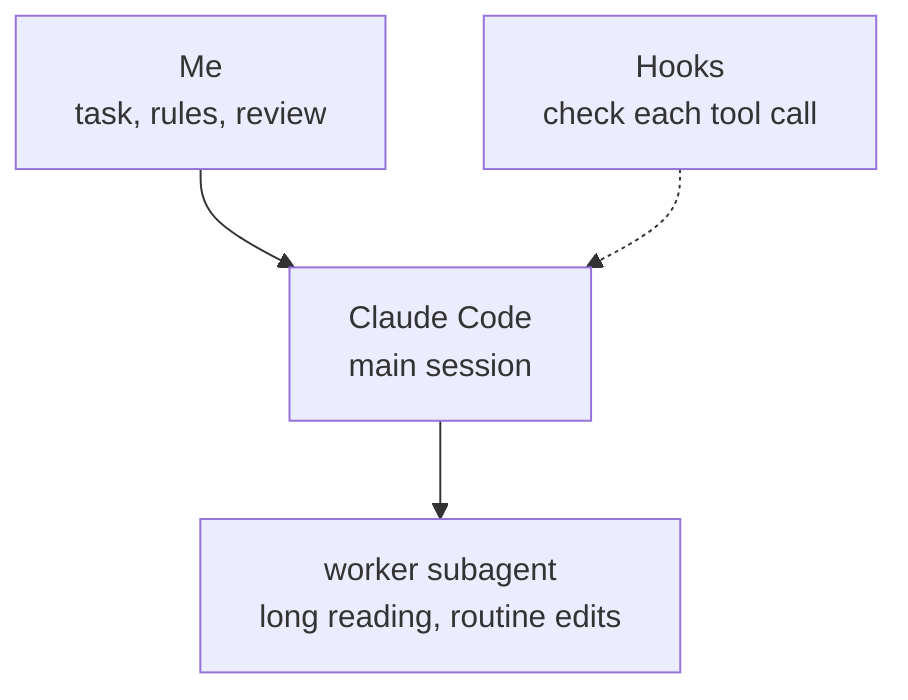

# How I work with coding agents

The hooks in this repository are one part of how I work with coding agents. I set the task and the rules, the tools do the work I hand them, and I review the result and approve anything risky. This page describes the rest of that setup.

## What I do myself

- **I set the task.** I say what I want, what must not change and how the result will be checked. If a requirement is unclear and the choice matters, the rules have the model ask me one question with options instead of guessing.
- **I make the decisions.** Each project has a `DECISIONS.md`. What I decide goes in there with the date, and later sessions read it first and don't reopen it.
- **I approve what's risky.** A shell command I haven't already allowed comes to me as a permission prompt. It has to end with a line in plain words saying what it does, so I know what I'm approving. `sql-guard` asks me before a DROP, a TRUNCATE, or a DELETE or UPDATE without WHERE.
- **I review the result.** The model has to show the check it ran and the output before it calls anything done, and I read both before I accept the work.

## What I hand to each tool

The rule: long reading of local files and second opinions go to a `worker` subagent, which runs Opus at medium effort (`worker-code` on Opus at high for code; Fable at medium for charts, science or maths) and has a budget of tool calls. A quick web lookup stays with the main session. Long reading used to go to outside command-line workers; they often failed or ran out of time and the job went back to Claude anyway, so it now goes straight to Claude's own capped helpers.

| Tool | What I use it for | Limits I set |
|---|---|---|
| Claude Code in the Nimbalyst editor (the main session) | Planning a change with me, writing and editing the code, running the checks | It does what I asked and nothing else: no unrelated refactoring, no extra features |
| `worker` subagent ([agents/worker.md](../agents/worker.md)) | Reading long files and logs, sweeping a project folder, a second opinion on a plan or a diff (about 15 tool calls, the answer is a lead that gets checked), one step of a bigger job, or routine edits that follow a clear plan | Medium effort, no `CLAUDE.md` loaded, and it stops after 80 turns. Its brief has to name the goal of the job, the files and the project commands it needs |
| `worker-full` subagent ([agents/worker-full.md](../agents/worker-full.md)) | The same, for a step that needs a skill or an MCP tool | It loads every tool and the `CLAUDE.md` files, so it costs much more to start |
| `worker-code` subagent ([agents/worker-code.md](../agents/worker-code.md)) | The same as `worker`, for a step that writes or changes code; a long refactor goes to `worker-refactor` | Opus at high effort; otherwise the same limits as `worker` |
| `worker-refactor` subagent ([agents/worker-refactor.md](../agents/worker-refactor.md)) | The same as `worker`, for a long refactor that changes something code in other files depends on, or a long refactor step that failed its check on `worker-code`; a rename alone never counts | Fable at high effort, so each step costs far more; otherwise the same limits as `worker` |
| `reviewer` subagent ([agents/reviewer.md](../agents/reviewer.md)) | One independent check of a finished bigger change, against the request and for quality | It reads files and changes nothing, stops after 60 turns; one for a job, 2 for a big job and 3 at most, each on its own part |
| `blind-reviewer` subagent ([agents/blind-reviewer.md](../agents/blind-reviewer.md)) | A newcomer's look at what a person will see, read or use: screenshots, a text, or a command's output | Fable at high effort; it can only read the files it is handed, never sees the code, plan or chat, and stops after 30 turns |
| `stuck-advisor` subagent ([agents/stuck-advisor.md](../agents/stuck-advisor.md)) | A second opinion when a session is stuck: the same error after 2 fixes, a choice the plan left open, a risky change | Fable at high effort; it reads files and changes nothing, stops after 20 turns, at most 3 calls a session |
| `planner` subagent ([agents/planner.md](../agents/planner.md)) | The plan for every build or design request, written by the strongest model before the main session starts on it | It reads files and runs only read-only commands (a hook refuses the rest), changes nothing, stops after 40 turns, and gets the situation without the main session's own idea of the answer |
| `plan-reviewer` subagent ([agents/plan-reviewer.md](../agents/plan-reviewer.md)) | One independent check of a big job's plan before it reaches me | It reads files, runs the plan's checks that only read or test, and changes no files, stops after 40 turns |

Long reading costs the most on the main model, which is why it goes to a `worker` subagent. A quick web lookup stays with Claude, which reads the page or the catalogue that knows the answer; deep research across many pages in a planned job goes to a `worker` on Opus. For a larger task I use a [skill](../skills/lead/SKILL.md) that runs it from the main session: the `planner` agent writes the plan, and the session turns it into a numbered job list, hands each step to a worker that knows the goal of the whole job, and has a reviewer check the result (2 or 3 on a big job, plus a `blind-reviewer` when a person will see it), so what comes back to me has already been checked once.

## The rules I wrote

A global instruction file holds the rules for every session. The file is [rules/CLAUDE.md](../rules/CLAUDE.md), and the installer puts it at `~/.claude/CLAUDE.md`. The main ones:

- Ask when a requirement is unclear and the choice matters. For a small, reversible choice, pick a default and say so.
- Do what was asked: no unrelated refactoring, no features nobody asked for.
- Nothing is called done without a real check and its output.
- Long reading of local files goes to a worker, and deep web research to a worker too. Planning goes to the planner, the final check to the reviewer, and the decisions stay in the main session.
- Every subagent gets the inputs it needs and a budget of tool calls, and reports back when the budget runs out.
- Large files are read in parts, and big command output is processed outside the conversation.

## Rules that became hooks

Written rules were sometimes skipped: a large file was read whole, or a search subagent was started anyway. I saw it in the numbers. `scripts/usage-scan.mjs` reads the session transcripts and reports tokens per session and per subagent, and it showed search subagent runs using 0.6 to 4.3 million tokens each. So I turned each rule that mattered into a hook, a script that runs around a tool call and can block it.

| When | Hook | Rule it enforces |
|---|---|---|
| Before a file read or shell command | `big-read-gate` | Read large files in parts (a Markdown file shows its headings) |
| Before a shell command | `command-explain` | Explain the command in plain words; a command without that line runs with a stand-in line, and the agent is reminded |
| Before a shell command | `sql-guard` | Confirm destructive SQL with me |
| Before a shell command | `delete-guard` | Bulk deletes are refused, deleting a named file passes; temp and worktree folders pass (`DELETE_GUARD=off`) |
| Before a shell command | `long-sleep-guard` | One sleep over 60 seconds is refused, and so is a helper's poll loop whose rounds sleep over 60 seconds (`LONG_SLEEP_GUARD=off`, `=warn`) |
| Before a shell command | `find-guard` | A search through a whole drive or the home folder is refused unless its depth is 3 or less (`FIND_GUARD=off`) |
| Before a shell command | `download-guard` | A plain download of a file over 50 MB runs through `workers/download.mjs`: 32 byte ranges side by side, resume, sha256 (`DOWNLOAD_GUARD=off`) |
| Before a push | `push-key-scan` | A push that would send a key or token, or a `.env` file, asks me first |
| Before a shell command | `opencli-readonly` | In my signed-in browser, only read: never post, like, follow or log in |
| Before a picture is shown in the chat | `picture-in-project` | The picture is shown from the project's `shown` folder, so it still loads after a cleanup and a click opens it enlarged |
| Before a Nimbalyst browser session opens | `browser-visible-gate` | A `headless: false` session shows no window you can see, so it is refused and the `site-login` skill is named: it opens a real window to sign in, which closes by itself once you are in |
| Before a question to me | `question-other` | A card with a plan-row id such as B6 I didn't use, or one that asks no decision, is refused with what to write instead (at most twice in a row; labels listed in the project's `.claude/card-labels.txt` always pass). A question I can't type my own answer to, a missing link, a choice with two recommended options or with one option goes to the agent as a note to fix in its reply. In Nimbalyst a start note sends a quick yes/no or pick-one to its question card, which always has a typing box, and everything else into the reply |
| After I answer a question | `form-answer` | What I typed outweighs what I ticked, and a tick against my words is asked about before it counts as decided (`FORM_ANSWER=off`) |
| Before a file edit, read or shell command | `repeat-guard` | On the second identical error, a note to find what both tries took for granted or call the `stuck-advisor`; refuse a retry of the same call after the same error came back three times, naming the advisor while its calls last; and remind once when one file is edited six times or read four times in a turn, or the same call is repeated |
| When I send a message | `context-guard` | Past 150k tokens, tell Claude (not me) to batch the work, and after an hour idle to move to a fresh session |
| When a reply ends | `context-guard` | Show me one line when a session has passed 300k tokens without compacting; it never stops the session |
| After a helper returns | `helper-stopped` | A helper cut off at its turn limit or with no report is asked once what is done and left, and the files are checked; a cut-off reviewer counts as not run (`HELPER_STOPPED=off`) |
| When I send a message | `cold-cache` | Warn when I come back to a session over 100k tokens after the prompt cache has expired (55 minutes), because the next message pays for the whole history again |
| When I send a message | `pc-tidy-nudge` | Run the chat archive every 3 days once it was turned on (`/disk-tidy`, `--archive-off` stops it) |
| When I send a message | `update-check` | Say when a newer version of the setup is released (checked every 12 hours), and let a small release of only hook, skill, agent or worker files install itself in the background; a notice about a coming release is shown once (`UPDATE_CHECK=off`; `AUTO_UPDATE=off` stops only the self-install) |
| When I send a message | `usage-dashboard-hook` | Typing just `usage` opens the usage dashboard without a model call (inside Nimbalyst it refreshes the data and says where to click) |
| While a session runs | `plan-usage-logger` | Save the plan's 5-hour and weekly percentages every 5 minutes, for the usage forecast |
| Before a reply goes out | `link-gate` | No link that wasn't opened in this session |
| Before a reply goes out | `file-link-gate` | File links are written in the form Nimbalyst's chat can open (an absolute path with forward slashes); only inside Nimbalyst |
| Before a reply goes out | `code-review-gate` | Work that changed 10 or more code files over a session, in which two or more helpers edited code, or that changed hooks, settings or CI files gets a `reviewer` agent before it ends (split by part on a big job, with a `blind-reviewer` when a person will see the result) |
| Before a reply goes out | `verify-gate` | A turn that edited a code file ends only after a build or test ran following the last edit; the gate asks once per turn and never runs the command itself (`VERIFY_GATE=off` and `VERIFY_PATTERN` for a project's own commands) |
| Before a push or release | `code-review-gate` | A `git push`, `gh release` or `npm publish` is refused while the work since the last review is due one (`REVIEW_PUSH_PATTERN` adds commands) |
| When a session starts | `nimbalyst-notes` | Inside Nimbalyst, the agent is told two quirks of its tools; nothing in the terminal (`NIMBALYST_NOTES=off`) |
| When a session starts | `experiment-alert` | I am told when `~/.claude.json` lists an experiment or feature flag it hasn't listed before, by name only (`EXPERIMENT_ALERT=off`) |
| When a session starts | `recheck-dates` | I am told, once a day per folder, which facts in the notes, rules or memory are past their `(recheck YYYY-MM-DD)` date (`RECHECK_DATES=off`) |
| Around a shell command and when a session ends | `session-cleanup` | A session closes what it started (dev servers, watchers, headless browsers, background shells) and lists the worktrees other sessions left; worktrees are never removed. It never closes or records a process whose command line holds `tools/nimbalyst-patch/`, the Nimbalyst update. Report mode first: it only logs what it would close until `SESSION_CLEANUP=on` (`=off` stops it; `SESSION_CLEANUP_IDLE_HOURS`, default 3, is when a silent session counts as ended) |
| Before a reply goes out | `run-yourself` | A reply that tells me to run a command is sent back once, so the agent runs it |
| After each reply | `handoff-brief` | Keep a brief so a new session can continue |
| Before a helper starts or a handoff note is written | `decided-quote` | A brief that says I decided something quotes my own words next to it; the first try is refused, the identical retry goes through |
| Before a helper starts | `map-brief` | A helper's brief gets the lines of the project's systems map for the parts it touches, and only those |
| Before a helper starts | `serves-brief` | A helper's brief that names a plan file and a step gets that row's Serves cell, my words on what the row is for; a reviewer's brief gets every row's cell. A row with no quoted purpose gets a visible line saying so; a worker's start is refused when the row names a thing listed under `## What each thing is for` in `DECISIONS.md` without my words for it, or limits it without a `NARROWED` mark (`SERVES_BRIEF=off`) |
| When I send a message | `background-tasks` | When Nimbalyst's "background tasks have settled" prompt only repeats tasks already reported, have the agent reply with one line while work still runs and one complete answer when it is done (`BACKGROUND_TASKS=off`) |
| Before a background launch | `background-tasks` | Add a note on what a background command or helper costs, that the foreground is the default, and that a finished job's notice gets no reply of its own while other work still runs |
| When I send a message | `job-done` | After a commit, tag or push in a session over 100k tokens, a new job is pointed to a fresh session; and right after a commit or merge, with steps of the job left, Claude hands the next one to a fresh session it opens itself (`JOB_DONE=off`) |
| Before a commit, a helper or a reply end | `job-done` | A session that claimed a plan row does that one piece: its next commit or a helper for another row is refused once, and its turn end is held once until it hands off |
| After a helper's tool call | `worker-size` | A helper past 150k tokens of context is told to finish the step in hand and report (`WORKER_SIZE=off`) |
| When I send a message | `map-prompt` | My message gets the names and first files of the systems map's how-to things and topics it asks about |
| When I send a message | `map-nudge` | A project with 100 or more code files and no systems map gets one built by a background worker |
| Before an edit | `map-generated` | A hand edit of a file a script writes is refused, with the script to change and rerun (`MAP_GENERATED=off`) |
| After an edit | `map-drift` | An edit that removes the code a map link rests on is named, so the agent checks that link (`MAP_DRIFT=off`) |

The uncapped search subagents are now stopped by the settings, not a hook: the installer puts `Agent(Explore)` and `Agent(general-purpose)` in `permissions.deny`. The scanner counts how often `big-read-gate` stopped a whole-file read. I use the scanner's counts to decide which rule needs a hook next. The wiring is in [settings.example.json](../settings.example.json).

## Long sessions

A long session sends its whole history again on every step, so every step costs more. From 150k tokens `context-guard` tells Claude to take fewer, batched steps. The [handoff skill](../skills/handoff/SKILL.md) writes a short brief (goal, state, next step, files) and the new session starts from it. `handoff-brief` also rewrites that brief after every reply, so one exists even when a session ends unexpectedly.

Each project keeps three short files that a new session reads first: `CLAUDE.md` (rules and commands for the project), `HANDOFF.md` (current state and what's next) and `DECISIONS.md` (what I decided and when).

## The systems map

A project with 100 or more code files gets a map of itself: a dictionary of its parts and what connects to what, saved in the project as `.claude/systems-map.json`. You don't write it. `map-nudge` has the agent start a background worker that builds it from [skills/systems-map](../skills/systems-map/SKILL.md), and the agent tells you in one line. After that `map-brief` adds to each helper's brief only the lines for the parts the brief touches, so a helper knows what its change connects to without searching for files or loading a whole graph. A project with fewer code files gets neither, and the map file is yours to read, edit or delete. A brief that ends with the line `SYSTEMS MAP: none` is left without map lines. When an edit removes the code a link rests on, `map-drift` names the link, so the map is fixed in the same session. `map-prompt` adds to your own message the how-to things and topics it asks about, each with its first files, once a session. In Nimbalyst the systems-map extension draws the map. A file a script writes is listed under `generated` in the map: `map-generated` refuses a hand edit of it, and the map's `--check` names one edited by hand since its script last ran. `MAP_NUDGE=off`, `MAP_BRIEF=off`, `MAP_PROMPT=off`, `MAP_DRIFT=off` and `MAP_GENERATED=off` turn the five hooks off.

## Disk and files

The setup cleans up after itself: an update clears its own leftovers (worktrees and chat logs from its test runs, its cache and temp folders) and says how much it freed. What is yours it only offers, on one question card: your own leftovers go through [`/disk-tidy`](../skills/disk-tidy/SKILL.md), which reports first and removes only what you tick, and a reorganize of your project files goes through [`/file-upkeep`](../skills/file-upkeep/SKILL.md), which checks names and places against [a file standard](../skills/file-upkeep/standard.md) and keeps a ledger to undo it. Not now leaves both for any time later. Once you say yes to the chat archive, chats older than 60 days move to `~/.claude-archive/chats` every 3 days; `--keep-forever` keeps a project's chats for good, and `--restore` brings one back.

## Nimbalyst updates

On Windows, Nimbalyst updates through the setup, not by itself. A patch turns Nimbalyst's own updater off, and every patch run applies it first: without it, no other patch goes in. The setup pins the Nimbalyst version it delivers in `tools/nimbalyst-patch/pin.json`. After an update, `/update-setup` gets that version ready with `deliver.mjs`: it is installed and patched when I close Nimbalyst, or at once through one restart card, which runs `restart.mjs` (it closes Nimbalyst, installs, patches and opens it again). `node ~/.claude/tools/nimbalyst-patch/deliver.mjs --off` or `NIMBALYST_FOLLOW=off` stops this. `/pc-tidy` and `session-cleanup` never stop a process whose command line holds `tools/nimbalyst-patch/`, so an update that waits for Nimbalyst to close is left alone.

## Asked once at install

The full install ([full-install.md](full-install.md)) asks two questions once and keeps both answers in `~/.claude/setup-state.json`, so no update asks them again. A "no" is fine: everything works without them.

- **Voice typing.** A yes installs [Handy](https://handy.computer) and sets it up; a Handy already on the computer counts as a yes and is left as it is. The answer only stops the question: Handy itself is yours to add or remove any time (`winget install --id cjpais.Handy -e`, on a Mac `brew install --cask handy`). To change the answer on record, run `node install.mjs --handy yes` or `--handy no` in the setup's folder; that run neither installs nor removes Handy.
- **The encrypted backup.** A yes runs [`/backup`](../skills/backup/SKILL.md) as the last step of the install. After a no, `/backup` sets it up any time. `/backup off` stops the schedule and deletes nothing. `node ~/.claude/skills/update-setup/update.mjs --backup no` puts a no on record and runs nothing else. An install from before this question is asked about the backup once, on its next `/update-setup`.

## Add-ons

Two pieces are opt-in and left out of a default install: the `phone-bot` skill and the `read-aloud` extension. `node install.mjs --with phone-bot,read-aloud` adds either or both, and a copy already in place stays and keeps being updated by a plain run.
