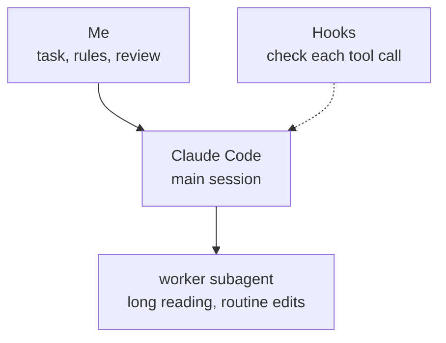

# How I work with coding agents

The hooks in this repository are one part of how I work with coding agents. I set the task and the rules, the tools do the work I hand them, and I review the result and approve anything risky. This page describes the rest of that setup.

## What I do myself

- **I set the task.** I say what I want, what must not change and how the result will be checked. If a requirement is unclear and the choice matters, the rules have the model ask me one question with options instead of guessing.
- **I make the decisions.** Each project has a `DECISIONS.md`. What I decide goes in there with the date, and later sessions read it first and don't reopen it.
- **I approve what's risky.** A shell command I haven't already allowed comes to me as a permission prompt. It has to end with a line in plain words saying what it does, so I know what I'm approving. `sql-guard` asks me before a DROP, a TRUNCATE, or a DELETE or UPDATE without WHERE.
- **I review the result.** The model has to show the check it ran and the output before it calls anything done, and I read both before I accept the work.

## What I hand to each tool

The rule: long reading of local files and second opinions go to a `worker` subagent, which runs Sonnet and has a budget of tool calls. Searching the web, design and code stay with the main session. Long reading used to go to outside command-line workers; they often failed or ran out of time and the job went back to Claude anyway, so it now goes straight to Claude's own capped helpers.

| Tool | What I use it for | Limits I set |
|---|---|---|
| Claude Code in the Nimbalyst editor (the main session) | Planning a change with me, writing and editing the code, running the checks | It does what I asked and nothing else: no unrelated refactoring, no extra features |
| `worker` subagent ([agents/worker.md](../agents/worker.md)) | Reading long files and logs, sweeping a project folder, a second opinion on a plan or a diff (about 15 tool calls, the answer is a lead that gets checked), one step of a bigger job, or routine edits that follow a clear plan | A smaller model, no `CLAUDE.md` loaded, and it stops after 80 turns. Its brief has to name the goal of the job, the files and the project commands it needs |
| `worker-full` subagent ([agents/worker-full.md](../agents/worker-full.md)) | The same, for a step that needs a skill or an MCP tool | It loads every tool and the `CLAUDE.md` files, so it costs much more to start |
| `reviewer` subagent ([agents/reviewer.md](../agents/reviewer.md)) | One independent check of a finished bigger change, against the request and for quality | It reads files and changes nothing, stops after 40 turns, and one is enough |
| `rec-check` subagent ([agents/rec-check.md](../agents/rec-check.md)) | A second look at a recommended option before a question reaches me | It reads files and changes nothing, stops after 8 turns, and answers keep or change |
| `planner` subagent ([agents/planner.md](../agents/planner.md)) | The plan for every build or design request, written by the strongest model before the main session starts on it | It reads files and changes nothing, stops after 15 turns, and gets the situation without the main session's own idea of the answer |

Long reading costs the most on the main model, which is why it goes to a `worker` subagent. Web research stays with Claude, which reads the page or the catalogue that knows the answer. For a larger task I use a [skill](../skills/lead/SKILL.md) that runs it from the main session: the `planner` agent writes the plan, and the session turns it into a numbered job list, hands each step to a worker that knows the goal of the whole job, and has one reviewer check the result, so what comes back to me has already been checked once. A separate Nimbalyst session is used only when a step needs my input or has to run past the turn.

## The rules I wrote

A global instruction file holds the rules for every session. The file is [rules/CLAUDE.md](../rules/CLAUDE.md), and the installer puts it at `~/.claude/CLAUDE.md`. The main ones:

- Ask when a requirement is unclear and the choice matters. For a small, reversible choice, pick a default and say so.
- Do what was asked: no unrelated refactoring, no features nobody asked for.
- Nothing is called done without a real check and its output.
- Long reading of local files goes to a cheaper tool. Web research, planning and the final check of the work stay in the main session.
- Every subagent gets the inputs it needs and a budget of tool calls, and reports back when the budget runs out.
- Large files are read in parts, and big command output is processed outside the conversation.

## Rules that became hooks

Written rules were sometimes skipped: a large file was read whole, or a search subagent was started anyway. I saw it in the numbers. `scripts/usage-scan.mjs` reads the session transcripts and reports tokens per session and per subagent, and it showed search subagent runs using 0.6 to 4.3 million tokens each. So I turned each rule that mattered into a hook, a script that runs around a tool call and can block it.

| When | Hook | Rule it enforces |
|---|---|---|
| Before a file read or shell command | `big-read-gate` | Read large files in parts |
| Before a subagent starts | `worker-nudge` | Long local reading, a build or a check goes to the capped `worker` agent (Sonnet; `worker-full` when it needs a skill or an MCP tool), and a review of a finished job goes to the `reviewer` agent; an uncapped Explore, general-purpose or claude helper is refused every time |
| Before a shell command | `command-explain` | Explain the command in plain words; a command without that line runs with a stand-in line, and the agent is reminded |
| Before a shell command | `sql-guard` | Confirm destructive SQL with me |
| Before a shell command | `opencli-readonly` | In my signed-in browser, only read: never post, like, follow or log in |
| Before a picture is shown in the chat | `picture-in-project` | The picture is shown from the project's `shown` folder, so it still loads after a cleanup and a click opens it enlarged |
| Before a question to me | `question-other` | Every question lets me type my own answer, a question about something to look at links to it, a recommendation that says "Checked:" must match a lookup in the session log, and a recommendation has to pass a `rec-check` agent first (`REC_CHECK=off` turns that part off) |
| Before any tool call | `loop-warn` | Tell the agent when it repeats the same call |
| Before a file edit, read or shell command | `repeat-guard` | Refuse a retry of the same call after the same error came back three times, and remind once when one file is edited six times or read four times in a turn |
| When I send a message | `context-guard` | Warn when the session passes 150k tokens |
| When a reply ends | `context-guard` | Warn when a session passes 150k tokens and say to batch the work; it never stops the session |
| When I send a message | `cold-cache` | Warn when I come back to a session over 100k tokens after the prompt cache has expired (55 minutes), because the next message pays for the whole history again |
| When I send a message | `board-nudge` | Offer a board cleanup when many sessions have piled up |
| When I send a message | `pc-tidy-nudge` | On Windows, say to restart Nimbalyst after 12 hours open |
| When I send a message | `update-check` | Say, at most every 12 hours, when a newer version of the setup is released |
| When I send a message | `usage-dashboard-hook` | Typing just `usage` opens the usage dashboard without a model call |
| While a session runs | `plan-usage-logger` | Save the plan's 5-hour and weekly percentages every 5 minutes, for the usage forecast |
| Before a reply goes out | `link-gate` | No link that wasn't opened in this session |
| Before a reply goes out | `file-link-gate` | File links are written in the form Nimbalyst's chat can open (an absolute path with forward slashes); only inside Nimbalyst |
| Before a reply goes out | `code-review-gate` | Work that changed 10 or more code files over a session, in which two or more helpers edited code, or that changed hooks, settings or CI files gets one `reviewer` agent before it ends |
| Before a reply goes out | `verify-gate` | A turn that edited a code file ends only after a build or test ran following the last edit; the gate asks once per turn and never runs the command itself (`VERIFY_GATE=off` and `VERIFY_PATTERN` for a project's own commands) |
| Before a push or release | `code-review-gate` | A `git push`, `gh release` or `npm publish` is refused while the work since the last review is due one (`REVIEW_PUSH_PATTERN` adds commands) |
| After a skill file is written | `skill-pointer` | The project's `CLAUDE.md` must name the skill and the ask that calls it, or the agent is told to add one line (`SKILL_POINTER=off`) |
| When a session starts | `nimbalyst-notes` | Inside Nimbalyst, the agent is told two quirks of its tools; nothing in the terminal (`NIMBALYST_NOTES=off`) |
| Before a reply goes out | `run-yourself` | A reply that tells me to run a command is sent back once, so the agent runs it |
| After each reply | `handoff-brief` | Keep a brief so a new session can continue |
| Before a helper starts or a handoff note is written | `decided-quote` | A brief that says I decided something quotes my own words next to it; the first try is refused, the identical retry goes through |
| Before a helper starts | `map-brief` | A helper's brief gets the lines of the project's systems map for the parts it touches, and only those |
| When I send a message | `background-tasks` | When Nimbalyst's "background tasks have settled" prompt only repeats tasks already reported, have the agent reply with one line while work still runs and one complete answer when it is done (`BACKGROUND_TASKS=off`) |
| Before a background launch | `background-tasks` | Add a note on what a background command or helper costs, that the foreground is the default, and that a finished job's notice gets no reply of its own while other work still runs |
| When I send a message | `job-done` | After a commit, tag or push in a session over 100k tokens, a new job is pointed to a fresh session (`JOB_DONE=off`) |
| After a helper's tool call | `worker-size` | A helper past 150k tokens of context is told to finish the step in hand and report (`WORKER_SIZE=off`) |
| When I send a message | `map-nudge` | A project with 100 or more code files and no systems map gets one built by a background worker |

The scanner counts how often `big-read-gate` stopped a whole-file read and `worker-nudge` stopped a search subagent. I use the scanner's counts to decide which rule needs a hook next. The wiring is in [settings.example.json](../settings.example.json).

## Long sessions

A long session sends its whole history again on every step, so every step costs more. `context-guard` warns at 150k tokens and suggests fewer, batched steps. The [handoff skill](../skills/handoff/SKILL.md) writes a short brief (goal, state, next step, files) and the new session starts from it. `handoff-brief` also rewrites that brief after every reply, so one exists even when a session ends unexpectedly.

Each project keeps three short files that a new session reads first: `CLAUDE.md` (rules and commands for the project), `HANDOFF.md` (current state and what's next) and `DECISIONS.md` (what I decided and when).

## The systems map

A project with 100 or more code files gets a map of itself: a dictionary of its parts and what connects to what, saved in the project as `.claude/systems-map.json`. You don't write it. `map-nudge` has the agent start a background worker that builds it from [skills/systems-map](../skills/systems-map/SKILL.md), and the agent tells you in one line. After that `map-brief` adds to each helper's brief only the lines for the parts the brief touches, so a helper knows what its change connects to without searching for files or loading a whole graph. A project with fewer code files gets neither, and the map file is yours to read, edit or delete. A brief that ends with the line `SYSTEMS MAP: none` is left without map lines. `MAP_NUDGE=off` and `MAP_BRIEF=off` turn the two hooks off.

## Add-ons

Three pieces are opt-in and left out of a default install: the `phone-bot` skill, the `shared-usage` skill and the `read-aloud` extension. `node install.mjs --with phone-bot,shared-usage,read-aloud` adds any subset of them, and a copy already in place stays and keeps being updated by a plain run.
