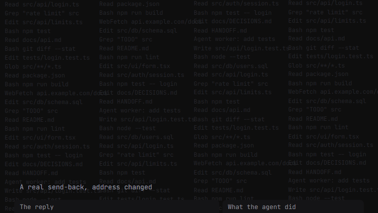

# Checks

Stratus's checks are hooks: small Node.js scripts that Claude Code runs around a step, and that can send the step
back with a reason. Claude Code logs every tool call in a session, and several hooks compare a reply with that log.
For example, a reply that links a page Claude never opened goes back to Claude before you see it.

This page describes what the checks do from your side. All 35 hooks, each with its off switch, are listed in the
[hooks reference](../reference/hooks.md). To see how a hook is built, read
[hooks/link-gate.mjs](../../hooks/link-gate.mjs) first.

## Checks on a reply

- **Links.** A reply with a link Claude remembered or saw in search results, but never opened, is sent back
  (`link-gate`). The hook knows that a page was opened, not what it said. In Nimbalyst, a file link the chat can't
  open (a relative path, backslashes, `file:///`) is sent back too (`file-link-gate`).
- **Tests after code.** A turn that edited a code file and ran no build or test after the last edit is sent back
  once to run one (`verify-gate`). The hook never runs a command itself, and a run of the project's verify skill
  counts.
- **Import cycles.** A turn whose edits leave JavaScript or TypeScript files importing each other in a loop the
  last commit did not have is sent back once, the loop named, to break it (`verify-gate`). Type-only imports don't
  count.
- **Code commits.** In a project with a [verify skill](projects.md#set-up-a-new-project-new-project) (the
  project's own steps that prove a change works), `verify-gate` also notes each `git commit` of code with no
  verify run since the last code edit. By default it only logs it; `VERIFY_GATE_COMMIT=enforce` refuses such a
  commit once. A `Verify: skipped — <reason>` line in the commit message lets it through.
  `node ~/.claude/workers/observe-log.mjs` prints the log (`--all` for every line).
- **Unanswered messages.** A reply to your message with no text, or only "No response requested.", is sent back
  once to answer you (`no-response-gate`). Thanks and other short acknowledgements pass. After you stop a session,
  the next turn makes no edits, starts no helpers and opens no new sessions until you say go.
- **Question cards.** See [Everyday work](everyday-work.md#question-cards).
- **Command lines.** A shell command without its `# WHAT THIS DOES:` line gets a stand-in line and a reminder
  (`command-explain`). This check never refuses.

## Guards on risky actions

The hooks below protect against actions that are hard to undo. All eight are guards: they refuse a call even when
they fail themselves. The [hooks reference](../reference/hooks.md#guards) names the hook behind each.

- **Deletes.** `rm -rf`, wildcard deletes, `find -delete`, `git clean -f` and `Remove-Item -Recurse` are refused
  outside temp, cache and worktree folders. Deleting named files passes.
- **Searches.** A search through a whole drive or the home folder is refused unless its depth is 3 or less.
- **SQL.** Claude asks you before `DROP`, `TRUNCATE`, or a `DELETE` or `UPDATE` without `WHERE`.
- **Keys in a push.** Claude asks you before a `git push` whose new lines hold something shaped like a key or token,
  or that adds a key file; gitleaks, when installed, also scans the outgoing commits. See [Security](security.md).
- **Nimbalyst settings.** Claude asks you before it changes one of your Nimbalyst settings with Nimbalyst's own
  tools, and names what it would set.
- **Research runs.** Claude Code's own `/deep-research` is refused in an app or a headless run (Nimbalyst included), where it skips
  its approval stop and can't be stopped. Run it in the Claude Code terminal.
- **Your accounts.** When OpenCLI (a command-line tool that drives websites through your signed-in browser) is
  installed, posting, liking or following through its site commands, or running a script in the page, is refused.
  Clicking and filling for a task you asked for still works.
- **Reviewers stay read-only.** A shell command from the plan reviewer or the end reviewer that would change a file
  is refused. They may look at git, file lists and the systems map, and run tests.

Large downloads get faster instead of being guarded: a plain `curl`, `wget` or `Invoke-WebRequest` of a file over
50 MB is rewritten to fetch 32 parts side by side, resume after a break and print the file's sha256.

## Help that keeps a session on track

- **A helper near its turn limit.** A helper is not told how many turns it has left. Close to its limit, every call
  it makes carries a note to finish and report, so it does not stop mid-work with no report (`repeat-guard`).
- **A helper that stopped early.** When a helper comes back cut off at its turn limit or with no report, Claude
  asks it once what is done and what is left, and checks the files itself.
- **File names.** Before a new file is written, a note says when its name or place breaks the file standard, with
  the rule and a proposed name. The note never refuses or rewrites the file.
- **Pictures.** A picture shown in the chat from a temporary path, or from one Nimbalyst can't open enlarged, is
  copied into the project's `shown` folder, and Claude gets the path to use.
- **Browser windows.** A Nimbalyst browser session opened with `headless: false` shows no window, so Claude is
  pointed to the `site-login` skill, which opens a real window to sign in.
- **Background processes.** When a session ends, `session-cleanup` can close what it started (dev servers,
  watchers, headless browsers, background shells). It starts in report mode: it writes what it would close to
  `~/.claude/hooks/state/session-cleanup/closed.log` and closes nothing until you set `SESSION_CLEANUP=on`.
- **A new Claude Code.** At the start of a session, Claude says when a new Claude Code changed the transcript
  format the hooks read, and when a hook crashed since the last session.

## Auto mode

Auto mode is Nimbalyst's per-project permission called "Agent-verified" (`mode: "bypass-all"` with the classifier
on). Instead of asking before each step, a second model checks every command and file change first: safe ones go
ahead, risky ones are stopped and you are asked. Stratus sets it up only in Nimbalyst; in a terminal, the
install and the update skip the question.

- **Who asks for it.** Stratus never turns it on by itself. The first install and `/update-setup` ask once, with a
  yes or no question card. Yes turns it on for `quick-tasks` and `claude-settings`, and, from `/update-setup`, also
  for the project the chat runs in. Other projects keep their setting until you change it in Nimbalyst. Your answer
  is kept, so it is not asked again.
- **The guards still run.** The hooks on this page are separate from the classifier and run on every call. A guard
  that refuses a call still refuses it. A hook that would rewrite a command (`command-explain`, `download-guard`)
  gives Claude its note instead, because a rewrite would cancel the classifier's review.
- **Model and cost.** Nimbalyst runs the classifier; Stratus sets no model for it.
- **Turning it off.** In Nimbalyst, open Settings > Project > Agent Permissions and pick another mode for that
  project. Each project has its own setting.

## When a hook fails

A hook that crashes lets the call through and writes one line to `~/.claude/hooks/state/hook-errors.log`. A guard
that crashes refuses the calls it checks, and only those. The [hooks reference](../reference/hooks.md#guards) names
the guards and explains how the hooks share Node.js processes.

## Settings

Each hook's off switch is an environment variable named after it: `LINK_GATE=off` turns off `link-gate`. The
[hooks reference](../reference/hooks.md) lists them all. A few hooks take more settings:

| Setting | What it does |
|---|---|
| `VERIFY_GATE=off` | Turns off `verify-gate`, for a project whose build or tests are slow. |
| `VERIFY_PATTERN` | A regular expression, matched without regard to case against the whole shell command. It replaces `verify-gate`'s list of build and test commands. |
| `VERIFY_GATE_CYCLES=off` | Turns off `verify-gate`'s import-cycle check alone. |
| `VERIFY_GATE_COMMIT` | `observe` (the default) only logs a code commit with no verify run; `enforce` refuses it once; `off` turns the commit check off. |
| `SESSION_CLEANUP` | Unset: `session-cleanup` only reports what it would close. `on`: it closes it. `off`: the hook is off. |
| `SESSION_CLEANUP_IDLE_HOURS` | How long a session's transcript must go unwritten before `session-cleanup` treats the session as ended. The default is 3. |
| `HOOK_CRASH_ALARM=off` | Stops the start-of-session line about hook crashes. |

[How to](../HOW-TO.md#turn-a-hook-off) shows how to set them. `VERIFY_PATTERN`, `VERIFY_GATE_COMMIT` and `VERIFY_GATE_CYCLES` are read
from the same places as `VERIFY_GATE`, so one project can differ; the
[hooks reference](../reference/hooks.md#turning-a-hook-off) says which switches each hook reads from settings files.
