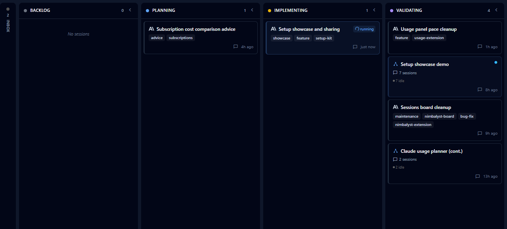

# Housekeeping

Commands that keep the Sessions board, the disk, your project files and a backup in order. Each one reports first
and changes only what you agree to.

## The Sessions board: `/board-cleanup`

Nimbalyst shows every conversation as a card on a board, and Claude moves its own card from Planning to Complete as
the work goes. `/board-cleanup` moves the finished cards that were left behind to Complete, then runs Board Tidy to
archive old sessions: Complete and idle for 3 days, with no phase for 14 days, or in planning, validating or
implementing for 30 days. Pinned, running and worktree sessions stay, and nothing is deleted. Board Tidy also does
this by itself every hour ([Nimbalyst](nimbalyst.md#board-tidy)). Archived view, then Unarchive, brings a session
back, and Claude can undo the last Board Tidy run.

Screenshot of the board

## The disk: `/disk-tidy`

`/disk-tidy` first reports what fills the disk (leftover worktrees, old chat logs, scratch and temp folders, old
project copies, editor backups) and changes nothing. Then each item goes only with your tick, checked again just
before. Anything with uncommitted or unmerged work is kept and named.

### The chat archive

Say yes to the chat archive and chats older than 60 days move, compressed, to `~/.claude-archive/chats` each time
you run `/update-setup` (the background update skips it). They are deleted there at the age at which Claude Code
deletes live chats (`cleanupPeriodDays` in `~/.claude/settings.json`). The worker is
`~/.claude/workers/disk-tidy.mjs`:

| Command | What it does |
|---|---|
| `--keep-forever "<project folder>"` | Keeps that project's chats archived and never deletes them. |
| `--archive-list --project <part of the folder name>` | Lists the archived chats with their ids. |
| `--restore <id>` | Brings one chat back. Only then open it with `/resume`, which sees only chats that are back in place. |
| `--archive-off` | Stops the archive. |

## Memory and processes: `/pc-tidy`

On Windows, `/pc-tidy` shows what holds the computer's memory and stops what finished sessions left behind. It
never stops a Nimbalyst update that waits for Nimbalyst to close.

## Project files: `/file-upkeep`

`/file-upkeep` holds the file standard ([standard.md](../../skills/file-upkeep/standard.md): names, places, where
old decisions and handoffs go) and a checker that lists misnamed and misplaced files in a project. After your yes
it moves them, fixes the references to them in the same pass, and records every rename and move in a ledger, so it
can be undone. `/new-project` starts new projects on the standard.

## Backup: `/backup`

`/backup` copies the Claude folder (settings, rules, skills, memory) and the project folders you pick to your own
Backblaze B2 storage with restic.

- **Encrypted on your computer.** The files are locked with a password only you keep, so Backblaze, or anyone with
  the storage key, sees only scrambled data.
- **The key.** The storage key the backup uses works only on its own bucket, but it can delete files there. The
  bucket keeps an overwritten or hidden file's old versions for 30 days. A file version the key deletes is gone at
  once, so a stolen key can delete the backup.
- **Setup** takes about 10 minutes, in its own window: you make a Backblaze B2 account and keep one password. Keys
  and the password are never typed into the chat.
- **Commands.** `/backup now` backs up; `/backup schedule` runs it every day or every week; `/backup restore <path>`
  brings a file or folder back into a new folder, never over the original; `/backup off` stops the schedule and
  deletes nothing.
- **Checks.** A restore into a temp folder is compared with your files before the schedule starts and once a month
  after.
- **Limits.** Files over 100 MB are left out and named. B2 is free up to 10 GB, then about $7 per TB a month.
- **Not yet tested with Backblaze.** The backup has been tested against a folder on the same computer, not against
  a real Backblaze account. Turning the schedule on has not been run on any system either; only the command it
  runs is tested.

The full install asks whether you want the backup. An update asks only while no answer is on record, for example
after an install with `node install.mjs` alone. Your answer is kept, and `/backup` sets the backup up at any time.
