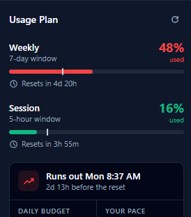

# Usage

Stratus shows how much of your Claude plan you have used, per project, and forecasts when you will reach the
limit at your current pace.

## The dashboard: type `usage`

Type the single word `usage`. A page opens in your browser. It is built from the logs on your computer, so opening
it costs no tokens. It shows:

- how much of the week and of the 5-hour window is used, and when each runs out at this pace;
- tokens by project, model, day and chat, over the last 90 days, with the main chat apart from its helpers;
- the Codex and Gemini use found on the computer;
- what the same work would cost at API prices;
- this computer's use apart from other use of the same account.

Inside Nimbalyst, typing `usage` refreshes the data and says where to click. The forecast needs a day or two of
readings before it shows.

## The forecast in the chat

Ask "will I run out?" and Claude gives the same forecast as a few lines in the chat.

## The Usage Plan button

In Nimbalyst, the `usage-plan` extension adds a button to the left sidebar. It opens a small pop-up with this week's
usage and the 5-hour window's usage as bars, a forecast line, and your pace beside the budget. The forecast line
gives the day and hour the week runs out at the current pace; the budget is the daily amount that would make it
last. Its **Full dashboard** button opens the whole dashboard in Nimbalyst's main area, with usage by the plan's
week (This week, Last week, earlier weeks, All).

Screenshot of the pop-up

## Claude Code's own `/usage`

`/usage` is Claude Code's built-in command. It shows where the tokens went in the last 24 hours and 7 days, by
skill, helper and MCP server. `/setup-audit usage` points to it.

## Where the percentages come from

The `plan-usage-logger` hook reads your saved Claude login (`~/.claude/.credentials.json`) and asks
api.anthropic.com for the plan percentages. It runs at the end of a reply, at most every 5 minutes, and every 30
seconds once either window is at 70% or more. The login goes to Anthropic only and is not written to the log. To
turn it off, set `PLAN_USAGE_LOGGER=off` in the environment.

On a Mac the login is in the Keychain, not in that file, so the forecast stays empty. See
[Platforms](../reference/platforms.md) for the other differences.
