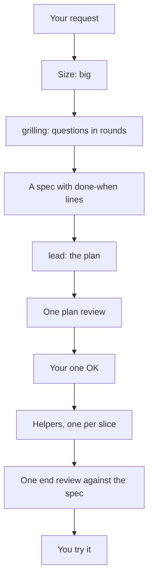

# How the setup works now (26.5)

## What changed

Claude now sizes every request before it starts. A small change is made and shown working. A medium or big job
starts with questions, then a written list of what "done" means, each line with the check that proves it. A big
job runs in your own chat: Claude writes the plan, gets it reviewed once, waits for your one OK, then hands the
pieces to helpers and reviews the result against your list at the end. Each project with code gets a verify
check: the project's own steps for starting the app, using it as a person does and printing what it saw. In
Nimbalyst, a **Try it** button beside the Note button in the chat box runs that check on the last change. Small
fixes to the setup install themselves. 23 hooks are gone, so each step runs fewer checks.

## How a job runs

Claude says the size in one line first. To change it, answer with one word: "small", "medium" or "big".

- **Small** (one change): made now and shown working.
- **Medium** (one session, a few parts): 1-3 questions, each with a recommended answer, then the "done when" lines
  in chat for your OK, then built in the same chat.
- **Big** (a new project, more than one session, several parts that must fit, or a result you judge by numbers or
  by how it looks): the full path below.

`grilling` asks in rounds. Open questions come as plain text; only clear choices come on a card (a short question
with options you click). Facts are Claude's job: it looks them up instead of asking you. A big job ends the
questions with a spec, a file (`docs/<date>-<job>-spec.md`) that lists what done means and keeps your exact words
for numbers, names and limits.

`lead` is the skill that runs a big job. It writes the plan beside the spec as slices, the pieces one helper
builds at a time, and sizes it as a count of slices and sessions, never as time. A `plan-reviewer`, a helper that
only reads, checks the plan once. Then you get links to both files and a short summary, and nothing is built
before your OK. Each slice goes to a helper in its own git worktree, a separate copy of the project on its own
branch, so helpers working side by side don't edit over each other. Claude picks the helper type for each slice:

- `worker` for reading, gathering, drafting, and mechanical edits such as renames;
- `worker-code` for code changes;
- `worker-full` for a slice that needs a skill, a browser or Nimbalyst's own tools;
- `worker-refactor` for a long change that other files depend on.

A slice that touches a safety check, a delete path or secrets also gets `/code-review`. At the end one `reviewer`
checks the finished result against each done-when line, and a `blind-reviewer` looks at any screen or text a
person will read, the way a newcomer would, without the code or the plan. When you try it and find something
wrong, say so in the same chat: each problem becomes a fix slice in the same run. Claude stops and tells you when
the spec turns out wrong, when a done-when line would change, or after three failed fixes of one check.

## Proof before "done"

Claude does not call a change done without the command and the output lines that prove it. Each project with code
has its own verify skill, `.claude/skills/verify/SKILL.md`, made from a template for a web app, a Godot game, a
data or video pipeline, or a command-line tool. `/new-project` writes it; `/update-project` offers it to a project
that has none. It starts the app headless (with no window on screen), uses it the way a person does and prints one
`PROOF` line per check: what was checked, what was expected and what came out.

When Claude edits code and then tries to end its reply without a build or test run after the edit, the reply is
held back once and Claude runs one first. `VERIFY_GATE=off` turns that off, for a project with a slow test suite.
Off switches like this one are environment variables: set them in your shell or your system environment. This
one is also read from the "env" section of a project's `.claude/settings.json`, so it can be off for one project only.

In Nimbalyst, the **Try it** button beside the Note button in every chat box asks the session to run the verify
check on its last change. When the change has a local web page, the page opens in a browser tab beside the chat.

## How fixes reach you

When you type a message, the setup checks for a newer release, at most once every 12 hours. A release reaches you
in one of two ways:

- A release that only changes setup files, or asks you nothing, installs itself in the background. No restart, no
  question; a grey line on a later message says it updated, or why it could not. Every fix release since 26.4
  went out this way.
- A release that needs a question, a step only a chat can do, or a newer Claude Code waits for you. A grey line
  reminds you about every 8 hours, and once a day Claude adds a short "What the update brings you" section to its
  reply. Run `/update-setup` when it suits you.

Files of the setup that you changed are never replaced without asking, and every replaced file is kept in
`~/.claude/setup-logs/<date>-install-backup/`. `AUTO_UPDATE=off` stops the background installs.

## Say or type → what happens

The quoted words are examples. Every row not marked "typed" also works when you say what you want in your own
plain words; a row marked "typed" starts only when you type its command.

| Say or type | What happens | Skill |
|---|---|---|
| "grill me", "задай мне вопросы", "погоняй меня по плану" (Russian works too) | Questions in rounds, then what done looks like | `grilling` |
| "lead this", "orchestrate", "веди эту работу", "раздай по агентам" (Russian works too), `/lead` | A big job run from its spec to the end review | `lead` |
| "wait what", "huh?", "не понял", "в смысле?" (Russian works too), `/wait-what` | The last reply again, in plain words | `wait-what` |
| "where are we", "how much is left", `/where-are-we` | What is left of a job, from Nimbalyst's tracker | `where-are-we` |
| "handoff", "new session", `/handoff` | A short brief and a fresh chat that goes on from it | `handoff` |
| `/btw <note>` (typed) | A note to a busy chat in the same folder, without stopping it | `btw` |
| `/next-move` (typed) | The one most useful thing to do next | `next-move` |
| "set this project up", `/new-project` | A new project folder with its notes, git and verify check | `new-project` |
| "update this project", `/update-project` | An older project folder brought up to this setup | `update-project` |
| "update the setup", "install the update", `/update-setup` | The newest release installed | `update-setup` |
| "what's new", "что нового" (Russian works too) | A short tour of this page, with its path | `update-setup` |
| "audit my setup", "where did my tokens go", "chat review", `/setup-audit` | A report on the setup, usage or chats | `setup-audit` |
| any web question, or a page to read word for word | Facts from the page that knows them | `web-research` |
| a video link and a question, `/watch` | The video's words and stills, read for you | `watch` |
| "update the README", "describe this PR" | Text other people read, written for you in plain words | `writing` |
| "tidy the PC", `/pc-tidy` | What holds memory; what old sessions left running is stopped | `pc-tidy` |
| "what takes space", `/disk-tidy` | What fills the disk, cleared item by item with your yes | `disk-tidy` |
| asking to tidy or rename a project's files, `/file-upkeep` | File names and places put to the common standard | `file-upkeep` |
| "back up", `/backup` | An encrypted backup to your own cloud storage | `backup` |
| "pair my phone", `/phone-bot` | The phone app joined to this computer | `phone-bot` |

Claude Code's own `/code-review` reviews the current change when you type it; Claude also runs it by
itself on a risky change (one that touches a safety check, a delete path or secrets).

## What's gone

23 hooks are removed, among them the automatic code review after many edits, the checks on helper briefs and the
automatic handoff brief after each reply. An update unwires them and deletes their files. A file of theirs that
you changed stays, and the update's output names it. The separate planner helper is gone (your own chat plans the
job), `grill-me` became `grilling`, and `stuck-advisor` gave way to Claude Code's built-in `/advisor`. The full
list, with what each change means for you, is in the 26.5 section of [CHANGELOG.md](../CHANGELOG.md).
