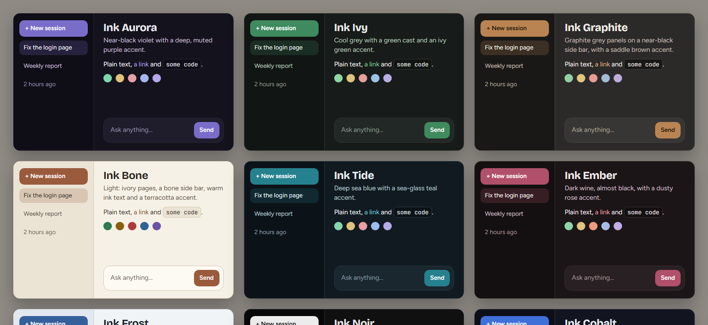

# Ink themes

Eleven colour themes for Nimbalyst. They share one look (the Figtree font, 8px corners, hairlines
instead of shadows, a name under every side button, one calm message box) and differ only in colour.



| Theme | What it looks like |
|---|---|
| **Ink Aurora** | Near-black violet with a deep, muted purple accent |
| **Ink Ivy** | Cool grey with a green cast and an ivy green accent |
| **Ink Graphite** | Graphite grey panels on a near-black side bar, with a saddle brown accent |
| **Ink Bone** | Light: ivory pages, a bone side bar, warm ink text and a terracotta accent |
| **Ink Tide** | Deep sea blue with a sea-glass teal accent |
| **Ink Ember** | Dark wine, almost black, with a dusty rose accent |
| **Ink Frost** | Light: cool white pages, a pale grey-blue side bar and a slate blue accent |
| **Ink Noir** | Black and white only: black panels, grey text and a white button |
| **Ink Cobalt** | Night blue with a bright cobalt accent |
| **Ink Blossom** | Light: blush white pages, a pale rose side bar and a berry accent |
| **Ink Neon** | Plum black with a hot magenta accent and electric cyan links |

## Install

It needs Node and nothing else: there is nothing to download.

```
npm run build
npm run install-ext
```

The second command prints `installed to` and the folder. Restart Nimbalyst, press the **Theme**
button at the bottom of the side bar, press **Ink themes** to unfold the list and pick one. The
themes sit under that one row so the menu stays short; the row also names the one that is on.
Nothing else changes until you pick a theme, and picking any other theme puts everything back as
it was.

## What it adds besides colour

- A **New session** button and a Sessions / Files / Tracker switch (tabs) at the top of the side panel. The
  button follows the switch (**New file** in Files, and so on), the same as the app's own create button.
- The theme menu stays open after a pick, so themes can be tried one after another (a click outside closes it).
- A short name under every side button, the extensions' buttons too ("Term", "Map", "Usage", "Cmds" fit
  the 48px side bar; the full name is in the tooltip), and a usage-ring percent that can be read on a large monitor (the app's Claude ring is the one place weekly use shows).
- In an empty chat, the project name as the heading with the app's command pills as rows under it.
- "Commit with AI" as a quiet outlined button (its sparkle stays).

Every added part presses or reads one of the app's own buttons. If an update of the app renames
one, that part does not appear and the app's own button stays.

## Changing or adding a theme

Each theme is about twenty base colours in [themes.mjs](themes.mjs); the build turns them into the
full set the app asks for. After a change:

```
npm test
```

It rebuilds and checks that every text colour can be read on its background (page, side bar and
raised boxes), that the text on the accent can be read, and that the styles apply only while one of
these themes is on.

To try a theme on a running window without installing it, start Nimbalyst with
`--remote-debugging-port=9222`, run `node build.mjs --preview <file.js> <theme id>` and run that
file in the window's inspector. `node build.mjs --swatches <file.html>` writes the page the picture
above was taken from.

## After a Nimbalyst update: node probe.mjs

The shell styles the app's own class names and test ids, and an update can rename one; the rule then
does nothing and no error shows. `selectors.json` lists every app selector the style sheet and
`shell.js` use (what it is for, the Nimbalyst version it was last seen in). With Nimbalyst running with
`--remote-debugging-port=9222`:

```
node probe.mjs
```

It prints the app version, every selector that matches nothing (`UNMATCHED`) and the line
`N unmatched of M`. Selectors for a surface that is not on screen right now (an empty chat, the Send
button while a session runs, the commit panel, the open theme menu) are listed apart as "not on
screen": open that surface and run it again. When it is clean, set `seenIn` in `selectors.json` to
the new version. A selector added to `theme.src.css` or `shell.js` goes into `selectors.json` too.

## Files

| File | What |
|---|---|
| `themes.mjs` | The colours of each theme |
| `theme.src.css` | The shell: sizes, shapes and labels on the shared tokens (`../shared/tokens.css`, put into the built style sheet by `build.mjs`), shared by all the themes |
| `shell.js` | The New session button, the tabs, the empty-chat heading and the folded theme menu |
| `selectors.json` | Every app selector the shell relies on |
| `probe.mjs` | Checks `selectors.json` against the running app |
| `build.mjs` | Writes `manifest.json` and `dist/` |
| `test.mjs` | The checks |
| `fonts/` | Figtree and JetBrains Mono (code only), each under the SIL Open Font License |
